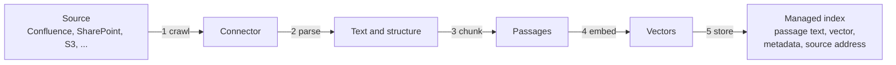
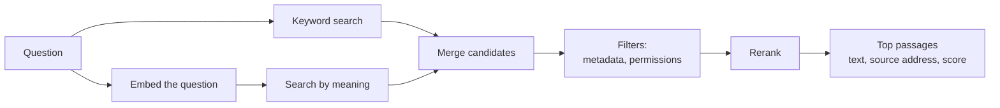
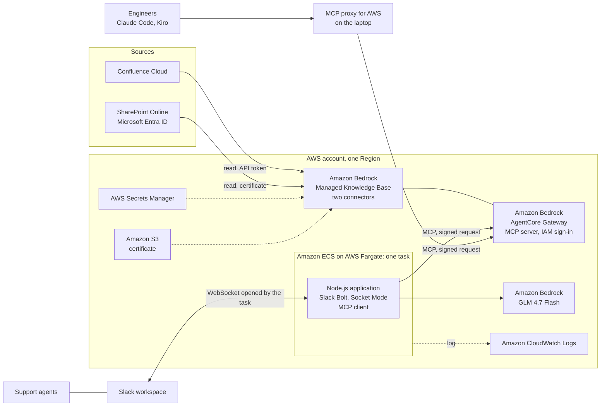

# Amazon Bedrock Managed Knowledge Base: An Introduction

This document explains Amazon Bedrock Managed Knowledge Base from the beginning: what it is, which sources it connects to, what it can do, how it indexes documents and answers a search, what can and cannot be configured, what it costs, what this repository observed when using it, and where it fits. It is for readers who have not used the service: decision makers can read sections 1 to 4 and 9 to 11; engineers will want all of it.

The service is new (announced in June 2026) and changes often. Facts about the service come from the AWS documentation as read on 2026-10-13 (section 12); check that documentation before relying on a list or a number. Limits that this repository confirmed by trying them, on 2026-10-14 in Asia Pacific (Sydney), and everything it observed, are marked as such. The setup steps used here are in [08-knowledge-base-chatbot.md](08-knowledge-base-chatbot.md), and the concept built on it is in [poc/03-knowledge-base-chatbot.md](poc/03-knowledge-base-chatbot.md).

## 1. The problem it solves

A large language model (LLM) knows what it was trained on. It does not know a company's warranty policy, last month's incident report or the price list in a spreadsheet. The usual way to let it answer from such content is **retrieval-augmented generation (RAG)**:

1. **Before any question:** read the company's documents, turn them into text, cut the text into small passages, and store the passages in an index that can be searched.
2. **For each question:** search the index for the passages closest to the question, and hand those passages to the LLM together with the question. The LLM writes the answer from them.

Building step 1 and the search of step 2 by hand means running a pipeline: connectors to each source, parsers for each file format, a chunking rule, an embedding model, a vector database, a ranking step, and the jobs that keep all of it in sync with the sources. A **knowledge base** in Amazon Bedrock is that pipeline as a service.

## 2. What a Managed Knowledge Base is

Amazon Bedrock Knowledge Bases comes in two kinds:

- **Managed Knowledge Base.** AWS runs everything: ingestion, parsing, chunking, embedding, storage, index and search. The team connects the sources and calls the search. There is no vector database to choose, size or pay for by the hour. AWS recommends this kind for new work.
- **Customer-managed Knowledge Base.** The team chooses and operates the vector store (for example Amazon OpenSearch Serverless, Amazon Aurora or Amazon Neptune) and controls each step of the pipeline.

| | Managed | Customer-managed |
|---|---|---|
| Data store | Managed by Bedrock, scales by itself; holds embeddings, text, metadata and the raw files | A vector store the team chooses, provisions and scales |
| Connectors to outside systems | Native connectors (section 3) | Amazon S3 and custom only |
| Parsing | One built-in parser with no settings, which picks its method per file type | The team chooses: default text parser, a foundation model with its own prompt, or Bedrock Data Automation |
| Chunking | The default only with the managed embedding model; default, fixed-size or none with the team's own | Default, fixed-size and further strategies |
| Embedding model | A managed model at no extra cost, or the team's own Bedrock embedding model | The team's own Bedrock embedding model |
| Search | Hybrid (keywords and meaning), always | The team chooses the search strategy |
| Ranking of results | A managed reranker at no extra cost (only with the managed embedding model), the team's own, or none | The team's own, or none |
| Agentic retrieval | Supported | Not supported |
| Document-level permissions | Supported | Not supported |
| Amazon Bedrock AgentCore Gateway (MCP) integration | Native | Not supported |
| Direct access to the vector database | No. The parsed text of each document and the passages a search returns can be read (section 5) | Yes |
| Best for | End-to-end RAG with connectors, without infrastructure | A specific vector database, parser or search configuration |

A Managed Knowledge Base returns **passages**, not finished answers. Writing the answer is the caller's job (as in this repository, where the Slack bot calls an LLM), unless agentic retrieval is asked to write one (section 6).

## 3. Connectors

A **data source** is one connection from the knowledge base to one place where documents live. A knowledge base can have up to 200 data sources. Each data source uses a **connector**.

Connectors listed in the AWS documentation on 2026-10-13:

| Connector | What it reads |
|---|---|
| Amazon S3 | Files in a bucket. Needs no stored credential, only permission on the bucket |
| Confluence Cloud | Spaces: pages, blog posts and their attachments, with filters by space |
| Confluence Data Center | The same, for a self-hosted Confluence reached over a private network connection |
| Microsoft SharePoint Online | Sites: files in document libraries, and site pages |
| Microsoft OneDrive | Files in users' drives |
| Google Drive | Files in drives |
| Box | Files |
| Salesforce | Content of a Salesforce organisation |
| ServiceNow | Content of a ServiceNow instance, such as knowledge articles |
| Zendesk | Content of a Zendesk account, such as help centre articles |
| Web Crawler | Public web pages, starting from given addresses, within limits the team sets |
| Custom | Documents the team pushes itself through the API, for any source without a connector |

The list has grown since launch (six connectors in June 2026; Salesforce, Zendesk, ServiceNow and Confluence Data Center were added in September 2026), and AWS pages disagree on it at any given moment. Take the current list from [Create a managed knowledge base](https://docs.aws.amazon.com/bedrock/latest/userguide/kb-managed-create.html) and the details of each connector from [Connect a data source](https://docs.aws.amazon.com/bedrock/latest/userguide/kb-managed-connect-ds.html). In AWS GovCloud only the S3 connector is offered. What each connector reads, in the table above, is a summary; the connector's own page is the reference.

**How a connector signs in.** Every connector to an outside system needs an identity in that system. The credential is stored in AWS Secrets Manager, never in the data source's settings, and the knowledge base's service role is the only identity allowed to read it. The sign-in method depends on the connector. The two used in this repository:

| Connector | Sign-in used here | What the source's administrator provides |
|---|---|---|
| Confluence Cloud | Basic: an Atlassian account's email and API token | An account that can read the spaces to index, and its token |
| SharePoint Online | Microsoft Entra ID, app-only: an application with a certificate, no user | An application registration with read permission on the sites, and administrator consent |

Other methods exist per connector, including a sign-in by an administrator in the browser (OAuth) for SharePoint, OneDrive and Confluence, service accounts for Google Drive, and client credentials for Box and Zendesk. If document permissions are to be carried over (section 7), the method is prescribed per connector.

**Options common to connectors:**

- **Filters:** which spaces, sites, folders or file types to include or leave out, and a maximum file size.
- **Sync schedule:** on demand (the default), daily, weekly on a chosen day, or monthly on a chosen day. AWS chooses the time of day.
- **Deletion safeguard:** if one sync would remove more than a set share of the indexed documents (15% by default), the removal is skipped. This protects against a source that is temporarily empty or unreachable.
- **Media:** whether to also index pictures, audio and video (section 5).
- **Private network:** a connector can reach a source inside a VPC.

## 4. Features at a glance

| Feature | What it gives |
|---|---|
| Managed storage and index | No vector database to run; up to 10 TB of source data per knowledge base |
| Native connectors | Content stays in the source systems and is copied for search |
| Smart parsing | One parser for Word, Excel, PowerPoint, PDF, HTML, text and scanned documents, choosing its method per file. Its reading of Vietnamese in Word, PowerPoint and PDF files is poor (section 5) |
| Incremental sync | Each sync processes only what was added, changed or deleted |
| Hybrid search | Every search combines keyword matching and matching by meaning |
| Managed reranking | A second model re-orders the candidates by relevance, at no extra cost |
| Agentic retrieval | For complex questions: plans several searches, checks whether it has enough, and can write the answer |
| Multimodal content | Pictures, audio and video can be indexed and found by text |
| Document-level permissions | Results can be filtered by what the asking person may read in the source |
| Metadata filters | A search can be limited by attributes of the documents |
| MCP through AgentCore Gateway | Any AI agent that speaks the Model Context Protocol can use the knowledge base as a tool, without custom code |
| Observability | Sync logs, retrieval traces, per-knowledge-base metrics, and the parsed text of each document |
| Encryption | At rest with an AWS key by default, or the team's own key; in transit always |
| Cross-account sharing | Resource policies can let another account query the knowledge base |

## 5. How indexing works

Indexing is called **ingestion** or **sync**. It runs when started by hand or by the schedule.



1. **Crawl.** The connector signs in and lists the documents within its filters. It compares them with the last sync and takes only the new, changed and deleted ones. With permissions enabled it also reads who may see each document.
2. **Parse.** Each document becomes text. The managed parser ("smart parsing") picks a method per file type; how it treats each format is described below. It is the only parser for text content in a Managed Knowledge Base, and it has no settings.
3. **Chunk.** The text is cut into passages. The default is fixed-size chunks of 300 tokens (roughly 200 to 250 English words) with 20% overlap between neighbours, so that a sentence on a boundary is not lost. With the managed embedding model that default is the only option. With an own embedding model the alternatives are a fixed size the team sets, or no chunking (one passage per document, for content that is already split). Semantic chunking is not offered. The choice is made when the data source is connected and cannot be changed afterwards.
4. **Embed.** An embedding model turns each passage into a vector: a list of 1,024 numbers that places the passage in a space where texts with similar meaning lie close together. That is what lets a question find a passage that uses different words, or another language.
5. **Store.** The passage's text, its vector, its metadata and the address of its source document (the page's URL, the file's URL) go into the managed index. The index is owned by AWS and cannot be opened.

A sync ends with a status and counts: documents scanned, newly indexed, modified, deleted and failed. Failures carry a reason per document.

**Media.** By default only text is indexed. Three switches per data source add pictures (standalone image files, and pictures inside PDF, Word and PowerPoint files), audio files and video files; their content is described or transcribed and then indexed as text. Separately, a knowledge base can be created with a native multimodal embedding model, which embeds the raw picture, sound or video without turning it into text; that mode has its own restrictions and is chosen at creation.

**Freshness.** The knowledge base is as current as its last sync. A page edited at noon is found in its old version until the next sync.

### How the parser reads each format

The documentation says only that smart parsing chooses its method per file. This repository's tests (section 10) show three behaviours:

| Formats | How they are read | Consequence |
|---|---|---|
| Excel, CSV | Cell by cell, from the file's data. The parser also writes an English summary of each table and a description and type for each column | Exact text. Hidden rows and white-on-white text are indexed too, and so become searchable |
| HTML, Markdown, text, wiki pages | As text, keeping headings and HTML tables | Exact text |
| Word, PowerPoint, PDF | As the page looks, by character recognition. Text that is in the file but not visible is left out. A PDF's own text layer is not used, even when it is correct | English is read correctly. Vietnamese loses about half of its words to wrong or missing accents ("du'o'c" for "được") |

Nothing in the parser can be changed: other parsers are rejected, smart parsing takes no options, and a transformation function, which the customer-managed kind runs after chunking, is accepted by the managed kind but never run (section 8). The one lever is the file handed to the parser. Word and PDF files converted to Markdown, HTML or plain text before the sync are read correctly; PowerPoint is read the same way as Word and converts cleanly, but a converted PowerPoint file was not synced (section 10).

### What can be inspected

The vector index cannot be opened: there is no API, console page or bucket that lists the passages of a knowledge base or returns their vectors. What can be seen:

| What | How | Shows |
|---|---|---|
| Each document's state | `ListKnowledgeBaseDocuments` | Source address, status (`INDEXED`; during a sync also `PENDING`, `IN_PROGRESS` and an undocumented `TEXT_INDEXED`; `FAILED` with a reason) and time of the last change |
| The original file | `GetDocumentContent` with format `RAW` | A short-lived link to the copy the service took |
| The parser's output | `GetDocumentContent` with format `EXTRACTED` | A short-lived link to a JSON file. Text files come back as plain text; the other formats as a list of elements: text blocks, and tables with their header, rows, section title and, for spreadsheets, the summaries the parser wrote |
| Passages | `Retrieve` | Up to 100 passages for a question, each with its text, score and metadata: source, page number, table id and section, chunk id, language |
| Sync events | Logs delivered to CloudWatch Logs | One event per document and step (crawl, text indexed, indexed) with its status and any error message. No passage counts |

The parser's output is the most useful of these for judging data quality. It is the text that was chunked and embedded, and it can be compared, file by file, with a local extraction of the same file. That is how the accent problem above was found and measured.

## 6. How a search works

There are two operations.

### Retrieve: one search, passages back



1. The question is embedded with the same model as the passages.
2. Two searches run: one by meaning (nearest vectors) and one by keywords. A Managed Knowledge Base always uses this **hybrid** search; search by meaning alone is not offered.
3. The candidates are merged. Metadata filters, and the permission filter if enabled, remove what does not qualify.
4. A **reranker**, a model that reads the question and each candidate together, re-orders them. The managed reranker is on by default; the caller may name another Bedrock reranking model or turn reranking off. A knowledge base with its own embedding model cannot use the managed reranker.
5. The best passages are returned, as many as the caller asked for (1 to 100). Each has its text, the address of its source document, its metadata and a relevance score.

Retrieve does not judge whether the passages answer the question. It returns the closest ones it has, even when the question has nothing to do with the content. Deciding "the documents do not say" is left to the caller's LLM or to a score threshold the caller applies.

### AgenticRetrieveStream: a planned search

For a question that needs several facts ("which products under warranty were affected by last month's incident, and what compensation applies?"), one search often finds only part of the answer. Agentic retrieval puts an LLM in charge of the searching:

1. It splits the question into sub-questions and plans the searches.
2. It runs a search, reads the result, and decides whether it has enough.
3. If not, it searches again with a refined query, up to a set number of rounds.
4. It returns the passages it used and, if asked, a written answer with citations.

It can search several knowledge bases in one request, streams its result, and can have a Bedrock guardrail applied to the generated answer. It is slower and costs more per call than Retrieve (section 9).

### Calling it

| Way in | For |
|---|---|
| The Bedrock API (Retrieve, AgenticRetrieveStream) | An application with AWS credentials |
| Amazon Bedrock AgentCore Gateway | AI agents and tools that speak MCP. The gateway publishes the knowledge base as an MCP server with one tool per operation, and checks each caller with AWS IAM or with tokens from an identity provider. No function or container runs behind it |
| The console's test panel | Trying questions by hand |
| Amazon Quick | Using the knowledge base inside AWS's business assistant |

This repository uses the gateway for both of its clients, the Slack bot and the AI assistants in code editors, so that both go through one door with one set of rules.

## 7. Document permissions

By default a knowledge base knows nothing about who may read what: every caller finds every indexed document. **ACL awareness**, set per data source, changes that:

- **At sync** the connector also reads each document's permissions from the source: allowed and denied users and groups, and who belongs to each group.
- **At search** the caller passes the identity of the person asking, as an email address. Only passages from documents that person may read are returned. A denial always wins over an allowance.
- **Real-time check.** For SharePoint, OneDrive, Google Drive, Confluence, Box and Zendesk, the service also asks the source at search time whether the person still has access, which catches changes made since the last sync. S3 and custom sources take their permissions from a file the team supplies and have no such check. The web crawler has no permissions at all.
- **If the check fails**, the affected documents are withheld, not shown.

Three points decide whether this is usable:

- **It is a filter, not authentication.** The service believes the email it is given. The application must have established who is asking, and must not let a user claim another identity.
- **Emails must match.** The email passed must be the one the person has in each source. A mismatch returns nothing, silently.
- **It is chosen when the data source is connected.** In this repository's experience it could not be switched on for an existing data source; the source has to be connected again. Some sign-in methods are required for it (for example app-only for SharePoint, and an administrator's token for Confluence).

Permissions work on whole documents. Content hidden inside a document that a person may read, such as a hidden row in a spreadsheet, is searchable by that person (section 5).

This repository left permissions off and indexed only content open to every user of the bot.

## 8. What can and cannot be configured

| Choice | Options | When | Changeable later |
|---|---|---|---|
| Embedding model | Managed (default), or an own Bedrock model with 1,024 dimensions and 32-bit floats (Amazon Titan Text Embeddings V2, Cohere Embed Multilingual v3, Cohere Embed v4, Amazon Nova Multimodal Embeddings), or a native multimodal model | Creating the knowledge base | No. A new knowledge base is needed |
| Vector store | None to choose | | |
| Encryption key | AWS key (default) or the team's own KMS key | Creating the knowledge base | No |
| Parser | Smart parsing only, for text content, without options | | |
| Chunking | With the managed embedding model: the default only (300 tokens, 20% overlap). With an own embedding model: default, fixed size (200 to 8,192 tokens, overlap 1 to 50%), or none | Connecting the data source | No |
| Document permissions | On or off | Connecting the data source | No (as observed here) |
| Filters, sync schedule, deletion safeguard, media switches | Per data source | Connecting the data source | Yes |
| Number of results | 1 to 100 | Each search | |
| Reranker | Managed (default; not with an own embedding model), Amazon Rerank 1.0 or Cohere Rerank 3.5, or none | Each search | |
| Metadata filter | Per search; the "starts with" and "contains" operators are not supported | Each search | |
| Search type | Hybrid only | | |
| Agentic retrieval: planning model, number of rounds, guardrail, whether to write an answer | Per request | Each request | |

**An own embedding model has three costs.** It is billed at the model's price. It rules out the managed reranker: a search asking for it is rejected, and a search that names no reranker is not reranked. And the sync is bound by the model's request quota in the account; in this repository's test a third of the documents failed for that reason (section 10). What it buys is control of chunking.

**Limits confirmed by trying them** (2026-10-14, Asia Pacific (Sydney)). Each was tried by creating a knowledge base, a data source or a search; the result is the service's own answer, in brief.

| Tried | Result |
|---|---|
| A storage configuration (for example Amazon S3 Vectors) | Rejected: none can be given for a managed knowledge base, and none is shown for one |
| Titan Text Embeddings V2 with 512 or 256 dimensions, or binary vectors | Rejected: only 1,024 dimensions and 32-bit floats |
| Cohere Embed Multilingual v3 | Accepted, without a dimensions setting (it rejects one) |
| Cohere Embed v4 | Not callable on demand in Sydney; it is offered through a cross-Region profile only, which was not tried |
| Changing the embedding model of an existing knowledge base | Rejected |
| Any chunking setting with the managed embedding model | Rejected: "omit chunkingConfiguration to use the default" |
| Fixed size below 200 or above 8,192 tokens, overlap 0 or above 50% | Rejected |
| Semantic or hierarchical chunking | Rejected |
| Changing chunking on an existing data source | Rejected |
| Parsing with a foundation model or with Bedrock Data Automation | Rejected |
| A transformation function run after chunking (AWS Lambda) | Accepted and stored with the data source, but never run: at sync the function was not invoked and nothing was written to its intermediate bucket, with no error. The documentation for the managed kind does not offer it |
| Search settings of the customer-managed kind (vector search settings, a search type) | Rejected: a search takes only the number of results, a filter and the reranker |
| The managed reranker on a knowledge base with an own embedding model | Rejected |
| An own reranker in Sydney | Only Amazon Rerank 1.0 and Cohere Rerank 3.5 are accepted, and both calls failed with an internal error: neither model is offered in that Region |

**Quotas** (defaults on 2026-10-13):

| Quota | Value |
|---|---|
| Managed knowledge bases per account and Region | 10,000 (adjustable) |
| Data sources per knowledge base | 200 |
| Concurrent sync jobs per knowledge base | 50 |
| Source data per knowledge base | 10 TB |
| Length of a question | 10,000 characters |
| Retrieve requests per knowledge base | 600 per minute, bursts of 25 per second (adjustable) |
| AgenticRetrieveStream requests per account | 300 per minute (adjustable) |

**Regions** (on 2026-10-13): US East (N. Virginia), US West (Oregon), Europe (Ireland), Europe (London), Europe (Frankfurt), Asia Pacific (Tokyo), Asia Pacific (Sydney), and AWS GovCloud (US-West) with a reduced feature set.

## 9. Cost

List prices on 2026-10-13, in USD. Check the [Amazon Bedrock pricing page](https://aws.amazon.com/bedrock/pricing/) for the Region in use.

| Item | Price |
|---|---|
| Storage and index | 5.00 per GB of source data per month |
| Parsing with the managed parser | 0 |
| Embedding with the managed model | 0 |
| Retrieve | 1.00 per 1,000 calls |
| Reranking with the managed reranker | 0 |
| Agentic retrieval with the managed planning model | 4.00 per 1,000 calls, plus 1.00 per 1,000 searches it runs underneath |

- An own embedding, reranking or planning model is billed at that model's price.
- Calls through AgentCore Gateway add the gateway's charge per tool call. Secrets for connectors cost 0.40 per secret per month. Logs are billed at Amazon CloudWatch rates.
- The LLM that writes the final answer from the passages is separate, and is the caller's choice.
- Nothing bills by the hour. A knowledge base that nobody queries costs its storage.

Two numbers drive the bill: the size of the indexed content, and the number of searches. One hundred megabytes of documents and 1,000 questions a month is about 1.5 USD; 10 GB and 20,000 questions is about 70 USD.

## 10. What this repository observed

### An example application: a support chatbot

This repository uses a Managed Knowledge Base for a customer-support chatbot in Slack. It shows the parts of an application built on the service, and how little of it the team has to write.



- **Sources.** The support knowledge stays in Confluence Cloud and SharePoint Online. Two connectors copy it into the knowledge base once a day; their credentials sit in Secrets Manager and, for the SharePoint certificate, in an encrypted S3 bucket.
- **Knowledge base.** It parses, chunks, embeds and indexes the pages and files (section 5). Nothing here was written or operated by the team.
- **Gateway.** AgentCore Gateway publishes the knowledge base as an MCP server and checks every caller with AWS IAM. It is the one door for all clients.
- **Slack bot.** The only code the team wrote: a small Node.js application, drawn here as one always-on container on Amazon ECS on AWS Fargate inside the same AWS account (in this repository's run it was started from a laptop instead). It receives a question from Slack, calls Retrieve through the gateway for eight passages (section 6), has an LLM on Amazon Bedrock write the answer from them, and replies with links to the cited pages and files.
- **Engineers.** The AI assistants in their code editors reach the same gateway through a local proxy that signs requests with each engineer's AWS identity.

The concept, its safeguards and its results are described in [poc/03-knowledge-base-chatbot.md](poc/03-knowledge-base-chatbot.md); the setup steps are in [08-knowledge-base-chatbot.md](08-knowledge-base-chatbot.md).

### What was written and what was not

Most of the chatbot is AWS services and libraries, set up by one script. The table lists each part, what provides it, and where to read it in this repository. The first group is configured only: the setup script creates it, and AWS or another provider runs it. The second group is code the team wrote, part of it shared with the other POCs in this repository.

| Part | Provided by | Team's code | Where to read |
|---|---|---|---|
| **Run by AWS or another service, configured only** | | | |
| Crawling Confluence and SharePoint, parsing, chunking, embedding, index, daily sync | Bedrock Managed Knowledge Base and its two connectors | None | The data source settings in [infra/kb.sh](../infra/kb.sh) (`confluence_source`, `sharepoint_source`, `put_source`) |
| Search: hybrid search, reranking | Bedrock Managed Knowledge Base | None | Called by the gateway client below |
| MCP server in front of the knowledge base, IAM sign-in | AgentCore Gateway | None | `gateway` in [infra/kb.sh](../infra/kb.sh) |
| Connector credentials | Secrets Manager, and S3 for the SharePoint certificate | None | `put_secret` and `cert` in [infra/kb.sh](../infra/kb.sh) |
| Access roles of the knowledge base and the gateway | IAM | None | `put_role` in [infra/kb.sh](../infra/kb.sh) |
| LLM that writes the answer | Bedrock (GLM 4.7 Flash) | None | |
| Bridge for code editors | MCP Proxy for AWS (open source, from AWS) | None | `mcp_config` in [infra/kb.sh](../infra/kb.sh) prints the editor's MCP entry |
| Slack bot registration: the `/ask` command, mention and direct-message events | Slack | None | [slack-app-manifest.yaml](../slack-app-manifest.yaml), shared with the other POCs |
| **Written by the team** | | | |
| Setup and teardown of everything above | | Shell script, about 370 lines | [infra/kb.sh](https://github.com/phuc-nt/my-poc/blob/main/infra/kb.sh): `up`, `sync`, `status`, `ask`, `down` |
| Gateway client: MCP over HTTP, each request signed with SigV4, Retrieve results turned into passages with a title and link | Uses the MCP SDK and the AWS signer | About 110 lines | [src/kb/gateway-mcp-client.js](https://github.com/phuc-nt/my-poc/blob/main/src/kb/gateway-mcp-client.js) |
| Answer writer: the LLM's instructions, numbering the sources, citations, the source list under the answer, question length limit | | About 55 lines | [src/kb/answer-question.js](https://github.com/phuc-nt/my-poc/blob/main/src/kb/answer-question.js) |
| Slack listeners and question guard: `/ask`, mention, direct message, rate limit per person, duplicate messages | Uses Slack Bolt | About 85 lines | [src/slack/kb-handlers.js](https://github.com/phuc-nt/my-poc/blob/main/src/slack/kb-handlers.js) |
| Wiring and settings: the `KB_*` settings, starting the client and the listeners | | About 10 lines in shared files | [src/config.js](https://github.com/phuc-nt/my-poc/blob/main/src/config.js), [src/slack/start-slack-app.js](https://github.com/phuc-nt/my-poc/blob/main/src/slack/start-slack-app.js) |
| Tests of the three files above, with fakes for Slack, the gateway and the LLM | Node's test runner | About 160 lines | [test/kb-chat.test.js](https://github.com/phuc-nt/my-poc/blob/main/test/kb-chat.test.js) |
| LLM call (Bedrock Converse) and the choice of provider | Uses the AWS SDK | About 45 lines, shared with the other POCs | [src/llm/bedrock-chat.js](https://github.com/phuc-nt/my-poc/blob/main/src/llm/bedrock-chat.js), [src/llm/configured-chat.js](https://github.com/phuc-nt/my-poc/blob/main/src/llm/configured-chat.js) |
| Logging | | About 35 lines, shared with the other POCs | [src/core/logger.js](https://github.com/phuc-nt/my-poc/blob/main/src/core/logger.js) |
| Container image and its runtime template (Amazon ECS on AWS Fargate) | | Dockerfile and CloudFormation template, shared with the other POCs; not yet extended for the chatbot | [Dockerfile](https://github.com/phuc-nt/my-poc/blob/main/Dockerfile), [infra/platform.yaml](https://github.com/phuc-nt/my-poc/blob/main/infra/platform.yaml). The task role allows only the one Bedrock model, and the task has no `KB_*` settings: running the chatbot there needs permission to call the gateway and those settings |
| Test material, not needed in production: a fictional company's documents in every format, the Confluence space, the test questions and their check | | Python and Node.js scripts | [kb/](https://github.com/phuc-nt/my-poc/tree/main/kb): `content.py` holds the facts, `build.sh` builds the files, `publish_confluence.py` publishes the space, `check-answers.js` runs [kb/test-questions.json](https://github.com/phuc-nt/my-poc/blob/main/kb/test-questions.json) |

The chatbot's own logic is about 250 lines in three files. To read it, start with [src/kb/answer-question.js](https://github.com/phuc-nt/my-poc/blob/main/src/kb/answer-question.js) (what the bot does with a question), then [src/kb/gateway-mcp-client.js](https://github.com/phuc-nt/my-poc/blob/main/src/kb/gateway-mcp-client.js) (how it searches), then [src/slack/kb-handlers.js](https://github.com/phuc-nt/my-poc/blob/main/src/slack/kb-handlers.js) (how questions arrive from Slack), and [infra/kb.sh](https://github.com/phuc-nt/my-poc/blob/main/infra/kb.sh) for the AWS side. [test/kb-chat.test.js](https://github.com/phuc-nt/my-poc/blob/main/test/kb-chat.test.js) shows each part's expected behaviour without AWS or Slack.

### Observations

Two setups, both with invented content mostly in Vietnamese and some in English. These are observations from small setups, not properties guaranteed by the service.

- **The chatbot** (2026-10-13): one knowledge base with every setting at its default, two data sources (Confluence Cloud and SharePoint Online).
- **A test bench** (2026-10-14): the 95 SharePoint files (Word, PDF, Excel, CSV, HTML, Markdown, text) put in an S3 bucket and synced into two knowledge bases, one with every setting at its default and one with Titan Text Embeddings V2 and fixed 200-token chunks, plus probe files built for the parsing tests below. Every configuration limit in section 8 was tried here.

| Observation | Detail |
|---|---|
| Sync was reliable with the managed model | 137 Confluence documents and 97 SharePoint documents indexed, none failed; the first sync of each source took a few minutes. The 95 files from S3 took 3.5 minutes |
| Sync with an own embedding model was slow and lossy | The same 95 files with Titan Text Embeddings V2 were still syncing after an hour, and 28 had failed with "Embedding model throttled due to rate limits". The managed model has no such limit for the team to manage |
| Every format was searchable | Wiki pages, blog posts, Word, Excel (including a value in one cell), PDF, HTML, CSV, Markdown and text files. A PDF attached to a Confluence page was found through the Confluence connector |
| Search by meaning worked across spelling and language | Questions typed without Vietnamese accents, and questions in English about Vietnamese documents, found the right passages. The expected fact was in the eight passages returned for 28 of 28 test questions in the chatbot, and for 26 of 27 on the test bench; the one miss asked for a quarterly total that no document states and that has to be added up from monthly figures |
| Vietnamese in Word, PowerPoint and PDF lost its accents | About half of the words came out misspelt; see "Parsing quality" below. Search still worked, because the reranker and the keyword search tolerate the damage, but the passages quoted to the LLM and the user are hard to read |
| The managed reranker helped | It put the passage with the expected fact first for 23 of 27 questions, against 18 without reranking |
| Passages are short | A median of 88 words with the default chunking and 69 with 200-token chunks; at most 182 words |
| The requested number of passages always came back | Eight were asked for and eight were returned, also for a question unrelated to the content. The caller must handle "no answer" |
| Latency was low | A search alone took about 1.5 seconds from a laptop. A search through the gateway and the LLM's answer together took 2.6 to 4.3 seconds |
| The gateway needed no code | The knowledge base was added to an AgentCore Gateway as a target, and two tools appeared: one for Retrieve, one for agentic retrieval |
| Request shape differs from the customer-managed kind | Search settings go in a field for managed search; requests written for a customer-managed knowledge base need that one change |

### Parsing quality

The parser's output for each of the 95 files (section 5, "What can be inspected") was compared with a local extraction of the same file (python-docx, pdftotext, openpyxl). The measure is the share of the file's distinct words that appear, correctly spelt, in the parser's output.

| Format | Files | Words found |
|---|---|---|
| Excel, CSV, HTML, Markdown, text | 33 | 100% |
| Word, in English | 3 | 99 to 100% |
| PDF, in English | 1 | 100% |
| Word, in Vietnamese | 25 | 41 to 57%, mean 50% |
| PDF, in Vietnamese | 33 | 43 to 61%, mean 52% |

The damage is already in the parser's output, so it happens at parsing, not at embedding or search, and it is the same with an own embedding model. The errors are those of character recognition on Vietnamese: "du'o'c" for "được", "bao mât dû liêu" for "bảo mật dữ liệu". The PDFs had a correct Unicode text layer (they were made by Chromium), so the parser did not use it.

**Why some formats and not others.** Probe files in Word, Excel and PowerPoint each held one Vietnamese sentence and four markers: one visible, one hidden (a hidden run, a hidden row, a hidden shape), one in white on white, one in 1-point type.

| Format | Visible | Hidden | White on white | 1-point | Vietnamese words found |
|---|---|---|---|---|---|
| Excel | Found | Found | Found | Found | 100% |
| Word | Found | Not found | Not found | Not found | 51% |
| PowerPoint | Found | Not found | Not found | Not found | 51% |

A parser that read the file's text would have found all four markers, as it did in Excel. Finding only the visible one means Word and PowerPoint are read as pictures of their pages. Together with the PDF result, this gives the three behaviours in section 5.

**What fixes it.** The parser cannot be changed (section 8), so the files were changed instead. Two Word files and two PDF files were synced in several forms:

| Form | Words found |
|---|---|
| Original Word file | 54 to 56% |
| The same text saved as a new Word file by another tool (pandoc) | 53 to 54% |
| Original PDF | 43 to 56% |
| Word converted to Markdown or HTML (pandoc) | 96 to 99%; the rest is Markdown escaping and a dropped title, not accents |
| PDF converted to plain text (pdftotext) | 100% |

The damage follows the format, not the file. For Vietnamese content, Word, PowerPoint and PDF files should be converted to Markdown, HTML or text before the knowledge base reads them. The conversions used here:

```sh
pandoc input.docx -t gfm -o output.md      # Word to Markdown (tables kept as Markdown tables)
pandoc input.docx -o output.html           # Word to HTML
pdftotext -layout input.pdf output.txt     # PDF to text, from the PDF's own text layer
pandoc input.pptx -t gfm -o output.md      # PowerPoint to Markdown (converted locally, not synced)
```

`pdftotext` (from Poppler) needs a PDF with a text layer; a scanned PDF has none and needs character recognition that handles Vietnamese. The PowerPoint probe file converted this way kept every accent, but also took in the hidden, white and 1-point markers: a conversion reads the file's text, as the parser does for Excel, so content hidden in the original becomes searchable and should be removed first. A converted file keeps the original's name with a new extension, so the source address shown with each passage still points to a recognisable document; the address is that of the converted copy, not the original.

Where the conversion runs depends on the connector:

- **Amazon S3 or the custom connector:** a step before the sync (a script, or a function triggered by each upload) writes the converted copy where the data source reads, and the original is left out by a filter or kept elsewhere.
- **SharePoint and Confluence:** the connector reads the files where they live and cannot be given converted copies. The converted copies go in a separate S3 data source of the same knowledge base, and the originals are filtered out of the SharePoint or Confluence data source by file type. The copies must be refreshed when the originals change, and links in answers point to the copies.

Not tried here: agentic retrieval, document permissions, media, metadata filters, the schedule over several days, and any connector other than Confluence Cloud, SharePoint Online and Amazon S3.

### The knowledge base in an agent's work: a benchmark

On 2026-10-21 the same questions and work items were given to Claude Code (`claude -p`, Claude Sonnet 5.5, two runs each), with five ways to reach the documents: only the knowledge base's `Retrieve` tool (`kb`); the same documents converted to Markdown and text, read with `Grep`, `Read` and `Glob` (`files`); a corpus ten times as large, with nine superseded yearly versions of every document (`files10`); the whole corpus in the system prompt, about 151k tokens (`ctx`); and nothing (`none`). The questions are the 28 of `kb/test-questions.json`; the work items are six that need business rules, scored field by field against `kb/content.py`. The runner, the results and the options for the AIPF are in the `aipf-sdlc` repository, `bench/kb/` and `docs/kb-benchmark.md`.

| Arm | Questions right | Work item values right | Tokens processed per work item | List-price cost per work item |
|---|---|---|---|---|
| kb | 56 of 56 | 64 of 64 | 45.8k | $0.132 |
| files | 56 of 56 | 64 of 64 | 59.1k | $0.103 |
| files10 | 56 of 56 | 64 of 64 | 110.7k | $0.144 |
| ctx | 56 of 56 | 64 of 64 | 151.6k | $0.039 with a warm cache; a cold question cost $0.61 |
| none | 4 of 56 | 2 of 64 | | |

- The knowledge base gives the agent the facts it needs: without documents the agent got 4 of 56 answers right. Reading the files was as accurate and, at this corpus size, 45% cheaper per question and 22% per work item, because `Retrieve` always returns eight passages (7 to 10 KB) while `Grep` returns the matching lines.
- The cost of reading files grows with the corpus (74% more tokens per question and 87% per work item at ten times the size); the knowledge base's does not. The benchmark did not measure the knowledge base's accuracy on a large corpus.
- The knowledge base found the facts that live only in PDF, PowerPoint and text files despite the accent damage above.
- `infra/kb.sh mcp-config` prints the proxy with `--read-only`. With the proxy version of 2026-10-21 that flag hid both gateway tools: the IDE connected and saw no tool. Without it, both tools appear.

The proposals (a Markdown mirror read with `Grep` and `Read`, the knowledge base indexed from that mirror, a business-rules catalog over MCP) are not built. The AIPF POC stays on the knowledge base as it is.

## 11. Strengths, limits and when to choose it

### Strengths and limits

Each row sums up one area from the sections above; the section number points to the detail. Rows marked "observed" come from this repository's tests, not from AWS's documentation.

| Area | Strengths | Limits |
|---|---|---|
| Operations (2, 5) | No vector database, embedding service or ingestion pipeline to run, size or patch; storage scales by itself to 10 TB | Nothing in the pipeline can be tuned beyond what section 8 lists |
| Connectors (3) | Native connectors for Confluence, SharePoint, OneDrive, Google Drive, Box, Salesforce, ServiceNow, Zendesk, S3 and the web; credentials kept in Secrets Manager | Content is only as fresh as the last sync (daily at best on a schedule); SharePoint and Confluence are read in place, so their files cannot be prepared before parsing |
| Sync (5, 10) | Incremental, with per-document status and a reason for each failure; 95 files in 3.5 minutes with the managed model (observed); a safeguard against mass deletion | With an own embedding model the sync is bound by that model's quota: 28 of 95 files throttled (observed) |
| Parsing (5, 10) | One parser for all common formats; Excel and CSV read exactly, with table and column summaries; HTML, Markdown and text read exactly | One parser, no options, and transformation functions are ignored; Word, PowerPoint and PDF are read as page images, so Vietnamese loses about half its words to accent errors (observed); hidden content in Excel becomes searchable |
| Chunking and embedding (5, 8) | Managed embedding and chunking at no extra cost; vectors work across spelling and language | With the managed model chunking cannot be set; with an own model only fixed size or none, no semantic or hierarchical chunking; neither can be changed after creation |
| Search (6, 10) | Hybrid search always on; managed reranker free and effective (best passage first for 23 of 27 questions against 18, observed); about 1.5 seconds per search (observed) | Search type cannot be changed; the managed reranker is lost with an own embedding model; an own reranker did not work in Sydney; Retrieve always returns passages, even for unrelated questions |
| Agentic retrieval (6) | Plans several searches, can search several knowledge bases and write a cited answer | Slower and dearer per call; not tried here |
| Inspection (5) | The parsed text of each document, the original file, per-document status, and passages with metadata can all be read | The vector index itself cannot be opened, listed or exported |
| Permissions (7) | Document-level filtering by the asking person, with a real-time check for most connectors | A filter that trusts the email it is given; emails must match across sources; chosen at connection and not switchable later (observed); works on whole documents only |
| Integration (6) | AgentCore Gateway turns it into an MCP server with no code; one source serves a chatbot, agents and code editors | Request shape differs from the customer-managed kind; the caller must write the final answer with its own LLM, unless agentic retrieval does |
| Cost (9) | Pay per use, nothing by the hour; parsing, embedding and reranking with managed models free; a small workload costs a few dollars a month | Storage at 5 USD per GB of source data per month; own models billed at their own price |
| Availability (8) | Seven commercial Regions plus GovCloud | Not in every Region; some models (Cohere Embed v4, the rerank models) not on demand in every Region |

### When to choose it

| A Managed Knowledge Base fits when | Look elsewhere when |
|---|---|
| The content is documents in the systems it has connectors for | The content is rows in a database or a data warehouse. Bedrock has a separate kind of knowledge base for structured data |
| The team wants search over documents without operating a database | A specific vector database, search method, parser or chunking method is required, or the index itself must be inspected. That is the customer-managed kind |
| The content is in English, or in spreadsheets, web pages and text files | The content is mostly Vietnamese (or another language with many accents) in Word, PowerPoint or PDF files, and the team cannot convert them before indexing |
| A day's delay between an edit and its appearance in search is acceptable | Content must be searchable within minutes of a change, unless the team pushes documents itself through the custom connector |
| Several clients (a chatbot, AI agents, code editors) should share one source of knowledge | The Region the organisation must use is not on the list |
| The workload is small or uneven, so paying per use matters | |

## 12. Sources

AWS documentation and announcements, read on 2026-10-13 and, for parsing and chunking, again on 2026-10-14:

- [Amazon Bedrock Knowledge Bases](https://docs.aws.amazon.com/bedrock/latest/userguide/knowledge-base.html): the two kinds of knowledge base
- [How Amazon Bedrock knowledge bases work](https://docs.aws.amazon.com/bedrock/latest/userguide/kb-how-it-works.html): RAG, chunks and embeddings
- [Build a managed knowledge base](https://docs.aws.amazon.com/bedrock/latest/userguide/kb-build-managed.html): comparison with the customer-managed kind
- [Create a managed knowledge base](https://docs.aws.amazon.com/bedrock/latest/userguide/kb-managed-create.html): embedding options and the connector list
- [Connect a data source](https://docs.aws.amazon.com/bedrock/latest/userguide/kb-managed-connect-ds.html): connector options, with one page per connector
- [Customize ingestion for a data source](https://docs.aws.amazon.com/bedrock/latest/userguide/kb-managed-customize-ingestion.html): parsing and chunking; foundation-model parsing, Bedrock Data Automation and semantic chunking are not supported
- [Sync a data source](https://docs.aws.amazon.com/bedrock/latest/userguide/kb-managed-sync.html): incremental sync and schedules
- [Access Control Lists awareness enablement](https://docs.aws.amazon.com/bedrock/latest/userguide/kb-managed-acl.html): document permissions
- [Native multimodal processing](https://docs.aws.amazon.com/bedrock/latest/userguide/kb-managed-native-multimodal.html)
- [Query a knowledge base and retrieve data](https://docs.aws.amazon.com/bedrock/latest/userguide/kb-test-retrieve.html): hybrid search and reranking
- [Connect to your knowledge base through AgentCore Gateway](https://docs.aws.amazon.com/bedrock/latest/userguide/kb-gateway-target.html)
- [Service quotas for managed knowledge bases](https://docs.aws.amazon.com/bedrock/latest/userguide/kb-managed-quotas.html)
- [Supported AWS Regions](https://docs.aws.amazon.com/bedrock/latest/userguide/kb-managed-regions.html)
- [Amazon Bedrock pricing](https://aws.amazon.com/bedrock/pricing/)
- [Introducing Amazon Bedrock Managed Knowledge Base](https://aws.amazon.com/blogs/aws/introducing-amazon-bedrock-managed-knowledge-base-for-faster-more-accurate-enterprise-ai-applications/) (AWS News Blog, June 2026)
- [Salesforce and Zendesk connectors](https://aws.amazon.com/about-aws/whats-new/2026/09/amazon-bedrock-managed-knowledge-base-salesforce-zendesk-native-data-source-connectors/), [ServiceNow connector](https://aws.amazon.com/about-aws/whats-new/2026/09/amazon-bedrock-managed-knowledge-base-servicenow-native-data-source-connector/), [Confluence Data Center connector](https://aws.amazon.com/about-aws/whats-new/2026/09/amazon-bedrock-managed-knowledge-base-confluence-data-center-native-data-source-connector/) (AWS What's New, September 2026)
