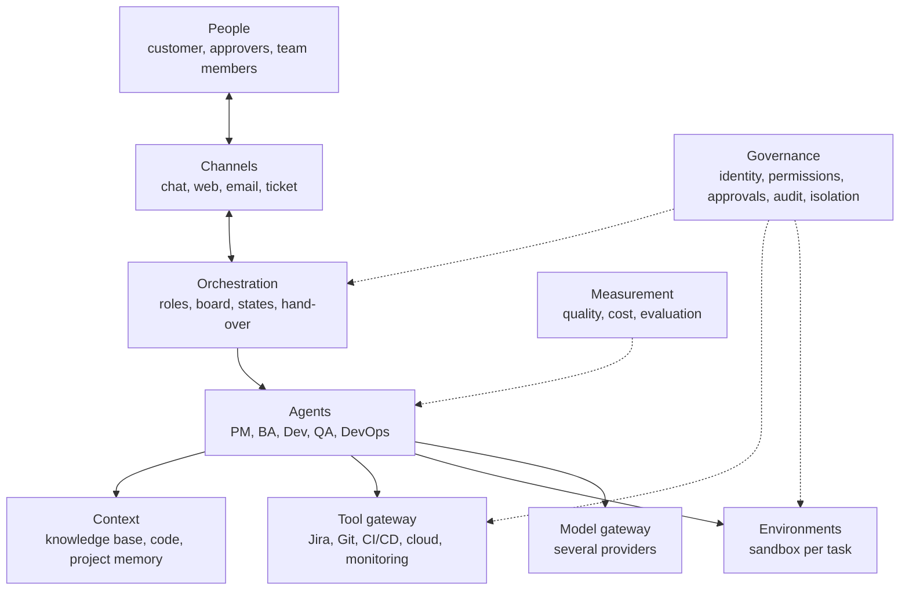

# AIPF: Platform Components

This document lists the parts an internal AI platform (AIPF) needs so that agents can carry the roles of a whole development team: PM, BA, developer, QA and DevOps. It is for the engineers and architects who will design it. Why the platform is built at all is in [01-why-an-internal-aipf.md](01-why-an-internal-aipf.md); the standard each project must meet is in [03-ai-ready-repo.md](03-ai-ready-repo.md).

Status: a list of requirements from internal discussion on 2026-10-18. It names capabilities, not products; nothing has been chosen or built.

## 1. Overview

| # | Component | Purpose |
|---|---|---|
| 2 | Orchestration | Turns agents into a team: roles, work board, hand-over, long-running work |
| 3 | Context | What agents know: knowledge base, source code, project memory |
| 4 | Tool gateway | What agents can act on: the team's tools, through one controlled door |
| 5 | Environments | Where agents build, run and test the software |
| 6 | Governance | Who may do what, who approves, what is recorded, what is kept apart |
| 7 | Model gateway | Which models are used, by which role, at what cost |
| 8 | Measurement | Whether the team is good, getting better, and worth its cost |
| 9 | Channels | Where people meet the agent team |

## 2. Orchestration

- **Roles.** Each agent role has its responsibilities, its instructions (the organisation's process for that role), its tools and its permissions. A role is configuration, so a team can be assembled from roles.
- **Work board and states.** Work items move through defined states (for example: requested, specified, in progress, in review, testing, ready to deploy, done). Each state says which role acts and what must be true to leave it.
- **Hand-over.** When one role finishes, the next one gets the item with its context: the specification, the decisions, the links. Rejections go back with reasons.
- **Long-running work.** Items last days or weeks. Agents must be able to pause, wait for an event or an approval, and resume with their context.
- **Events and schedules.** Triggers from tickets, emails, pull requests, build results and alerts; routines on a schedule (stand-up, planning, reports).
- **Escalation.** A clear path to a person when an agent is blocked, unsure, or outside its permissions.
- **Team templates.** A team (its roles, process and tools) is packaged so that a new project gets one quickly.

## 3. Context

- **Knowledge base.** Requirements, designs, meeting notes, customer documents, standards and past projects, searchable by agents. Documents in formats the parser handles poorly may need converting before indexing.
- **Source code.** The project's repositories and, where allowed, the organisation's shared libraries and reference implementations.
- **Project memory.** Decisions and their reasons, exchanges with the customer, incidents and their fixes, kept per project and readable by every role on it.
- **Organisational process.** Lifecycle standard, templates, checklists and definitions of done, given to each role as instructions.
- **Isolation.** Context is scoped per customer and per project; an agent on one project cannot read another's.

## 4. Tool gateway

- **One door for all tools:** ticketing (Jira or similar), source control, CI/CD, cloud accounts, monitoring and logs, chat, email, documents. Exposed to agents in one standard way (for example as MCP tools).
- **Credentials held by the platform,** never by agents or on laptops. Short-lived where the tool allows.
- **Permissions checked per call,** by role and project (section 6).
- **Every call recorded** with the agent, the work item and the result.
- **The same tools for people's own assistants.** Developers' editor assistants can use the gateway too, so people and agents work from the same tools and context.

## 5. Environments

An agent can test only what it can run. For each task the platform must provide an environment in which the agent can build the application, start it and run its tests without help.

**What an environment contains:**

- the toolchain: language versions, SDKs, build tools, dependencies;
- the services the application depends on: database, cache, queue, storage, search;
- test data: synthetic or anonymised, never production data;
- stand-ins for outside systems: third-party APIs, single sign-on, payment, email, usually as mocks or sandboxes;
- secrets and configuration for testing only;
- test tooling: test runners, browsers for end-to-end tests, emulators.

**Environment levels, by kind of test:**

| Test | Needs | Difficulty |
|---|---|---|
| Unit | The toolchain only | Low; almost every project can do it |
| Integration | Toolchain plus dependent services in containers | Medium |
| End-to-end | The whole application running, with a browser or emulator and sample data | High |
| Acceptance, staging | An environment close to production, shared, with human approval | Usually shared, not created per task |

**How the platform provides them:**

- **Defined in the repository.** Each project declares how to build its environment (container image, dev container, compose file, setup script). See [03-ai-ready-repo.md](03-ai-ready-repo.md).
- **Short-lived, per task or per pull request.** Created when an agent takes work, removed when it is done. Agents do not break each other's environments, and cost accrues only while they run.
- **Isolated per customer,** with restricted network access and limits on time and cost.
- **Stand-ins for what cannot be created:** cloud service emulators, API mocks, mobile emulators.

**Cases that need separate planning:** mobile apps (iOS needs macOS), Windows desktop software, embedded systems and hardware, legacy or customer-hosted systems behind a VPN or tied to licensed software, and systems that need GPUs, large data sets or many services at once.

**Consequence.** How far a project can be automated is bounded by the environments that can be created for it. A project with unit tests only should get only the work that unit tests can verify; end-to-end and acceptance testing stay with people until those environments exist.

## 6. Governance

- **Identity per agent and role,** distinct from people's identities, so every action is attributable.
- **Least privilege by role and project.** Examples: the PM agent edits the backlog but does not deploy; the developer agent pushes branches but does not merge to the main branch; the DevOps agent deploys to staging, and to production only after approval.
- **Approval gates** that the platform enforces, not the agent: requirement sign-off, merge, production deployment, spending over budget, any message to the customer.
- **Audit trail** from requirement to code, test, deployment and operation, with who approved each step.
- **Blast-radius limits:** destructive actions blocked or gated, rollback available, environments separated.
- **Customer isolation** across context, tools, environments and logs.
- **Data residency and guardrails:** data stays in the organisation's cloud environment and Region; prompts and outputs pass through guardrails (for example against prompt injection from documents, and for personal data).

## 7. Model gateway

- **Several providers and models,** reached through one interface, so roles can use the model that suits them and models can be swapped.
- **Budgets and quotas** per project and team, with alerts and hard limits.
- **Cost per work item and per project,** to compare with the cost of the same work by people.
- **Version pinning,** so a model change is deliberate and checked (section 8).

## 8. Measurement

- **Quality per role:** specifications accepted without rework, pull requests passing review, defects escaping to later stages, incidents.
- **Flow:** time from request to production, time waiting for approval, items blocked.
- **Cost:** model usage, environments, and people's time spent approving and correcting.
- **Evaluation sets:** fixed tasks with known good results per role, run before any change of model, prompt or process, to catch regressions.
- **Feedback loop:** rejected work and its reasons feed back into the roles' instructions.

## 9. Channels

- **Where people already work:** chat, ticketing, email, a web console.
- **For the customer:** status reports and questions in the form the customer expects, always through an approval gate.
- **For approvers:** one place to see and act on everything waiting for them.
- **For management:** a portfolio view across projects and teams, people and agents together.

## 10. Prerequisites outside the platform

The platform does not work on projects that are not ready for it. Before an agent team takes a project:

- the repository meets the [AI-ready repo](03-ai-ready-repo.md) standard;
- the project's knowledge (requirements, decisions, customer context) is in the knowledge base, not only in people's heads or private chats;
- the customer's contract allows the work to be done by agents, and says where data may be processed;
- the approval points and the people who hold them are named.
