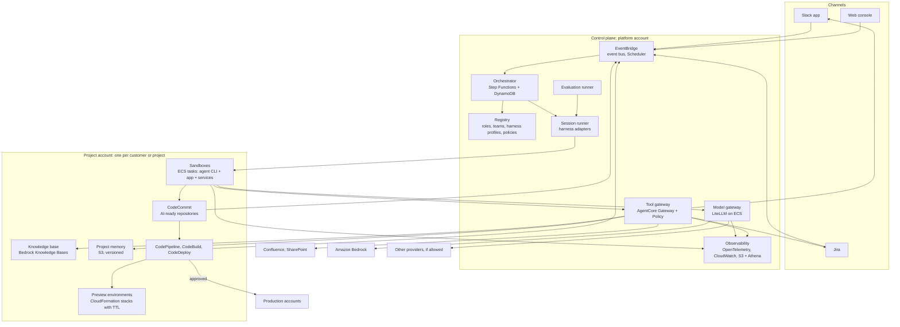
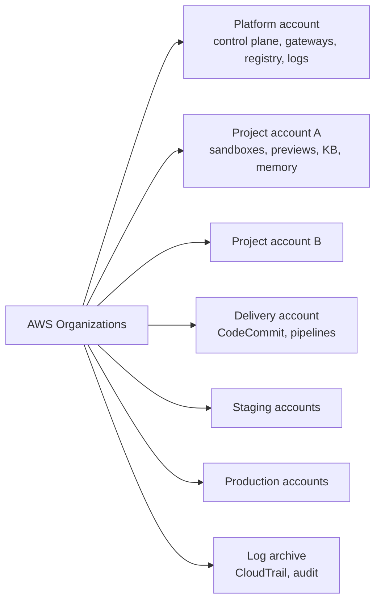
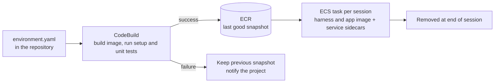
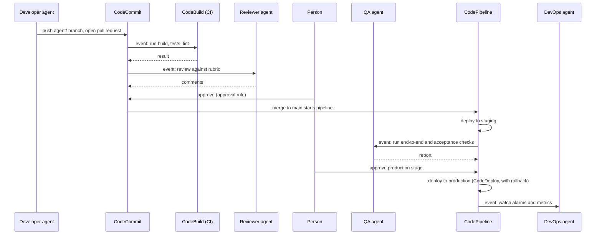

# AIPF: System Design on AWS

This document is a first, high-level system design for the AI platform (AIPF) described in [01](01-why-an-internal-aipf.md) to [04](04-reference-platforms.md). It is for the engineers and architects who will build it. It turns the components in [02-platform-components.md](02-platform-components.md) into AWS services and the platform's own parts, for one specific context.

Status: a draft design from internal discussion on 2026-10-18, updated on 2026-10-19 with the results of both POC rounds, OpenCode with GLM-5 and Claude Code with Claude Sonnet 5.5 and Opus 5.5 ([06](06-poc-architecture.md), sections 12 to 16). Only the POC has been built, and nothing has been load-tested. Service limits and Region availability named here must be checked before building (section 13).

## 1. Context and design goals

**The organisation:**

- runs on AWS: code in AWS CodeCommit, products and services served from AWS for many years;
- works with Atlassian (Jira, Confluence), SharePoint and Slack;
- has repositories that meet the [AI-ready repository standard](03-ai-ready-repo.md).

**Goals for the platform:**

| # | Goal | What it means for the design |
|---|---|---|
| G1 | Runs on AWS, in the same cloud environment as the products | All platform parts, sandboxes, knowledge bases and logs in the organisation's AWS accounts and main Region |
| G2 | No fixed harness | Agent CLIs (Claude Code, Codex, OpenCode, Pi, Oh My Pi and others) are replaceable executors. The platform, not the CLI, owns roles, tools, knowledge, permissions and environments |
| G3 | No fixed model provider | One model gateway in front of Amazon Bedrock and other providers; the model is chosen per role, project or task |
| G4 | Works on CodeCommit repositories | Hosted coding agents do not cover CodeCommit (they need GitHub, GitLab, Bitbucket or Azure DevOps; see [04](04-reference-platforms.md), section 4), so the platform runs its own |
| G5 | Environments per task and per project in AWS | Sandboxes and preview environments are created from each repository's specification and removed afterwards |
| G6 | Deploys to production on AWS | Agents start the existing pipelines; production changes pass a human approval the platform enforces |
| G7 | Full team: PM, BA, developer, QA, DevOps | Orchestration, knowledge base, project memory, approvals and measurement, not only a coding agent |

**The central decision.** The platform is the control plane; an agent CLI is a worker that runs one session inside a sandbox. Everything that must stay the same when the CLI or the model changes lives in the platform:

- the role definitions and instructions;
- the tools (exposed as MCP);
- the knowledge;
- the permissions (enforced outside the CLI);
- the environments;
- the records.

This follows what the reference platforms do (agent, environment and session kept apart; [04](04-reference-platforms.md), section 7), but with the agent loop replaceable.

## 2. Architecture overview



| Layer | AWS services and parts | AIPF component ([02](02-platform-components.md)) |
|---|---|---|
| Channels | Slack app, Jira, web console (CloudFront, S3, IAM Identity Center) | 9 Channels |
| Events | Amazon EventBridge, EventBridge Scheduler, API Gateway for webhooks | 2 Orchestration |
| Orchestrator | AWS Step Functions, DynamoDB | 2 Orchestration |
| Registry | Configuration repository in CodeCommit, applied to DynamoDB and S3 | 2 Orchestration, 6 Governance |
| Session runner and harness adapters | Lambda or a small ECS service, container images in ECR | 2 Orchestration, 5 Environments |
| Sandboxes and preview environments | Amazon ECS (Fargate, or EC2 where Docker is needed), CodeBuild, CloudFormation | 5 Environments |
| Model gateway | LiteLLM (open source) on ECS, Amazon Bedrock, other providers | 7 Model gateway |
| Tool gateway | Amazon Bedrock AgentCore Gateway, AgentCore Policy, AgentCore Identity | 4 Tool gateway, 6 Governance |
| Knowledge base and project memory | Amazon Bedrock Knowledge Bases, S3 | 3 Context |
| Delivery | CodeCommit, CodePipeline, CodeBuild, CodeDeploy | 5 Environments, 6 Governance |
| Governance | AWS Organizations, IAM, session tags, CloudTrail, Network Firewall | 6 Governance |
| Measurement | OpenTelemetry, CloudWatch, S3 and Athena, evaluation runner | 8 Measurement |

## 3. AWS account layout



- **Platform account.** The control plane, the model and tool gateways, the registry and the observability store. It holds no customer code or data at rest, except logs and transcripts.
- **One project account per customer** (or per project where contracts require it). It holds the sandboxes, preview environments, knowledge base and project memory. Customer isolation is enforced by account boundaries, not only by tags.
- **Repositories and pipelines stay where they are today.** The design assumes CodeCommit and the pipelines live in existing delivery accounts. The platform reaches them through cross-account roles.
- **Staging and production accounts are not touched by agents directly.** Changes reach them only through the pipeline (section 9).
- **Service control policies** at the organisation level deny agent roles any action in production accounts, and any action outside the main Region.

## 4. Orchestration

### 4.1 Work items and the board

- **Jira is the board.** Work items, their states and their owners live in Jira. People see and steer the agent team there, as they do a human team.
- **The orchestrator keeps the runs.** For each work item it records in DynamoDB:
  - its role assignments;
  - the sessions it started;
  - the approvals it is waiting for;
  - links to the transcripts.
- **Each work item gets a Step Functions Standard workflow** (these can run for up to a year). The workflow follows the item's states and starts a session for the role that acts in each state.
- **Waiting is free.** Waiting for an approval or an event uses a task token. The workflow pauses until Slack, Jira or the console returns the token.
- **A person can decline the work.** An answer can end the run as declined, instead of sending the agent back to try again. In the POC, a person's "no" led to a retry that would have escalated.
- **Related work items run one after another,** or their branches are rebased before CI. In the POC, two items worked on in parallel added migrations with the same file name.

| State (example) | Acting role | Leaves the state when |
|---|---|---|
| Requested | PM | The item is understood, sized and assigned |
| Specifying | BA | The specification and acceptance criteria are in Confluence and **approved by a person** |
| In development | Developer | A pull request is open and CI passes |
| In review | Reviewer agent, then a person | The pull request approval rules are met; **a person approves** |
| Testing | QA | End-to-end and acceptance checks pass in a preview or staging environment |
| Ready to deploy | DevOps | **A person approves** the production deployment |
| Done, monitored | DevOps | No alarms for the agreed period |

The states, roles and exit conditions are configuration in the registry (section 4.3), so each team template can change them.

### 4.2 Events and schedules

All triggers arrive on one EventBridge bus and are matched to work items or routines:

| Source | How it arrives |
|---|---|
| Jira (issue created, transitioned, commented) | Jira webhook to API Gateway, then EventBridge |
| Slack (mentions, commands, approval buttons) | Slack app (Events API through API Gateway, or Socket Mode on ECS) |
| CodeCommit (pull request created, updated, commented, merged) | Native CodeCommit events in EventBridge |
| CodeBuild and CodePipeline (build failed, stage succeeded) | Native events in EventBridge |
| CloudWatch alarms | Native events in EventBridge |
| Routines (stand-up, planning, weekly report) | EventBridge Scheduler |

### 4.3 Registry: roles, teams and harness profiles as code

One configuration repository holds the platform's definitions. It is reviewed like code and applied by a pipeline, the same idea as configuration as code in Claude Managed Agents and Factory ([04](04-reference-platforms.md), section 7).

```text
aipf-config/
  roles/            developer.yaml, qa.yaml, ba.yaml, pm.yaml, devops.yaml, reviewer.yaml
  instructions/     the organisation's process for each role (Markdown)
  skills/           shared skills (SKILL.md folders)
  teams/            team templates: roles, states, approvals, routing
  harnesses/        one profile per agent CLI: image, how to run it, how to configure it
  policies/         tool permissions per role (Cedar)
  evaluations/      evaluation tasks and rubrics per role
```

A role definition, as an example:

```yaml
role: developer
instructions: instructions/developer.md
skills: [codecommit-pr, run-tests, write-adr]
tools: [jira.read, jira.comment, confluence.read, kb.search, memory.read, memory.propose]
aws_permissions: developer-sandbox     # IAM role template, see section 8
git:
  push_branches: "agent/*"             # never main
harness:
  default: claude-code
  allowed: [claude-code, codex, opencode, pi]
model:
  default: bedrock/claude-sonnet       # resolved by the model gateway
  hard: bedrock/claude-opus            # items marked hard; 2 to 5 times the cost per session in the POC
limits:
  session_hours: 4
  budget_usd: 20
outcome_rubric: rubrics/developer-pr.md
```

### 4.4 Several agents

- **Flat hand-over through the board, not deep agent hierarchies.** Each state starts its own session with its own role. Results pass through Jira, Confluence, the pull request and project memory, which people can read.
- **Inside one session, an agent CLI may use its own sub-agents.** Claude Code and others do this. The platform treats the session as one unit: one sandbox, one budget, one transcript.
- This keeps the design independent of any one CLI's multi-agent features. It also matches the reference platforms' limits on delegation depth ([04](04-reference-platforms.md), section 7, lesson 10).
- **The POC runs six agents in turn on one work item:** PM, designer, developer, reviewer, tester and operator. Each ends with a verdict, and its reply is handed to the next agents in their prompt, marked as input to check, while the story, the design and the reports are also posted to Jira and the pull request ([06](06-poc-architecture.md), section 18).

## 5. Harness layer: replaceable agent CLIs

### 5.1 The contract

Every agent CLI is wrapped by a **harness adapter** that implements the same contract. The orchestrator only knows the contract.

| Direction | Content |
|---|---|
| Input | Work item and role; instruction text; skills; repository and branch; MCP server list with session token; model gateway URL and session key; outcome rubric; limits (time, budget) |
| Output | A stream of events (messages, tool calls, files changed) in one platform format; a final status (completed, needs input, failed, limit reached); artifacts (branch pushed, files in the outputs folder); usage (tokens, cost) |
| Controls | Start, send a message, interrupt, stop |

### 5.2 What the adapter does

1. **Writes the CLI's own configuration from the platform's definitions.** Each CLI has its own format for instruction files, MCP servers, model provider and permissions. The adapter generates them from the role:
   - `AGENTS.md` is the canonical instruction file in the repository, and the adapter adds the role's instructions next to it.
   - Where a CLI reads another file name (for example `CLAUDE.md`), the adapter adds a file that imports or copies `AGENTS.md`.
   - Skills are copied to the folder that CLI reads.
   - The MCP server list and the model gateway settings are written in that CLI's format.
2. **Runs the CLI non-interactively** (for example `claude -p` or `codex exec`) with its own permission prompts switched off. Safety comes from outside the CLI (section 8), because CLIs differ in what their permission systems can express.
3. **Translates the CLI's output** (JSON event streams where the CLI offers them, otherwise logs) into the platform's event format. It also collects OpenTelemetry data where the CLI exports it.
4. **Detects the end state** and reports it: finished, asked a question (sent to the channel as an escalation), failed, or hit a limit.
5. **Passes environment failures to the agent.** If preparing the environment fails on the agent's branch, the adapter still runs the CLI and gives it the error. In the POC, failing the session instead used up all three attempts on one item without the agent seeing why.

### 5.3 Harness profiles and routing

- **A harness profile** is a container image with the CLI installed, plus the adapter for it. Images are built by CodeBuild, stored in ECR, and pinned by version, the same way models are pinned.
- **Routing** picks the harness and model for each session in this order:
  1. the work item, if a person set it;
  2. the project's setting;
  3. the role's default;
  4. the platform's default.
- **Routing rules can depend on the kind of task,** for example a cheaper model for documentation and a stronger one for refactoring.
- **The evaluation runner (section 10.3) supplies the evidence for routing.** It runs the same tasks with each harness and model, and publishes which combination does best for each role and kind of task.
- **Fallback:** if a harness fails to start or its provider is unavailable, the session can restart with the next allowed profile.

### 5.4 What stays the same when the harness changes

The repository, its environment, the role's instructions and skills, the tools, the knowledge base, the project memory, the permissions, the approvals and the records. Only the agent loop and possibly the model change. Moving a project from one CLI to another is a change to one line of configuration, verified by the evaluation set.

## 6. Environments

### 6.1 Environment specification in the repository

Each AI-ready repository declares its environment ([03](03-ai-ready-repo.md), checklist "Environment" and "Commands"):

```text
.aipf/
  environment.yaml    base image or Dockerfile, services, setup and start commands, test commands
AGENTS.md             instructions for any agent
```

```yaml
image: Dockerfile.dev
services:                       # run as sidecar containers in the same task
  - postgres:16
  - redis:7
setup: make setup               # safe to re-run
start: make start
check_ready: curl -sf localhost:8080/health
commands:
  unit: make test
  integration: make test-integration
  e2e: make test-e2e
network:
  allow: [package-registries, internal-artifact-repo]
environments:                   # deployed environments; dev is the sandbox itself
  staging:
    release: make migrate       # once per deploy, before the new version takes traffic
```

The platform builds the deployable image from the same file, so a simple service needs no deployment code of its own. In the POC, staging runs the repository's start command in a platform image and runs `release` once per deploy ([06](06-poc-architecture.md), section 17.2).

### 6.2 From specification to sandbox



- **Snapshots.** CodeBuild builds the environment image when the specification or the main branch changes, and once a day. It pushes the image to ECR only when setup and unit tests pass. A failed build keeps the last good snapshot, as Cursor and Devin do.
- **A sandbox is one ECS task per session.** The task contains:
  - one container with the agent CLI, the adapter and the application's development environment. The snapshot image is built on top of the harness image, so the agent runs the application's commands in its own shell ([06](06-poc-architecture.md), section 12.1);
  - the dependent services as sidecar containers.
  
  The task is created when the session starts and removed when it ends.
- **Fargate by default.** It has no servers to manage and fits most projects. In the POC, a 2 vCPU task took about 35 s to start and 35 s to stop.
- **ECS on EC2 or CodeBuild where Docker is needed.** Fargate does not allow a Docker daemon inside the task, so projects that need one use one of these instead. Examples: building container images, running Testcontainers, starting a compose file of many services.
- **The sandbox prepares the database the way CI does:** migrations on an empty database, then seed data. In the POC, a migration tested only on the seeded snapshot passed in the sandbox and failed in CI.
- **CI runs on a prebuilt image** with the language runtime and service images in it. In the POC, installing Node on the standard CodeBuild image took 57 s of about 85 s.
- **Agents can draft the specification.** For a repository without one, a setup session can draft `environment.yaml`. A person reviews it and supplies any credentials, as with Devin blueprints and the Cursor setup agent.

### 6.3 Preview environments per pull request

- When a pull request reaches the testing state, the pipeline deploys the application to the project account as a CloudFormation stack (or with the project's own infrastructure code). The stack is tagged with the work item and an expiry time.
- QA agents run end-to-end tests against it. People can open it for acceptance.
- A scheduled cleanup removes stacks past their expiry, and removes them when the pull request is merged or closed.
- Outside systems use the mocks and sandboxes the repository provides ([03](03-ai-ready-repo.md)). Preview environments never use production data or production credentials.

### 6.4 Projects outside containers

| Kind of project | Approach on AWS |
|---|---|
| iOS and macOS | EC2 Mac instances as build and test hosts |
| Windows software | Windows containers on ECS on EC2, or Windows CodeBuild |
| GPU workloads | ECS on GPU instances, scheduled and capped |
| Many services or large data | A shared, long-lived test environment in the project account instead of one per task |
| Legacy systems | Agents limited to the levels the project reaches ([03](03-ai-ready-repo.md), section 3) |

## 7. Context: knowledge base, code and project memory

### 7.1 Knowledge base

- **One Amazon Bedrock knowledge base per project account,** with these data sources:
  - Confluence spaces and SharePoint sites, through the built-in connectors;
  - selected Slack channels and Jira history, exported by a scheduled job to S3;
  - architecture decisions and runbooks from the repositories.
- **Per-customer isolation comes from the account, not from filters.** A shared organisational knowledge base (standards, templates, past project lessons cleared for reuse) lives in the platform account and is read-only.
- **The connectors and parsing behaviour were tested in this repository's POC.** See [08](../08-knowledge-base-chatbot.md) and [09](../09-bedrock-managed-knowledge-base.md). Documents the parser handles poorly are converted before they are indexed.
- **Agents reach the knowledge base only through the tool gateway,** as a search tool. The tool returns passages with links to their sources, so specifications and answers can cite them.

### 7.2 Code

- **Agents read code by cloning the repository into the sandbox.** No separate code index is needed to start.
- **A code index can be added later** for cross-repository questions. One option is a generated repository wiki indexed into the knowledge base, as DeepWiki does.

### 7.3 Project memory

- **What it holds.** Decisions and their reasons, customer exchanges, incidents and their fixes, lessons. It is stored as Markdown files in a versioned S3 bucket in the project account, one folder per project.
- **Every role reads it** through a memory tool, and the files are mounted read-only into the sandbox.
- **Writes are proposals.** A memory tool call creates a new version, recorded with the session that wrote it. Changes to shared reference material need a person's approval. This follows the poisoning warning in Claude Managed Agents ([04](04-reference-platforms.md), section 2.5).
- **Old versions can be restored.** S3 versioning keeps every version.

## 8. Governance and security

### 8.1 Identity

- **Each session runs under its own IAM role session,** with session tags: project, work item, role and harness. Every AWS action in CloudTrail can then be traced to the agent role and the work item.
  - An ECS task role session carries no session tags and no useful session name; the POC found this. So the session runner assumes the agent role itself, with tags and the work item as session name, and hands those credentials to the agent.
  - Whether AgentCore Policy can then match the session name or tags is still to verify. In the POC it saw only the role.
- **One IAM role per agent, and the agent's name in every tool call.** In the POC, a filter between the CLI and the gateway adds the agent's name to each call, and the Cedar policy requires that it names the role that signed the call. The tools sign their output with it, so people see which agent wrote each comment ([06](06-poc-architecture.md), section 18.3).
- **The role's permissions come from an IAM role template per agent role.** Examples:
  - The developer sandbox role may pull from its project's repositories, and push only to `agent/*` branches (CodeCommit's `codecommit:References` condition key). It cannot merge.
  - The QA role may read preview environments and test results.
  - The DevOps role may start pipelines, but not approve production stages.
- **Attribute-based conditions** on the session tags stop a session from reaching another project's resources, in addition to the account boundary.
- **People sign in through IAM Identity Center.** Approvals are recorded with the person's identity.
- **People reach the platform from a chat client through their own gateway.** In the POC, this user gateway is AIPF MCP, a second AgentCore Gateway with a custom JWT authorizer, using the console's user pool. Its interceptor puts the signed-in person in every call and writes an audit line. The agents keep their IAM-signed gateway and its Cedar policies ([06](06-poc-architecture.md), section 19).

### 8.2 Keeping secrets out of the sandbox

The sandbox holds no long-lived third-party credentials:

| Access | How the sandbox gets it |
|---|---|
| Models | A session key for the model gateway, limited to the session's budget and lifetime |
| Jira, Confluence, SharePoint, Slack, knowledge base, memory | Tools on the tool gateway, called with a session token. The gateway holds the OAuth credentials (AgentCore Identity) |
| CodeCommit and AWS APIs | The task's IAM role session, with temporary credentials |
| Test secrets for the application | Injected from Secrets Manager at task start, only test values, scoped to the project account |

Keys that a tool needs for an outside API stay in a vault. In the POC, AgentCore Identity holds them as API key credential providers. An agent calls `vault___fetch` with a credential's name; the tools function adds the value to one header, for that credential's agents, hosts, paths and methods only, and takes the value and its usual encodings out of the response. The value never enters the sandbox, so the agent CLI in use (Claude Code, OpenCode or Pi) does not matter ([06](06-poc-architecture.md), section 19.6).

Assume the agent can read anything in its sandbox. In the POC, the agent could read its task role credentials and, for Claude Code, the subscription token, and so could call the gateway without the MCP proxy. The gates still held, because they are in the gateway and IAM.

### 8.3 Permission per tool call, outside the agent CLI

- **AgentCore Policy checks every tool call** on the gateway against the role's Cedar policy before it runs. For example, the PM role may create and edit Jira issues, but only the DevOps role may call the deployment tools.
- **Calls that need a person are routed to an approval** instead of being run. Examples: messages to the customer, changes to approved specifications, actions over a cost threshold.
- **The rules do not depend on which CLI is running,** because they sit in the gateway, IAM and the network.
- **How it behaved in the POC** ([06](06-poc-architecture.md), section 13.3):
  - Through the MCP proxy, an agent sees only the tools its role may call. A call to a hidden tool gets "Unknown tool" from the proxy and never reaches the gateway.
  - A signed call sent straight to the gateway for a refused tool gets JSON-RPC error -32002.
  - Conditions on tool input work, for example a transition only to "In Review", or a pull request only from an `agent/*` branch.
  - Each call takes 30 to 100 ms longer.
  - A DENY log entry names neither the tool nor the policy. Reports join it with the request's log entry by request ID.
  - The gateway's role needs `GetPolicyEngine`, `AuthorizeAction` and `PartiallyAuthorizeActions` on the policy engine.

### 8.4 Network

- Sandboxes run in private subnets with no inbound access.
- Outbound traffic goes through AWS Network Firewall with a domain allowlist per project: package registries, the internal artifact repository, the gateways, and AWS service endpoints through VPC endpoints.
- No sandbox can reach production networks.

### 8.5 Approval gates

| Gate | Enforced by |
|---|---|
| Specification sign-off | Step Functions waits for a person's approval in Slack, Jira or the console |
| Merge to the main branch | CodeCommit approval rule templates: at least one person, never the requester |
| Production deployment | CodePipeline manual approval action, approvers limited by IAM |
| Messages to the customer | Tool policy routes them to an approval |
| Spending over budget | The model gateway stops the session; the orchestrator asks for more budget |

The reviewer agent's approval never counts towards the merge rule ([04](04-reference-platforms.md), section 7, lesson 7).

### 8.6 Audit

The chain from requirement to production is joined by the work item key. Each link records who approved it:

- Jira item;
- Confluence specification;
- sessions and their transcripts;
- commits and pull request;
- builds;
- deployment;
- alarms.

Records are kept as follows:

- **Transcripts and events:** in S3, queried with Athena.
- **CloudTrail:** in the log archive account.

Tool targets act with their own role. A pull request comment in CodeCommit therefore shows the tools role, not the agent. The gateway log, joined by the work item key, records which agent role made the call.

## 9. Delivery and operations



- **Deploy scripts belong to the platform, not to the repository.** A change in the repository cannot change how it is deployed, and agents cannot start a deploy.
- **A tester agent runs user acceptance tests on staging from outside** after every merge. It checks each acceptance criterion of the work item with requests to staging and posts a report with a verdict. A failure sends the developer agent back with the report, to fix forward from `main` through a new pull request. An operator agent then checks staging's health and writes the release note. The POC built both ([06](06-poc-architecture.md), sections 17.3 and 18).
- **Agents use the existing pipelines;** they do not deploy by other means. The DevOps role can start a pipeline, read its state, and propose a rollback. Production stages need a person.
- **Operations.** CloudWatch alarms start a DevOps session that investigates logs, metrics and recent deployments, and posts findings to Slack.
  - The organisation can also use AWS DevOps Agent for incident investigation ([04](04-reference-platforms.md), section 4.7) and connect it through MCP. It then becomes one more tool on the gateway.
- **Infrastructure changes** are pull requests to the infrastructure code, reviewed and deployed through the same gates as application code.

## 10. Measurement and evaluation

### 10.1 Traces and records

- Every session emits events in the platform format, and OpenTelemetry where the CLI supports it.
- These go to CloudWatch for live views, and to S3 for analysis with Athena.
- The model gateway records tokens and cost per session key. The tool gateway records every call.
- **Cost reports use the Usage record type.** Credits cancel each service's cost in Cost Explorer, so reports without that filter show zero.
- **The model dominates cost.** In the POC it was 94% to 97% of a work item's cost; the sandbox, CI, knowledge base and workflow together were about $0.02 to $0.025 per item ([06](06-poc-architecture.md), section 15).
- **Caching is the main lever.** GLM-5 on Bedrock used no cache, and its input was 99% of the tokens. Claude Code cached its context, and a work item cost about a third as much at API prices, $0.34 against $0.96. Cache writes were then 65% of the model cost, so cost reports need uncached, cache read, cache write and output tokens apart.

### 10.2 Dashboards

| View | Measures |
|---|---|
| Per role | Specifications accepted without rework, pull requests merged without major change, defects found later, incidents |
| Flow | Time from request to production, time waiting for approval, items blocked |
| Cost | Model cost, sandbox and preview cost (tagged per project and work item), people's approval time |
| Harness and model | Success rate, cost and duration per harness and model, per role and kind of task |

The POC's console has a first version: runs, what waits for a person, staging, and sessions, refusals, verdicts and cost per agent, next to the control plane that turns agents on or off and sets their models, and a chat with the knowledge base ([06](06-poc-architecture.md), section 18.4).

### 10.3 Evaluation runner

- **Each role has a fixed set of evaluation tasks with rubrics,** in the registry: real past work items with known good results, run against frozen snapshots of the repositories.
- **A Step Functions workflow runs the set for every combination worth comparing:** harness, model and instruction version. It runs nightly, and before any change to a role, a harness profile or a model.
- **A grader session scores each result against the rubric.** It uses a different model from the one being graded where possible, as the separate grader does in Claude Managed Agents ([04](04-reference-platforms.md), section 2.6).
- **The results feed the routing rules (section 5.3)** and block changes that make a role worse.

## 11. Build, configure or adopt

| Part | Approach |
|---|---|
| Event bus, workflows, state | AWS managed services: EventBridge, Step Functions, DynamoDB |
| Sandboxes, images, previews | AWS managed services: ECS, CodeBuild, ECR, CloudFormation |
| Tool gateway, tool policy, OAuth credentials | AWS managed services: AgentCore Gateway, Policy, Identity |
| Knowledge base | AWS managed service: Bedrock Knowledge Bases, with export jobs for Slack and Jira |
| Model gateway | Open source (LiteLLM), self-run on ECS |
| Agent CLIs | Adopted as they are; pinned in harness profiles |
| MCP servers for Jira, Confluence, Slack, SharePoint, CodeCommit, CodePipeline | Vendor or open-source servers where they exist and pass review; small custom servers otherwise |
| Harness adapters, orchestrator logic, registry, approval flows, console, evaluation runner | **Built by the organisation.** This is where its process lives ([01](01-why-an-internal-aipf.md), section 2.8) |

## 12. Rollout

| Phase | Scope | Exit condition |
|---|---|---|
| 1. Developer and reviewer | One project at level 2 or above; one harness and one model; Jira trigger to pull request; CodeCommit approval rules | Agent pull requests merged at an agreed rate, no gate bypassed |
| 2. Second harness and evaluation | Add a second CLI and a second model provider; evaluation runner and routing | Switching harness for a project is a configuration change, verified by the evaluation set |
| 3. QA and BA | Preview environments; end-to-end tests by the QA agent; specifications in Confluence by the BA agent | Specifications accepted with little rework; defects found before staging |
| 4. DevOps and PM | Pipelines started by agents; alarm investigation; backlog grooming, reports and stand-ups | Production deployments with human approval only; reports accepted by project managers |
| 5. Several projects | Team templates; project accounts created from a template; portfolio view | A new project gets an agent team in days |

## 13. To verify before building

- **Region.** Which models are offered in the main Region through Amazon Bedrock, and whether any need cross-Region inference. The same check applies to AgentCore Gateway, Policy and Identity, and to the Bedrock knowledge base connectors.
- **Agent CLIs.** For each CLI:
  - Its non-interactive mode and output format.
  - Its MCP support, its instruction-file conventions and its telemetry.
  - Whether it can reach models through the gateway, and the licence and support terms for company use.
- **OAuth.** AgentCore Identity's support for the Atlassian, Slack and Microsoft OAuth flows the tools need.
- **CodeCommit.** Event coverage in EventBridge for every pull request action the orchestrator needs. Push restriction by branch with `codecommit:References` in practice; the POC showed it limits push and branch deletion.
- **ECS.** Fargate task size, storage and start time for the largest project environments, and which projects need ECS on EC2 for Docker.
- **Data and contracts.** Customer contracts on where data and model calls may go. This decides which providers the model gateway may route to, per project.
- **Cost.** Sandbox hours, preview environments, model usage and gateway calls for one work item, measured in phase 1 rather than estimated. The POC's figures for both rounds and an estimating formula are in [06](06-poc-architecture.md), section 15.
