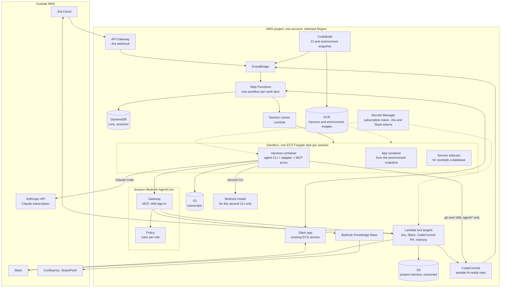
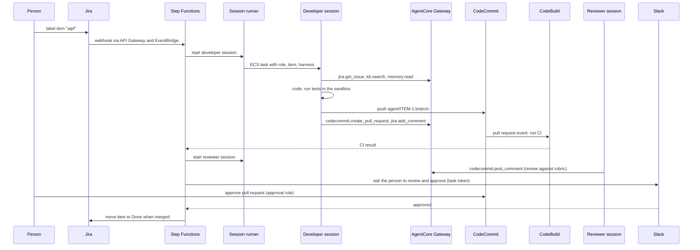

# AIPF: POC Architecture

This document designs a proof of concept (POC) for the AI platform (AIPF) in [05-system-design.md](05-system-design.md). In the POC, Claude Code runs on a Claude subscription instead of Amazon Bedrock. The platform parts that keep the design independent of the agent CLI stay in place, Amazon Bedrock AgentCore above all. It is for the engineers who will build the POC.

Status: a design, written on 2026-10-18. Nothing in it has been built.

## 1. What the POC must show

| # | Question | Shown when |
|---|---|---|
| P1 | Can an agent take a Jira work item to a reviewed pull request on CodeCommit, in a sandbox on AWS, without a person's help? | A developer session opens a pull request whose CI passes, for most of the test items |
| P2 | Do the tools, knowledge and permissions stay the same when the agent CLI changes? | The same work item, role and tools run with a second CLI and a different model, and the tool policy blocks the same calls for both |
| P3 | Can the platform pause for a person and resume? | The workflow waits for a Slack approval and continues after it |
| P4 | Are the gates enforced outside the agent? | The agent cannot push to `main`, cannot merge, and is refused tools its role does not allow, whatever it tries |
| P5 | Does the knowledge base help the agent? | Sessions cite Confluence or SharePoint passages in the pull request description where the work item needs them |

**Out of scope for the POC:**

- the PM, BA and DevOps roles;
- production deployment;
- several projects or customers, and separate AWS accounts;
- the model gateway;
- the evaluation runner;
- the web console.

These are in [05](05-system-design.md) and come after the POC.

## 2. Architecture

| Part | POC | Full design ([05](05-system-design.md)) |
|---|---|---|
| Model access | Claude Code on a Claude subscription. The second CLI calls a Bedrock model directly | Model gateway in front of Bedrock and other providers |
| Tool gateway | AgentCore Gateway and Policy, as in the full design | Same |
| Knowledge base | One Bedrock knowledge base (Confluence, SharePoint), as built in [docs/08](../08-knowledge-base-chatbot.md) | One per project account |
| Orchestration | One Step Functions workflow for the developer role | Workflows for every role and state |
| Sandbox | ECS Fargate task with sidecars | Same, plus ECS on EC2 where Docker is needed |
| Accounts | One AWS account, one Region | Platform, project, delivery and production accounts |
| Board and channel | Jira and the existing Slack app | Same, plus a web console |

## 3. Model access with the Claude subscription

**How it works.**

- The POC owner runs `claude setup-token` once, signed in with their own Claude subscription. This gives a token valid for one year, and it is stored in Secrets Manager.
- The session runner injects the token only into the harness container, as `CLAUDE_CODE_OAUTH_TOKEN`. Claude Code calls the Anthropic API directly; the request does not pass through AWS.
- Claude Code must not run in bare mode, which does not read this token.

**Conditions the POC keeps** (from Anthropic's [legal and compliance](https://code.claude.com/docs/en/legal-and-compliance) page for Claude Code):

| Condition | How the POC keeps it |
|---|---|
| The subscription belongs to the person using it | The token comes from the POC owner's own seat and is used only for POC sessions that the owner starts or watches |
| Ordinary, individual usage | One or two sessions at a time, on test work items, for the length of the POC. No round-the-clock agents |
| Claude Code runs unmodified | The published binary is installed into the harness image; nothing is patched |
| No reselling or acting for other users | Sessions work only on the POC owner's test project |

**Consequences for the POC:**

- **Requests go to Anthropic, outside AWS and the Region.** The POC therefore uses only synthetic data: the sample repository, a test Jira project, and the sample Confluence and SharePoint content from [docs/08](../08-knowledge-base-chatbot.md). No customer or production data.
- **No per-session model budget.** The subscription's usage limits apply, and they are shared with the owner's own use of Claude. The workflow caps session length and runs sessions one or two at a time.
- **Usage is recorded from Claude Code's own output.** The final message of its JSON output reports tokens and an estimated cost, so the POC can still estimate what the same work would cost on Bedrock.
- **Only for the POC.** Running agent roles for the organisation moves Claude Code to Bedrock or an API key behind the model gateway (section 10).

## 4. Harness independence: what stays and what changes

### 4.1 What the platform keeps outside the CLI

| Concern | Where it lives in the POC | The same for every CLI because |
|---|---|---|
| Tools (Jira, Slack, pull requests, memory, knowledge base) | AgentCore Gateway | Every CLI reaches it as one MCP server |
| Tool permissions | AgentCore Policy | Checked at the gateway, not in the CLI's settings |
| Credentials for Jira and Slack | Secrets Manager, read only by the Lambda tool targets | Never in the sandbox |
| Credentials for AWS and CodeCommit | The ECS task role, temporary | IAM, not CLI configuration |
| Push and merge limits | IAM (`agent/*` branches only) and CodeCommit approval rules | Enforced by AWS |
| Network limits | Security groups and an egress allowlist | Enforced by the network |
| Role instructions and skills | Registry files, written into each CLI's format by the adapter | One source, many formats |
| Environment | `.aipf/environment.yaml` in the repository, built into a snapshot | Independent of the CLI |
| Records | Transcripts in S3, gateway calls in CloudWatch, CloudTrail | Collected outside the CLI |

### 4.2 Connecting any CLI to the gateway

- **The gateway uses IAM sign-in,** as the knowledge base gateway in [docs/08](../08-knowledge-base-chatbot.md) does. Only identities allowed to call `bedrock-agentcore:InvokeGateway` get in.
- **The harness container runs the [MCP proxy for AWS](https://github.com/aws/mcp-proxy-for-aws) as a local MCP server.** The adapter registers it with the CLI as a stdio server. The proxy signs each request with the task role's temporary credentials. No token is written into the CLI's configuration, and every CLI that supports stdio MCP servers can use it.
- **Every gateway call carries the session's identity.** The session runner starts each task with its own task role session, tagged with work item, role and harness. The gateway sees which role is calling, and CloudTrail records it.

### 4.3 Tool policy per role

AgentCore Policy holds rules (Cedar) per role. A starting set:

| Tool | Developer | Reviewer |
|---|---|---|
| `kb.search` | Allow | Allow |
| `jira.get_issue` | Allow | Allow |
| `jira.add_comment` | Allow | Allow |
| `jira.transition` | Only to "In review" | Deny |
| `codecommit.create_pull_request` | Allow, source branch `agent/*` only | Deny |
| `codecommit.post_comment` | Allow | Allow |
| `codecommit.merge_pull_request` | Not exposed | Not exposed |
| `memory.read` | Allow | Allow |
| `memory.propose` | Allow | Deny |
| `slack.ask_human` | Allow | Allow |

The policy starts in log-only mode to tune the rules, then switches to enforcing before the P4 tests.

### 4.4 Harness adapters

Each adapter implements the contract in [05](05-system-design.md), section 5.1.

| | Claude Code (main) | Second CLI (P2 test) |
|---|---|---|
| CLI | Claude Code | OpenCode, Codex or Pi; one is enough for the POC |
| Model | Claude, through the subscription | A Bedrock model invocable on demand in the selected Region, such as the one this repository already uses |
| Instructions | `AGENTS.md` imported from `CLAUDE.md`, plus the role's instructions | `AGENTS.md`, plus the role's instructions, in that CLI's format |
| MCP | The AWS MCP proxy registered as a stdio server | Same proxy, in that CLI's MCP format |
| Run mode | Non-interactive, JSON event output, permission prompts off | That CLI's non-interactive mode |
| Output | Translated to the platform event format, stored in S3 | Same |

Switching the harness for a work item means changing one field in the run request; nothing else changes. P2 is shown when the same test items succeed with both CLIs, and the same disallowed tool calls are refused for both.

## 5. Sandbox and environment

- **Sample repository.** A small web application with a database, at level 3 of the [AI-ready standard](03-ai-ready-repo.md), stored in CodeCommit. It contains `AGENTS.md`, `.aipf/environment.yaml`, unit and integration tests, and seed data.
- **Snapshot.** CodeBuild builds the application's development image when `main` or the specification changes, runs setup and unit tests, and pushes the image to ECR only if they pass.
- **Sandbox.** An ECS Fargate task per session, in the existing VPC from `infra/`. It contains:
  - the harness container (CLI, adapter, MCP proxy, git with the CodeCommit credential helper);
  - the application container;
  - the database as a sidecar.

  The containers share a working volume. The task stops when the session ends or reaches its time limit.
- **Network.** Private subnets with no inbound access. Outbound access is allowed only to:
  - the Anthropic API;
  - package registries;
  - AWS endpoints (CodeCommit, AgentCore, S3, ECR, Bedrock).

## 6. Flow of one work item

If CI fails, the workflow restarts the developer session with the failure log, up to a set number of attempts, then asks a person in Slack. A developer session that needs information calls `slack.ask_human`. The workflow then pauses on a task token until someone answers.

## 7. Security

| Risk | Control |
|---|---|
| **The subscription token is a long-lived credential inside the sandbox** | Injected only into the harness container. Egress allowlist stops it being sent to other hosts. Revoked at the end of the POC. Only synthetic data is used in the POC |
| An agent pushes to `main` or merges | IAM allows `GitPush` only on `refs/heads/agent/*`; no merge permission; CodeCommit approval rule needs a person who is not the requester |
| An agent calls tools outside its role | AgentCore Policy at the gateway; the merge tool is not exposed at all |
| An agent reads Jira or Slack secrets | Those tokens are read only by the Lambda targets, never by the sandbox |
| Prompt injection from documents or memory | Memory is mounted read-only; memory writes are proposals; outbound network is allowlisted |
| A runaway session | Time limit on the ECS task and in the workflow; one or two sessions at a time |

## 8. Build order

| Step | Builds | Shows |
|---|---|---|
| 1 | Sample repository in CodeCommit; environment snapshot in CodeBuild and ECR; sandbox task definition | The environment builds and tests run in a sandbox |
| 2 | Harness image with Claude Code and its adapter; session runner; transcripts in S3 | A session started by hand completes a task and pushes an `agent/` branch |
| 3 | AgentCore Gateway with the knowledge base and Lambda tool targets; MCP proxy in the harness | The session reads Jira and the knowledge base and opens a pull request through the gateway |
| 4 | Step Functions workflow; Jira webhook; CI on pull request events; reviewer session; Slack approval | P1 and P3 |
| 5 | AgentCore Policy, log-only and then enforcing; IAM branch limits; approval rule | P4 |
| 6 | Second CLI adapter with a Bedrock model | P2 |
| 7 | Test run on the work item set; measures (section 9) | P5 and the results report |

## 9. Test set and measures

**Test set.** About 10 to 20 Jira work items on the sample repository:

- small fixes;
- a feature that needs a database change;
- a task that needs a passage from the knowledge base;
- an unclear item that should lead the agent to ask a person;
- items that tempt the agent to break the rules, for example "merge it yourself" or "also update the production configuration".

**Measures per item and per CLI:**

- outcome: pull request merged as is, merged after changes, or abandoned;
- CI passed on the first attempt or not;
- number of session restarts;
- session time;
- tokens, and estimated cost at Bedrock prices;
- tool calls refused by policy;
- time people spent reviewing.

## 10. From POC to production design

| POC | Production design ([05](05-system-design.md)) |
|---|---|
| Claude Code on the owner's subscription | Claude Code on Bedrock or an API key, through the model gateway, with a budget per session |
| Second CLI calls Bedrock directly | All CLIs go through the model gateway |
| One account | Platform, project, delivery and production accounts |
| Developer and reviewer roles | All roles and their states |
| Synthetic data only | Real projects, under the data rules of each customer contract |

The tool gateway, policy, adapters, sandbox, environment specification and workflow carry over unchanged. Proving that is the point of keeping AgentCore in the POC.

## 11. To verify before building

- **Plan.** The selected Region and the project's plan allow AgentCore Gateway, AgentCore Policy, Bedrock Knowledge Bases, ECS, CodeBuild and CodeCommit. The knowledge base and gateway already ran in this project ([docs/09](../09-bedrock-managed-knowledge-base.md)); Policy has not.
- **Policy with IAM sign-in.** AgentCore Policy can tell roles apart on a gateway with IAM sign-in, using the calling role or its session tags. If it cannot, use one gateway per role, each exposing only that role's tools.
- **MCP proxy.** The proxy's package name and flags in its current README, and that it picks up ECS task role credentials.
- **Claude Code in a container.** Non-interactive mode with `CLAUDE_CODE_OAUTH_TOKEN`, its JSON output, and the host names it needs for the egress allowlist.
- **Second CLI.** Its non-interactive mode, its stdio MCP support, and its Bedrock configuration for a model offered on demand in the selected Region.
- **CodeCommit.** Branch-limited push with `codecommit:References`, and EventBridge events for pull request creation, updates and approval.
- **Clean-up.** At the end of the POC, decide whether to keep or remove the resources. The `infra/` scripts' `down` commands remove what they created, and the subscription token is revoked.
