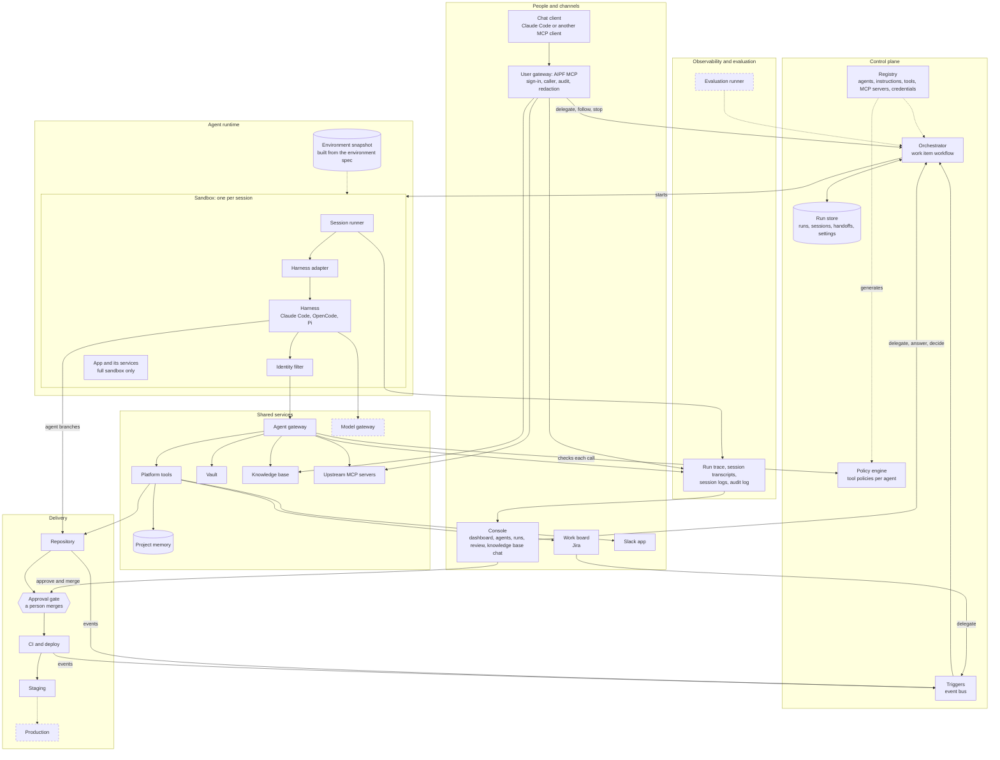

# AIPF: Architecture and Component Names

This document redraws the AI platform (AIPF) as a whole, gives each component one name and a statement of its role, and compares those names with the ones that cloud providers, model providers and development-tool vendors use for the same parts. It is for the engineers and architects who build and extend the AIPF. It builds on the components in [02](02-platform-components.md), the design in [05](05-system-design.md) and the POC in [06](06-poc-architecture.md).

Status: the names were decided on 2026-10-19 (section 5). The documents use them. The code, the AWS resources and the tool names keep the old names until their rename (section 8). The vendors' names come from their documentation, read on 2026-10-19; none of these products was tried here. A name found only in a secondary source is marked *(unverified)*.

## 1. Summary

- **Most of the AIPF's names already match the industry's.** Control plane, registry, orchestrator, sandbox, harness, vault and knowledge base are each the term that most vendors use for the same part. They stay.
- **Three names said something wrong, and were changed.**
  - **"Cloud Harness MCP" is not a harness.** In the AIPF, as at most vendors, the harness is the agent loop, such as Claude Code. The Cloud Harness MCP is the door through which people reach the platform from a chat client. Decided: **AIPF MCP**, the way GitHub, Devin and Atlassian name the MCP servers of their own products. In the architecture it is the **user gateway**.
  - **"Engine" and "harness" both name Claude Code, OpenCode and Pi.** Decided: **harness** everywhere, the term that Anthropic, AWS, OpenAI, LangChain and Cloudflare use.
  - **The console's Agents view is called "the control plane",** but the control plane is a whole layer: the registry, the policy engine, the orchestrator and the agents' settings. Decided: the **Agents view**, which is part of the control plane.
- **What kind of platform the AIPF is:** an agent platform for the software lifecycle, short **AIPF for SDLC**.
- **Some words mean different things at different vendors:** harness, runtime, gateway, control plane, environment, session and run, among others. The AIPF uses each in one sense only, and qualifies it wherever it could be read two ways (section 6).

| Layer | Components, by their recommended names |
|---|---|
| People and channels | Console, user gateway (AIPF MCP), Slack app, work board |
| Control plane | Triggers, orchestrator with the work item workflow, run store, registry, policy engine |
| Agent runtime | Sandbox, environment spec and snapshot, session runner, harness, harness adapter, identity filter |
| Shared services | Agent gateway, platform tools, upstream MCP servers, agent identity, vault, model gateway, knowledge base, project memory |
| Delivery | Repository, approval gate, CI and deploy, staging, production |
| Observability and evaluation | Run trace, session transcript, session log, audit log, dashboard, evaluation runner |

## 2. The architecture

Dashed boxes are in the full design ([05](05-system-design.md)) but not in the POC.

| Layer | Its job |
|---|---|
| People and channels | Where people delegate work, answer the agents' questions, decide at the gates and watch the runs |
| Control plane | What decides: which agents work on a work item, in which order, with which tools and under which policy |
| Agent runtime | Where agents work: one sandbox per session, with a harness inside it |
| Shared services | What agents and people use through the gateways: tools, credentials, knowledge, memory and models |
| Delivery | The way from an agent's branch to staging and production, through a person's approval |
| Observability and evaluation | What happened, what it cost and how good it was |

"Agent runtime" is the name of the layer. It is not Amazon Bedrock AgentCore Runtime, a product that the AIPF does not use; that product is always named in full.

One run goes through the layers in this order:

1. **A person delegates a work item** with a Jira label, in the console or from a chat client through AIPF MCP. The person stays accountable for it.
2. **A trigger starts the orchestrator's work item workflow.** One execution of the workflow is a run.
3. **For each stage, the orchestrator reads the agent's definition from the registry and starts a session:** a sandbox from the environment snapshot, under the agent's own IAM role.
4. **In the sandbox, the session runner prepares the workspace and starts the harness through its adapter.** The harness reaches the platform only through the agent gateway. The identity filter adds the agent's name to each call, and the policy engine checks every call.
5. **The agent's verdict and handoff go to the run store,** and the next stage starts.
6. **The developer agent's pull request waits at the approval gate.** A person approves and merges it in the console; CI deploys it to staging; the tester and operator agents check staging.
7. **Every step leaves a record:** the run trace, the session transcripts and logs, and the audit log. The console's dashboard and AIPF MCP read them.

## 3. Components

Each table gives a component's role, its recommended name, the other names in use with the vendors that use them, and what it is in the POC today.

### 3.1 People and channels

| Component | Role | Recommended name | Other names | In the POC |
|---|---|---|---|---|
| Console | The web page for people: the dashboard, the agents' settings, runs with their review and the person's decision, and a chat with the knowledge base | **Console** | "Mission control" (GitHub: its command centre to assign, steer and track agents; Factory: the view of one mission); "control plane" (Microsoft Foundry Control Plane, a management interface for an agent fleet); "dashboard" (one of its views); "portal" | `console/`, function `aipf-poc-console`, path `/console` ([06](06-poc-architecture.md), sections 18.4 and 20) |
| User gateway | One MCP endpoint that gives a person's chat client the platform: delegate a work item to the agents, follow its run, trace, sessions and logs, and stop it; also the knowledge base and the upstream MCP servers. It signs the person in, names them in every call, writes an audit line and redacts the results | **AIPF MCP** as the product's name; **user gateway** in the architecture | "_Product_ MCP Server" (GitHub MCP Server, with `assign_copilot_to_issue`, `create_pull_request_with_copilot` and `request_copilot_review`; Devin MCP, with `devin_session_create`, `_interact`, `_events`, `_search` and `_gather`; Atlassian Rovo MCP Server); "delegation" (Linear delegates an issue to an agent; GitHub "delegate tasks"); "MCP server portal" (Cloudflare); "managed deep agents MCP endpoint" (LangSmith); "Cloud Harness MCP" (the POC's name until 2026-10-19) | AgentCore gateway `aipf-poc-harness`, its function `aipf-poc-harness` (`console/harness.mjs`) and interceptor `aipf-poc-interceptor` (section 19) |
| Slack app | The agents ask people questions there, and the platform reports | **Slack app** | — | The existing Slack app on ECS; the tool `slack___ask_human` |
| Work board | Where work items live, each with the person accountable for it | **Work board**; its entries are **work items** (Jira's term) | "Issue" (Linear, GitHub); "ticket". Linear makes the agent a **delegate**, "not an assignee" | Jira Cloud |

**Why "AIPF MCP".** The vendors that let an outside chat client or IDE hand work to their cloud agents name the endpoint after the product, followed by "MCP" or "MCP Server": GitHub, Devin, Atlassian. The name says what the thing is and nothing wrong. "Delegation gateway" says its main job but leaves out following runs, the knowledge base and the upstream servers. "Mission control" is a user interface at GitHub and the view of one mission at Factory. The POC's "Cloud Harness MCP" came from the request that started it. It works as a feature name, but "harness" means the agent loop everywhere else in the AIPF, and "cloud" adds nothing (section 5.1).

### 3.2 Control plane

| Component | Role | Recommended name | Other names | In the POC |
|---|---|---|---|---|
| Triggers | Turn outside events into runs and steps: a Jira label, a pull request merged or closed, a build finished | **Triggers**, on an **event bus** | "Automations" (Cursor and Factory, for agents started by schedules or events); "Dispatch" (Datadog, which turns a signal into a bounded agent run); "webhooks" | EventBridge rules; the Jira webhook on the platform's HTTP API |
| Orchestrator | Runs the work item workflow: the stages in order, the gates, the waits for people and the retries. It is deterministic code, not an agent, and it decides from facts (the repository, the run store) rather than from an agent's word | **Orchestrator**, running the **work item workflow**; one execution is a **run** | "Workflows" (Microsoft Agent Framework, with executors, edges, human-in-the-loop and checkpoints; Google ADK graph workflows with human input and action confirmations); "InvokeHarness state in AWS Step Functions" (AWS); "Missions" (Factory: a plan in milestones, run by an orchestrator agent with workers and gates); "coordinator" (Devin's coordinator session, Anthropic's multiagent sessions: an agent that delegates to other agents, unlike the AIPF's orchestrator); "pipeline" (taken by CI and deploy) | State machine `aipf-poc-work-item` (`orchestrator/workflow.asl.json`) and function `aipf-poc-orchestrator` (`functions/orchestrator.mjs`) |
| Run store | The state of every run: its sessions, verdicts, handoffs and questions, and the agents' settings | **Run store** | "Session state" (OpenAI Agents API); "Sessions" (Google Agent Platform, for conversation state); "threads" (LangSmith) | DynamoDB table `aipf-poc` |
| Registry | The platform's configuration as code: agent definitions, their instructions, tools, MCP servers, the description of each credential, and the user gateway's tools. Every other part reads it | **Registry**; its entries are **agent definitions**, **tools**, **MCP servers** and **credentials** | "Agent Registry" (AWS, with records that are drafted, approved and deprecated; Google, with Agent, McpServer, Endpoint and Skill entries); "MCP Registry" (the official MCP project, GitHub, Kong); "catalog" (Backstage Software Catalog, Docker MCP Catalog, Kong's Konnect Catalog: a view to browse); "agent profiles" (GitHub, `.github/agents/`); "custom droids" (Factory, `.factory/droids/`) | `registry/`: `agents.json`, `roles/*.md`, `tools.json`, `mcp-servers.json`, `vault.json`, `harness-tools.json` |
| Policy engine | Decides each tool call: may this agent call this tool with these arguments. Its policies are generated from the registry and enforced at the agent gateway | **Policy engine**, holding **tool policies** | "Policy in AgentCore", with policy engines in Cedar (AWS); "permission policies" `always_allow`, `always_ask` and `auto` (Anthropic); IAM policies on Google's Agent Gateway; "guardrails" (OpenAI Agents SDK, Microsoft: mostly checks of content and safety) | AgentCore Policy in ENFORCE mode; Cedar policies written by `infra/policies.mjs` |

**Registry or catalog.** "Registry" is where definitions are kept and governed; "catalog" is the page that lists them. AWS and Google keep their registries as approved records. The AIPF's registry is files reviewed in its repository, the way GitHub and Factory keep agent definitions.

**Policy, not guardrails.** Most vendors use "guardrails" for checks of what goes into and comes out of a model. Whether an agent may call a tool is a policy.

### 3.3 Agent runtime

| Component | Role | Recommended name | Other names | In the POC |
|---|---|---|---|---|
| Sandbox | Isolated compute for one session, removed when the session ends. A full sandbox holds the harness, the app and its services; a light one holds the harness only | **Sandbox**, full or light | "Sandbox" is used by Google, Microsoft, E2B, Daytona, Modal, Vercel and Cloudflare; "environment" (Anthropic and OpenAI, for the sandbox's configuration); "isolated VM" or "microVM" (Cursor, AWS); "ephemeral cloud development environment" (GitHub); "Droid Computers" (Factory, persistent); "isolated workspace" (Codex) | One ECS Fargate task per session, on one of two task definitions |
| Environment spec and snapshot | What the repository says its sandbox needs, and the image built from it | **Environment spec**, built into an **environment snapshot** | Blueprint, then build, then snapshot (Devin); `.cursor/environment.json` and a saved snapshot (Cursor); template (E2B); snapshot (Daytona); image (Modal); `copilot-setup-steps.yml` (GitHub) | `.aipf/environment.yaml` in the repository; `harness/snapshot.Dockerfile`, built by CodeBuild into ECR |
| Session runner | The program in the sandbox that prepares the workspace, starts the harness through its adapter, connects it to the agent gateway, and records the transcript and the measures after redacting them | **Session runner** | "Executor" (OpenAI: runs the tools that the hosted harness asks for); "worker" (Anthropic's self-hosted sandbox, Devin); "runner" (GitHub Actions, for a machine) | `harness/runner/session.mjs` |
| Harness | The agent loop: model calls, tool calls, context management. The AIPF adopts harnesses as they are | **Harness** | "Agent harness" (Anthropic, AWS, LangChain: "Agent = Model + Harness", Cloudflare); "managed Codex harness" (OpenAI); "agent CLI" (a plain description); "engine" (the POC's console, `run_start` and `infra/aipf.sh engines`); "runtime" (Cloudflare and LangChain use it for the durable infrastructure under the harness) | Claude Code by default; OpenCode and Pi with the project owner's approval |
| Harness adapter and harness image | The adapter wraps one harness behind the AIPF's contract: how to start it, give it the prompt and the MCP configuration, and read its output and transcript. The image holds the harness and its adapter | **Harness adapter**; **harness image** ([05](05-system-design.md) calls an image with its settings a harness profile) | "Driver", "plugin" | `harness/runner/adapters/`: `claude-code.mjs`, `opencode.mjs`, `pi.mjs`; `harness/Dockerfile` |
| Identity filter | Sits between the harness and the agent gateway: adds the agent's name to each call, and hides that argument from the agent. A convenience; the policy engine is the control | **Identity filter** | — | `harness/runner/mcp-identity.mjs` |

**Harness, and nothing else.** The AIPF uses "harness" for the agent loop only. That is why the user gateway should not carry the word (section 3.1), and why the evaluation runner is not an "evaluation harness", as EleutherAI's lm-evaluation-harness would suggest (section 3.6).

### 3.4 Shared services

The tool gateway of [02](02-platform-components.md) has two instances, because their callers sign in differently and may do different things: the **agent gateway** takes IAM-signed calls from the sandboxes and checks each against the agent's policy; the **user gateway** (section 3.1) takes OAuth tokens from people's chat clients.

| Component | Role | Recommended name | Other names | In the POC |
|---|---|---|---|---|
| Agent gateway | The one door from the sandboxes to the platform's tools: MCP, signed with the agent's IAM role, every call checked by the policy engine | **Agent gateway**, an instance of the **tool gateway** | "MCP gateway" (Docker, LiteLLM; Kong's "MCP Traffic Gateway"); "Gateway" with targets (AWS AgentCore); "Agent Gateway" (Google: agent traffic in and out under IAM); "Toolbox" (Microsoft Foundry: one managed MCP endpoint); "MCP server portals" (Cloudflare, formerly "Agents Gateway"); "AI MCP Proxy" (Kong) | AgentCore gateway `aipf-poc` |
| Platform tools | The platform's own tools for agents: the work item, pull requests, project memory, asking a person, staging operations, and calls with a vault credential | **Platform tools**; each group is a **target** | "Gateway targets", "connectors", "integrations" (AWS); "custom tools" (Anthropic); "function tools" (OpenAI) | Function `aipf-poc-tools` (`functions/tools.mjs`); targets `jira`, `codecommit`, `memory`, `slack`, `ops`, `vault`; `registry/tools.json` |
| Upstream MCP servers | Other MCP servers, listed once and offered through both gateways | **Upstream MCP servers** | "Aggregation mode", a "unified virtual MCP server" (AWS); "MCP toolset" (Anthropic); "MCP hub" (Port); "MCP Toolkit" (Docker) | `registry/mcp-servers.json`; the first is `awsknowledge` |
| Agent identity | Who the agent is, in every call and every comment: its own IAM role, its name checked against that role, its output signed | **Agent identity** | "Workload identity" and "agent access token" (AWS); "Agent Identity", based on SPIFFE (Google); "Microsoft Entra Agent ID" with agent identity blueprints and sponsors (Microsoft) | IAM roles `aipf-poc-<agent>`; the Cedar check; comments signed `[AIPF <Agent> agent]` |
| Vault | Holds the credentials that agents use but never see. The platform makes the call and adds the credential on the way | **Vault**; the pattern is **credential brokering** | "Token vault" and "resource credential provider" (AWS); "vaults", with a placeholder substituted at egress (Anthropic); "auth manager", a "centralized credentials vault and authentication broker" (Google); "credential injection" (Microsoft Foundry Toolbox); "credential brokering" (Vercel Sandbox); "network secrets" (Codex); "virtual keys" (LiteLLM, for model keys); "secrets" (Cursor, Devin, Modal: environment variables inside the sandbox, which is what the AIPF avoids) | AgentCore Identity: workload identity `aipf-poc-vault` and one credential provider per credential; the tool `vault___fetch` (`functions/vault.mjs`); `registry/vault.json` |
| Model gateway | One door to the models: providers, budgets, pinned versions, routing and logs | **Model gateway** | "AI Gateway" (Cloudflare, Vercel, Kong, LiteLLM, Port; Azure API Management): the market's name; "LLM gateway" (Anthropic, in the Claude Code documentation); "model router" (Microsoft, a routing feature); "inference targets" (AgentCore Gateway) | Not in the POC: Claude Code calls Anthropic on the subscription; Pi and the knowledge base chat call Bedrock directly |
| Knowledge base | The organisation's documents for retrieval: Confluence and SharePoint | **Knowledge base** | Bedrock Knowledge Bases (AWS); RAG Engine (Google); Foundry IQ, a "managed knowledge layer" (Microsoft) | Bedrock knowledge base; target `kb`, tool `kb___Retrieve` |
| Project memory | What the agents learn about one project, versioned; agents propose changes | **Project memory** | AgentCore Memory, short- and long-term (AWS); Memory Bank (Google); memory stores, versioned (Anthropic) | Versioned S3 bucket; tools `memory___read` and `memory___propose` |

**Model gateway, not AI gateway.** "AI gateway" is the market's name, but the AI gateways of Kong and LiteLLM now carry MCP traffic as well. "Model gateway" says which traffic passes, and pairs with "tool gateway".

**How the AIPF's vault differs.** Anthropic's vaults put a placeholder in the sandbox and swap in the real value in an egress proxy. The AIPF's vault makes the call itself, through `vault___fetch`, and takes the value out of the response. Both are credential brokering; neither lets the value into the sandbox.

### 3.5 Delivery

| Component | Role | Recommended name | Other names | In the POC |
|---|---|---|---|---|
| Repository | The project's code, at the AI-ready level of [03](03-ai-ready-repo.md). Agents push only to their own branches | **Repository** | — | A CodeCommit sample repository; agents push to `agent/*` only |
| Approval gate | Where a person decides: approve and merge, or close | **Approval gate** | "Gates" for QA, security, code review and deployment (Factory); "approval rules" (CodeCommit); plan approval, `approvePlan` (Jules); "human-in-the-loop" (Microsoft Agent Framework); "action confirmations" (Google ADK) | Approval rule template `aipf-poc-human-approval`; Approve and merge in the console |
| CI and deploy | Tests each commit; deploys main to staging after a merge | **CI** and **deploy** | "Pipeline" | CodeBuild |
| Staging | A deployment like production with synthetic data, where the tester agent does user acceptance testing | **Staging** | — | One ECS service with its database ([06](06-poc-architecture.md), section 17) |
| Production | The customer's live system | **Production** | — | Not in the POC |

### 3.6 Observability and evaluation

| Component | Role | Recommended name | Other names | In the POC |
|---|---|---|---|---|
| Run trace | The workflow's steps in order: start, duration, result, failure, and the step the run waits on | **Run trace** | "Trace" and "run" (LangSmith, where a run is one span); OpenTelemetry GenAI spans `invoke_agent` and `execute_tool` | Step Functions history; the tool `run_trace` |
| Session transcript | Everything an agent did in one session, redacted | **Session transcript** | "Events" (Anthropic); "Agent Activity" (Linear); "session logs" (GitHub) | S3, `transcripts/<run>/<agent>-<attempt>/` |
| Session log | The sandbox's container log | **Session log** | — | Log group `/aipf-poc/sessions` |
| Audit log | One line per call through the user gateway: who, which tool, the names of the arguments | **Audit log** | "Agent session audit events" (GitHub) | The interceptor's and the user gateway function's log lines |
| Dashboard | Runs, what waits for a person, and per agent its sessions, refusals, verdicts and cost | **Dashboard**, a view of the console | "Copilot metrics dashboard" (GitHub) | The console's Dashboard view |
| Evaluation runner | Runs a fixed set of work items on each harness, model and instruction version, and compares them | **Evaluation runner** | "Evaluations" and "Optimization" (AWS AgentCore); "outcomes", with a grader and a rubric (Anthropic); "graders" (OpenAI); "online evaluators" (LangSmith); "lm-evaluation-harness" (EleutherAI) | Not built ([05](05-system-design.md), section 10.3) |

When the AIPF exports traces, it should use the OpenTelemetry GenAI span names, such as `invoke_agent` and `execute_tool`. Their status is still "Development".

## 4. Terms of the work

| Term | Meaning in the AIPF | The same word elsewhere |
|---|---|---|
| Work item | One entry on the work board; what a person delegates | "Issue" (Linear, GitHub) |
| Delegate | A person hands a work item to the agents and stays accountable for it | Linear: an agent is a delegate, not an assignee |
| Run | One execution of the work item workflow, from delegation to done or to a person | Cursor's API: one prompt turn; LangSmith: one span; Factory: a mission; Codex and Copilot: a task |
| Stage | A step of the software lifecycle: plan, design, build, review, test, operate | — |
| Agent | A definition in the registry: perspective, tools, verdicts, sandbox and model | Cursor's API: a conversation; GitHub: a profile file; Factory: a droid |
| Instructions | An agent's prompt, kept in `registry/roles/<id>.md` | "System prompt" (Anthropic's agent definition); "playbook" (Devin) |
| Session | One attempt of one agent in one sandbox, such as `developer#2` | Anthropic, Devin, Jules and Linear's Agent Session: one task; AWS: one microVM; Google's Sessions: conversation state |
| Verdict | The word an agent ends with: `ready`, `approve`, `changes`, `pass`, `fail`, `healthy` and so on | Anthropic's outcomes: `satisfied`, `needs_revision` |
| Handoff | An agent's reply, kept for the agents of the next stages | OpenAI Agents SDK and Microsoft Agent Framework: passing control to another agent |
| Gate | A point where the workflow waits for a person | Factory's gates |

"Role" is avoided for agents, because it means an IAM role. The directory `registry/roles/` keeps its name until a rename (section 8).

## 5. Names decided

The other components have one clear name. These had more than one candidate. The names in bold were decided on 2026-10-19; the other options stay here as the record of what was weighed.

### 5.1 The people's MCP endpoint: AIPF MCP

| Option | For | Against |
|---|---|---|
| **AIPF MCP** | The pattern of GitHub MCP Server, Devin MCP and Atlassian Rovo MCP Server; short; says nothing wrong; the server becomes `aipf` in a chat client | Says what it is, not what it does |
| AIPF Delegate, or delegation gateway | Says the main job, in Linear's and GitHub's word | It also follows runs, and carries the knowledge base and the upstream servers |
| AIPF Mission Control | GitHub's term for directing agents | A user interface at GitHub, one mission's view at Factory; this is not a user interface |
| Cloud Harness MCP | Known to the team | "Harness" is the agent loop; "cloud" adds nothing |

### 5.2 Claude Code, OpenCode and Pi: harness

| Option | For | Against |
|---|---|---|
| **Harness** | Anthropic, AWS, OpenAI, LangChain and Cloudflare use it for the agent loop; it matches "harness adapter" and "harness image" | Less plain to people who are not engineers |
| Engine | Plain; the console, `run_start` and the project's rules use it today | No vendor uses it for this; AWS has "policy engines", and Google's Agent Runtime calls its resource `ReasoningEngine` |
| Agent CLI | Exact for these three | Wrong when a harness is a library or a hosted loop |

### 5.3 The layer where agents work: agent runtime

| Option | For | Against |
|---|---|---|
| **Agent runtime** | The team's own word; Google's and Microsoft's Agent Runtime mean the same layer | AWS AgentCore Runtime is a product the AIPF does not use, so it is always named in full |
| Data plane | Pairs with "control plane", as at LangSmith, Kong and Google's Interactions API | Often read as "where the data is stored" |
| Execution layer | Plain | No vendor uses it |

### 5.4 The two gateways: agent gateway and user gateway

| Option | For | Against |
|---|---|---|
| **Agent gateway and user gateway** | Says whose calls pass; both are tool gateways | — |
| Agent gateway and harness gateway (today) | Known to the team | "Harness" again |
| Inner and outer gateway | Short | Says nothing about the callers |

### 5.5 The platform's category: agent platform for the software lifecycle

The AIPF keeps its own name. What kind of thing it is: an **agent platform for the software lifecycle**, short **AIPF for SDLC**. The options weighed:

| Option | For | Against |
|---|---|---|
| **Agent platform for the software lifecycle** | "Agent platform" is the term of AWS, Google and Microsoft | Generic without the qualifier |
| Software factory | Factory and Port use it | Factory's product name |
| Agentic SDLC platform | Port uses it | Jargon |
| Agent HQ | GitHub uses it | GitHub's product name |

## 6. Words that mean different things

| Word | What it means at the vendors | How the AIPF uses it |
|---|---|---|
| Harness | AWS: the managed loop, which runs inside Runtime. Anthropic: the loop that powers Claude Code, and Managed Agents as a whole. LangChain: everything that is not the model. OpenAI: the hosted Codex loop; "harness engineering" is designing the agents' environment. EleutherAI and testing: an evaluation or test harness | The agent loop only: Claude Code, OpenCode, Pi |
| Runtime | AgentCore Runtime hosts the customer's own loop; Google's and Microsoft's Agent Runtime are hosting products; Cloudflare and LangChain: the durable infrastructure under the harness | "Agent runtime" is the layer; AgentCore Runtime is named in full |
| Gateway | AWS: tools, agents and models, with MCP aggregation. Google: agent traffic in and out under IAM. Azure: AI gateway features of API Management. Anthropic: an LLM gateway that the customer supplies. Cloudflare renamed its gateway to "portals" | Always qualified: agent, user, tool or model gateway |
| Control plane | AWS and Google: one half of an API. Microsoft: Foundry Control Plane, a product. GitHub: enterprise governance of agents. LangSmith and Kong: deployment management, paired with a data plane | The layer that decides; never one page |
| Environment | Anthropic and OpenAI: a sandbox's configuration. Codex: a published, reusable setup. GitHub: a scope for secrets. Elsewhere: dev, staging, production | "Environment spec" and "environment snapshot" for sandboxes; deployments by name: staging, production |
| Registry | AWS and Google: governed catalogs. Microsoft has three: the Foundry Control Plane registry, the Entra Agent Registry and the API Center MCP registry. MCP project: public metadata. GitHub: an allowlist URL | The files under `registry/` |
| Session, run, thread | Section 4 | Session: one agent's attempt; run: one work item's workflow |
| Agent | Cursor's API: a conversation. GitHub: a profile file. Factory: a sub-agent, a droid | A definition in the registry |
| Worker, orchestrator, runner | Devin: a worker is a machine, the orchestrator is provisioning software. Factory: both are agents. GitHub Actions: a runner is a machine | The orchestrator is the deterministic workflow; the session runner is the program in the sandbox |
| Snapshot | A boot image (Devin, Cursor, Daytona); a filesystem snapshot (Modal) | The built environment image |
| Automation | Agents started by triggers (Cursor, Factory); rules on traces (LangSmith) | Not used; say "trigger" |
| Mission control | GitHub: all agents; Factory: one mission | Not used |
| Vault | Anthropic: per end user. AWS: the token vault, per agent and user pair. Google: the auth manager. Microsoft: Key Vault | The platform's credential broker, used through `vault___fetch` |
| Handoff | OpenAI and Microsoft: passing control to another agent | An agent's reply passed to the next stages |
| Guardrails | Mostly checks on a model's input and output | Not used for tool permission; that is a policy |
| Agent Space | AWS DevOps Agent only: its unit of isolation | Not used |

## 7. Naming conventions

1. **One concept, one name,** in the documents, the code, the AWS resources, the console and the tool names.
2. **Keep a name that is in use and not wrong.** For a new part, take the term that most vendors use (section 3), and define it once.
3. **Name a part by its role, then say what implements it:** "the agent gateway, an AgentCore Gateway"; "the orchestrator, a Step Functions state machine".
4. **Qualify the words of section 6.** Never a bare "gateway", "environment" or "runtime".
5. **AWS resources:** `aipf-<deployment>-<component>`, with `poc` as the deployment today: `aipf-poc-console`, `aipf-poc-work-item`.
6. **Tool names:** AgentCore Gateway writes `<target>___<tool>`. The user gateway's own tools put the noun first, so that a list groups them: `run_start`, `run_get`, `run_trace`, `run_stop`. Tools that mirror an outside API keep its words: `jira___get_issue`.
7. **Agents sign what they write:** `[AIPF <Agent> agent]`; the workflow writes as `[AIPF platform]`.
8. **Code directories follow the components:** `console/`, `orchestrator/`, `functions/`, `harness/`, `registry/`, `infra/`.

## 8. From the old names to the decided ones

The documents were changed on 2026-10-19. The code, the AWS resources and the tool names still use the old names; this is what their rename touches.

| Old | New | Where | What the change involves |
|---|---|---|---|
| "Cloud Harness MCP" | AIPF MCP, the user gateway | [05](05-system-design.md) section 8.1; [06](06-poc-architecture.md) section 19; comments in `console/`, `infra/` and the POC's README | Done in the documents on 2026-10-19; the code's comments change with the rows below |
| Gateway `aipf-poc-harness` | `aipf-poc-user-gw` | `infra/stack.yaml`, `infra/aipf.sh` | A new gateway with a new address; every chat client connects again |
| Function `aipf-poc-harness`, `console/harness.mjs` | `aipf-poc-platform`, `console/platform.mjs` | `infra/stack.yaml`, `infra/aipf.sh`, the console's imports | Redeploy |
| Target `harness`, tools `harness___*` | Target `platform`, tools `platform___*` | `registry/harness-tools.json`, the interceptor, `harness/test/` | Chat clients see the new tool names |
| `registry/harness-tools.json` and its copy in `console/` | `registry/platform-tools.json` | `infra/aipf.sh deploy` | — |
| Claude Code server `aipf-harness` | `aipf` | `infra/aipf.sh harness connect` | Each person runs connect again |
| `infra/aipf.sh harness login`, `connect`, `status`, `logout` | `infra/aipf.sh mcp ...` | `infra/aipf.sh`, the POC's README, [06](06-poc-architecture.md) | — |
| `infra/harness-token.mjs`, `~/.aipf/harness-token.json` | `infra/mcp-token.mjs`, `~/.aipf/mcp-token.json` | `infra/aipf.sh` | Each person signs in again |
| Cognito app clients `aipf-poc-harness-cli`, `aipf-poc-harness-claude` | `aipf-poc-mcp-cli`, `aipf-poc-mcp-claude` | `infra/stack.yaml` | New client IDs |
| "Engine": the console, `run_start`'s `engine`, `PLATFORM/engines`, `infra/aipf.sh engines allow` | "Harness" | `console/`, `functions/`, `infra/aipf.sh`, `registry/harness-tools.json` | Done in the documents' text on 2026-10-19, where it names the concept; the argument `engine`, `PLATFORM/engines` and the command keep the old name until the code changes. The project's rules speak of the "agent engine"; their wording is the project owner's to change |
| The Agents view called "the control plane" | The Agents view, part of the control plane | [06](06-poc-architecture.md) section 18.4, the console's text | Done in the documents on 2026-10-19; the console's text changes with the code |
| Gateway `aipf-poc` | `aipf-poc-agent-gw` (optional) | `infra/stack.yaml`, the policy engine, the harness image's MCP configuration | A new gateway and a new address in every sandbox; worth it only if the gateway is rebuilt anyway |
| `registry/roles/*.md` | `registry/instructions/*.md` (optional) | The session runner, the console, the orchestrator | — |
| `registry/tools.json` | `registry/agent-tools.json` (optional) | `infra/policies.mjs`, `infra/aipf.sh`, the console | — |

The names that stay: control plane, registry, orchestrator, work item workflow, run, session, run store, sandbox (full and light), environment spec and snapshot, session runner, harness adapter, identity filter, agent gateway, platform tools, upstream MCP servers, agent identity, vault, model gateway, knowledge base, project memory, console, dashboard, approval gate, staging.

**Order.**

1. The documents first: text only. Done on 2026-10-19.
2. Then every name of the user gateway in one change, so that people connect and sign in again once.
3. The agent gateway and the registry files only when they are rebuilt for another reason.

## 9. Sources

Read on 2026-10-19. The sources of [04](04-reference-platforms.md), section 8, are not repeated here.

AWS:

- Amazon Bedrock AgentCore: [overview](https://docs.aws.amazon.com/bedrock-agentcore/latest/devguide/what-is-bedrock-agentcore.html), [endpoints, control and data plane](https://docs.aws.amazon.com/general/latest/gr/bedrock_agentcore.html), [Harness](https://docs.aws.amazon.com/bedrock-agentcore/latest/devguide/harness.html), [Harness and Runtime](https://docs.aws.amazon.com/bedrock-agentcore/latest/devguide/harness-vs-runtime.html), [Gateway](https://docs.aws.amazon.com/bedrock-agentcore/latest/devguide/gateway.html), [Gateway concepts](https://docs.aws.amazon.com/bedrock-agentcore/latest/devguide/gateway-core-concepts.md), [Identity terms](https://docs.aws.amazon.com/bedrock-agentcore/latest/devguide/identity-terminology.html), [Policy](https://docs.aws.amazon.com/bedrock-agentcore/latest/devguide/policy.html), [Agent Registry](https://docs.aws.amazon.com/bedrock-agentcore/latest/devguide/registry.html)
- [AWS DevOps Agent Spaces](https://docs.aws.amazon.com/devopsagent/latest/userguide/about-aws-devops-agent-what-are-devops-agent-spaces.html); [Kiro autonomous agent](https://kiro.dev/docs/autonomous-agent/)

Google:

- Gemini Enterprise Agent Platform: [overview](https://docs.cloud.google.com/gemini-enterprise-agent-platform/overview), [Managed Agents](https://docs.cloud.google.com/gemini-enterprise-agent-platform/build/managed-agents), [Agent Runtime](https://docs.cloud.google.com/gemini-enterprise-agent-platform/build/runtime), [sandbox](https://docs.cloud.google.com/gemini-enterprise-agent-platform/scale/sandbox), [Agent Gateway](https://docs.cloud.google.com/gemini-enterprise-agent-platform/govern/gateways/agent-gateway-overview), [Agent Registry](https://docs.cloud.google.com/gemini-enterprise-agent-platform/govern/agent-registry), [Agent Registry overview](https://docs.cloud.google.com/agent-registry/overview)
- [Managed Agents quickstart (Gemini API)](https://ai.google.dev/gemini-api/docs/managed-agents-quickstart), [Agent Identity](https://docs.cloud.google.com/iam/docs/agent-identity-overview), [auth manager](https://docs.cloud.google.com/iam/docs/auth-manager-overview), [ADK](https://adk.dev/)
- Jules: [API](https://developers.google.com/jules/api), [CLI reference](https://jules.google/docs/cli/reference/)

Microsoft:

- Foundry: [Agent Service](https://learn.microsoft.com/en-us/azure/foundry/agents/overview), [Control Plane](https://learn.microsoft.com/en-us/azure/foundry/control-plane/overview), [runtime components](https://learn.microsoft.com/en-us/azure/foundry/agents/concepts/runtime-components), [hosted agents](https://learn.microsoft.com/en-us/azure/foundry/agents/concepts/hosted-agents), [Toolbox](https://learn.microsoft.com/en-us/azure/foundry/agents/concepts/toolbox-overview), [Foundry IQ](https://learn.microsoft.com/en-us/azure/foundry/agents/concepts/what-is-foundry-iq), [model router](https://learn.microsoft.com/en-us/azure/foundry/openai/concepts/model-router)
- [API Management AI gateway](https://learn.microsoft.com/en-us/azure/api-management/genai-gateway-capabilities), [API Center MCP registry](https://learn.microsoft.com/en-us/azure/api-center/register-discover-mcp-server), [Agent Framework workflows](https://learn.microsoft.com/en-us/agent-framework/workflows/overview), [Entra agent identities](https://learn.microsoft.com/en-us/entra/agent-id/what-are-agent-identities)
- Agent 365: [the control plane for AI agents](https://www.microsoft.com/en-us/microsoft-365/blog/2025/11/18/microsoft-agent-365-the-control-plane-for-ai-agents/), [product page](https://www.microsoft.com/en-us/microsoft-agent-365)

Anthropic:

- Claude Managed Agents: [overview](https://platform.claude.com/docs/en/managed-agents/overview), [outcomes](https://platform.claude.com/docs/en/managed-agents/define-outcomes), [vaults](https://platform.claude.com/docs/en/managed-agents/vaults), [permission policies](https://platform.claude.com/docs/en/managed-agents/permission-policies), [memory](https://platform.claude.com/docs/en/managed-agents/memory)
- [Agent SDK](https://code.claude.com/docs/en/agent-sdk/overview), [Claude Code on the web](https://code.claude.com/docs/en/claude-code-on-the-web)
- Engineering: [effective harnesses for long-running agents](https://www.anthropic.com/engineering/effective-harnesses-for-long-running-agents), [harness design for long-running apps](https://www.anthropic.com/engineering/harness-design-long-running-apps)

OpenAI:

- Agents API: [architecture](https://developers.openai.com/api/docs/guides/agents-api/architecture), [overview](https://developers.openai.com/api/docs/guides/agents-api/overview); [Agents SDK](https://developers.openai.com/api/docs/guides/agents/sdk); [graders](https://developers.openai.com/api/docs/guides/graders); [harness engineering](https://openai.com/index/harness-engineering/)
- Codex: [cloud environments](https://learn.chatgpt.com/docs/environments/cloud-environments), [older cloud environment](https://learn.chatgpt.com/docs/environments/cloud-environment)
- Secondary: [Help Net Security on the Agents SDK harness and sandbox](https://helpnetsecurity.com/2026/04/16/openai-agents-sdk-harness-and-sandbox-update/) (the vendor's page could not be read)

GitHub:

- [Copilot cloud agent](https://docs.github.com/en/copilot/concepts/agents/coding-agent/about-coding-agent), [custom agents](https://docs.github.com/en/copilot/concepts/agents/coding-agent/about-custom-agents), [cloud agent and MCP](https://docs.github.com/en/copilot/how-tos/use-copilot-agents/cloud-agent/extend-cloud-agent-with-mcp), [using the cloud agent from MCP](https://docs.github.com/en/copilot/how-tos/use-copilot-agents/cloud-agent/use-cloud-agent-with-mcp)
- [Agent HQ](https://github.blog/news-insights/company-news/welcome-home-agents/), [agent control plane](https://github.blog/changelog/2026-02-26-enterprise-ai-controls-agent-control-plane-now-generally-available/), [GitHub MCP Server](https://github.com/github/github-mcp-server), [delegating tasks from the MCP server](https://github.blog/changelog/2025-07-09-delegate-tasks-to-copilot-coding-agent-from-the-github-mcp-server/), [agentic workflows (gh-aw)](https://pkg.go.dev/github.com/githubnext/gh-aw)

Development-tool vendors:

- Devin: [Devin MCP](https://docs.devin.ai/work-with-devin/devin-mcp), [managed Devins](https://docs.devin.ai/work-with-devin/advanced-capabilities.md), [blueprints](https://docs.devin.ai/onboard-devin/environment/blueprints), [Outposts](https://docs.devin.ai/cloud/outposts/overview.md), [playbooks](https://docs.devin.ai/product-guides/creating-playbooks.md), [Cognition](https://cognition.com/)
- Factory: [home](https://factory.com/), [Software Factory](https://docs.factory.com/software-factory/overview), [Missions](https://docs.factory.com/missions/overview), [Droid Computers](https://docs.factory.com/droid-computers/overview), [droids](https://docs.factory.com/user-guides/droids/understanding-droids), [harness and subagents](https://docs.factory.ai/harness/subagents)
- Cursor: [cloud agent](https://cursor.com/docs/cloud-agent), [API endpoints](https://cursor.com/docs/cloud-agent/api/endpoints), [automations](https://cursor.com/docs/cloud-agent/automations)
- Linear: [agents in Linear](https://linear.app/docs/agents-in-linear), [agents for developers](https://linear.app/developers/agents), [coding environments](https://linear.app/changelog/2026-08-20-coding-environments)
- Atlassian: [Rovo MCP Server](https://developer.atlassian.com/cloud/rovo-mcp/), [Rovo agents](https://support.atlassian.com/studio/docs/create-and-edit-rovo-agents/), [Rovo Dev](https://www.atlassian.com/software/rovo-dev)
- Port: [home](https://www.port.io/), [external agents](https://docs.port.io/agent-management/external-agents/cursor-cloud-agents/); [Backstage AI](https://backstage.io/docs/ai/); [Datadog golden paths for AI agents](https://www.datadoghq.com/blog/golden-paths-for-ai-agents/); [Asana AI Teammates](https://asana.com/press/releases/pr/asana-announces-new-ai-teammates-collaborative-agents-that-deliver-results)
- LangChain: [products and concepts](https://docs.langchain.com/oss/python/concepts/products), [the anatomy of an agent harness](https://www.langchain.com/blog/the-anatomy-of-an-agent-harness), [Deep Agents](https://docs.langchain.com/oss/python/deepagents/overview), [LangSmith platform](https://www.langchain.com/langsmith-platform), [deployment](https://docs.langchain.com/langsmith/deployment), [observability concepts](https://docs.langchain.com/langsmith/observability-concepts), [online evaluations](https://docs.langchain.com/langsmith/online-evaluations), [Fleet](https://docs.langchain.com/langsmith/fleet), [managed deep agents](https://docs.langchain.com/langsmith/python/managed-deep-agents-overview)

Gateways, sandboxes and standards:

- Cloudflare: [AI Gateway](https://developers.cloudflare.com/ai-gateway/), [MCP server portals](https://developers.cloudflare.com/cloudflare-one/access-controls/ai-controls/mcp-portals/), [portals generally available](https://developers.cloudflare.com/changelog/post/2026-09-24-mcp-portals-ga/), [Sandbox](https://developers.cloudflare.com/sandbox/), [Agents](https://developers.cloudflare.com/agents/), [agents platform](https://blog.cloudflare.com/agents-platform-flue-sdk/), [Project Think](https://blog.cloudflare.com/project-think/)
- Kong: [AI Gateway](https://developer.konghq.com/ai-gateway/), [AI MCP Proxy](https://developer.konghq.com/plugins/ai-mcp-proxy/), [MCP](https://developer.konghq.com/mcp/), [MCP Registry](https://konghq.com/blog/product-releases/kong-mcp-registry-tech-preview), [AI Summit 2026](https://konghq.com/blog/news/ai-summit-2026-launch-recap)
- Docker: [MCP Catalog and Toolkit](https://docs.docker.com/ai/mcp-catalog-and-toolkit/), [MCP Gateway](https://docs.docker.com/ai/mcp-catalog-and-toolkit/mcp-gateway/)
- Vercel: [AI Gateway](https://vercel.com/docs/ai-gateway), [Sandbox](https://vercel.com/docs/vercel-sandbox), [credential brokering](https://vercel.com/changelog/safely-inject-credentials-in-http-headers-with-vercel-sandbox); [LiteLLM](https://docs.litellm.ai/docs/simple_proxy)
- Sandboxes: [E2B](https://docs.e2b.dev/), [Daytona](https://www.daytona.io/docs/en/), [Modal](https://modal.com/docs/guide/sandboxes)
- Standards: [MCP Registry](https://modelcontextprotocol.io/registry/about), [OpenTelemetry GenAI agent spans](https://opentelemetry.io/docs/specs/semconv/gen-ai/gen-ai-agent-spans), [GenAI semantic conventions](https://github.com/open-telemetry/semantic-conventions-genai), [lm-evaluation-harness](https://github.com/EleutherAI/lm-evaluation-harness)
