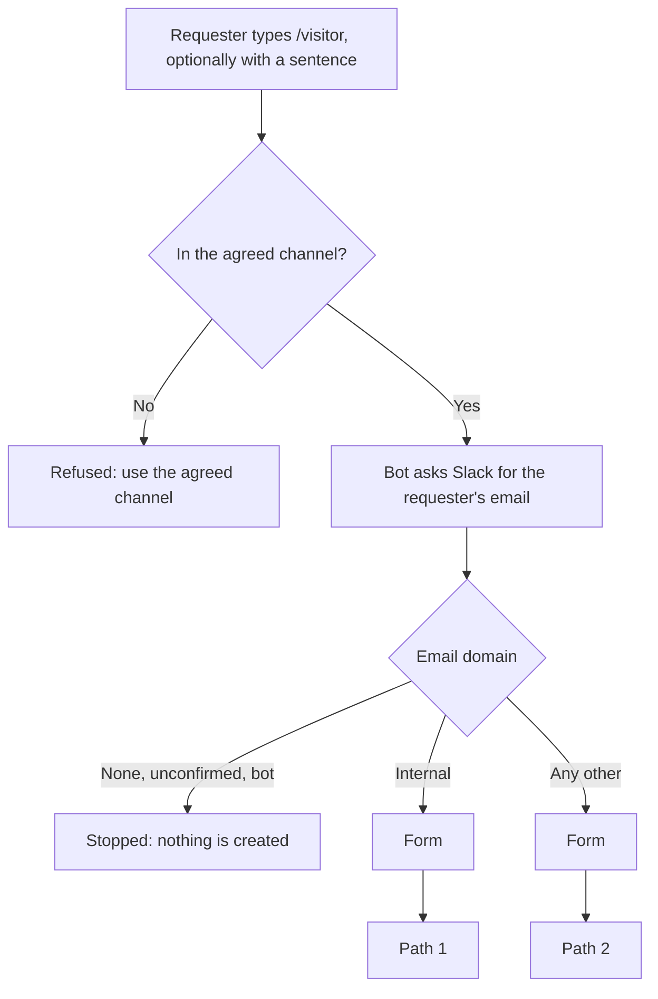
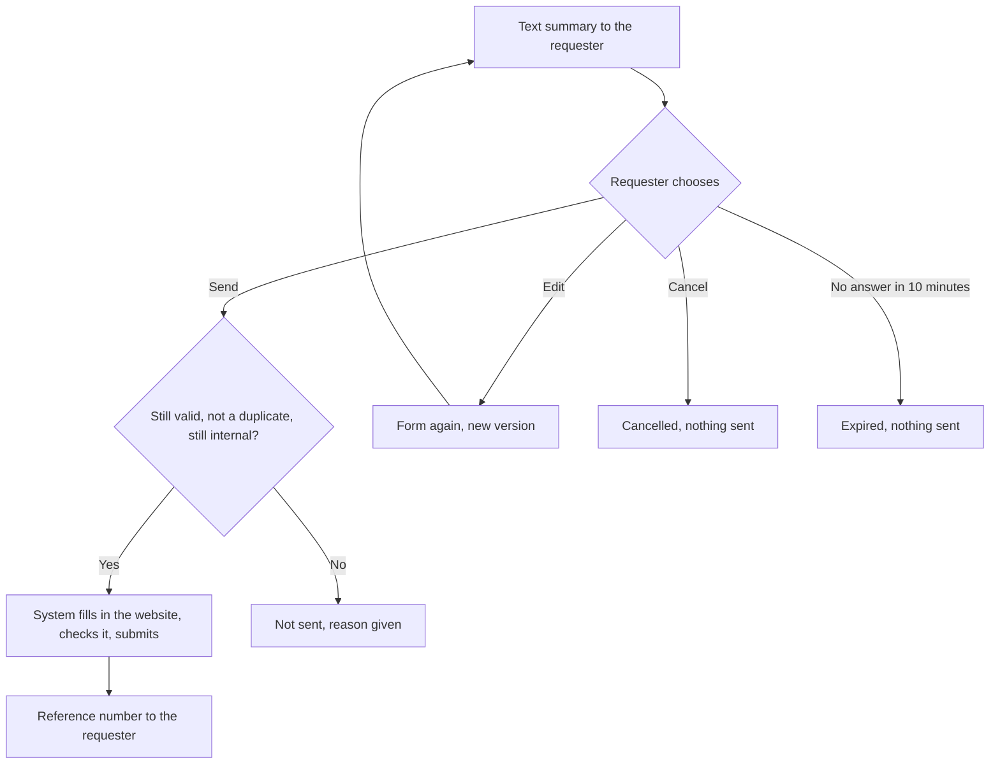
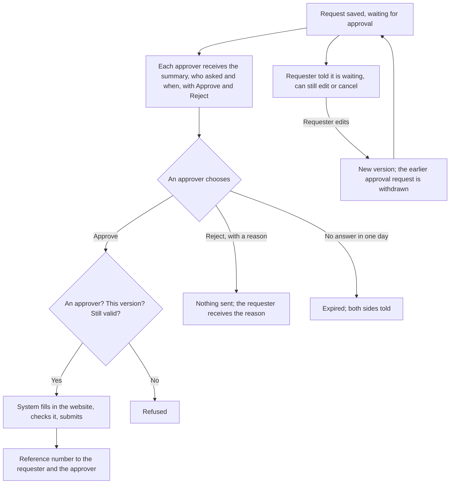

# PoC 1: Slack Automation Platform, Concept

This document is for decision makers. It describes what PoC 1 automates, how people use it, what has been proven and what has not, what it costs, and what must be decided and granted before a pilot. It has no code. The engineering detail is in [engineering.md](engineering.md).

Names are generic: "the internal domain" stands for the organisation's email domain, the target web application is a simulated visitor registration website, and all chat, issues and documents used in the tests were invented.

## 1. Summary

| | |
|---|---|
| **What it is** | One Slack app and one program behind it, connecting Slack to systems people otherwise work in by hand: a web application with no API, Jira, Confluence and SharePoint. An LLM does the reading and writing in between. It never takes an action by itself |
| **Use case 1: web form automation** | A person describes a request in Slack. The system fills in a web application's form and submits it, but only after a final check by a person. Staff on the internal email domain do that check themselves. Anyone else needs a named approver |
| **Use case 2: daily report** | Each day the system reads a project's Slack channels and its Jira issues. An LLM writes the status report, which also points out where the chat and Jira disagree |
| **Use case 3: knowledge base chatbot** | A support agent asks a question in Slack and gets a short answer from Confluence and SharePoint content, with links to the sources. AI assistants in engineers' code editors can search the same knowledge |
| **Status** | All three ran end to end against real Slack, Jira Cloud, Confluence Cloud and SharePoint Online, filled with invented data. Use cases 1 and 2 also ran on AWS. Nothing has run on real data, with real users or against a real target web application. Nothing is deployed now; the environment can be rebuilt with one command |
| **Running cost** | About 39 USD a month for use cases 1 and 2 together, or about 82 USD when the web application only accepts a registered IP address. Use case 3 adds about 2 USD at test size, and about 75 USD with 10 GB of documents and 20,000 questions a month |
| **Main blockers** | A real target web application whose owner agrees to automated use. The Slack administrator's approval of the app's permissions. A decision on which data may be sent to an LLM. A cloud environment in which Amazon Bedrock can be used |

## 2. Principles common to all three

| Principle | What it means for the user |
|---|---|
| A person decides every irreversible step | Nothing is submitted to a web application until a person has agreed to exactly what will be sent |
| The LLM only suggests or writes text | It pre-fills a form, writes a report or drafts an answer. Code decides what happens next. Text inside a message, an issue or a document is treated as content, never as an instruction |
| Facts that need counting are computed, not guessed | Whether an issue is overdue, or whether the chat mentions it, is worked out by rule before the LLM sees the data |
| Data stays in the organisation's cloud | With the LLM on Amazon Bedrock, requests, chat and documents do not leave the AWS account |
| Personal details stay out of channels | Request details go by direct message. Reports go to one fixed channel, and the person who asked receives only a link |
| Read-only where possible | The system never writes to Jira, Confluence or SharePoint |
| Nothing is open to the internet | The program opens its own connection to Slack, so nothing can connect into it |

## 3. Use case 1: web form automation

### 3.1 The problem

Staff repeat the same entry work in web applications that can only be used through their screens: registering a visitor, booking a resource, filing a request. The information fits in one sentence. The work is typing it into many fields over several screens. Some of these applications only accept connections from IP addresses registered in advance.

| It fits when | It does not fit when |
|---|---|
| The steps are the same every time | The volume comes in large batches |
| The application has no usable API | An API exists. Use it |
| Its owner allows automated use through a dedicated account, and will register one IP address | Its terms forbid automated use |
| Someone will maintain the automation when the screens change | Every sign-in asks for a CAPTCHA or a one-time code |

Alternatives that were considered: an API from the application's owner is best wherever one can be had. A commercial RPA product brings a licence and a platform to run for a single task. An LLM operating the browser by itself is slower, costs more and does not behave the same way twice.

### 3.2 The rules

| Rule | What it means |
|---|---|
| One way in | A request starts only with the command `/visitor`, typed in the one agreed channel. Anywhere else, the bot refuses |
| The email decides the path | The bot asks Slack for the requester's email. Internal domain: path 1. Any other domain: path 2 |
| When in doubt, stop | If there is no email, the email is unconfirmed, or the account is a bot or deactivated, no form opens and nothing is created |
| The email is not kept | It is read to choose the path and then dropped. It is never stored, logged or shown |
| Nothing is sent directly | A request reaches the web application only after a final **Send** (path 1) or an **Approve** (path 2) |
| Text, not screenshots | The person checks a text summary of the request |
| Approvers are named | Managing the Slack app does not make someone an approver. Approvers are listed in the system's settings |
| A record of each request | Request number, version, requester, who decided, time, final state, result, and the reason for a rejection. Never the email |

### 3.3 User flows

The first steps are the same for everyone:

The form opens at once. If the requester wrote a sentence, for example "Mr Tanaka from Acme, tomorrow at 2 pm, head office, floor 12", the LLM fills in the fields one to three seconds later, and the requester checks and corrects each one. The form's rules are checked before anything is sent. A rule only the website can check, such as a registration that overlaps an existing one, comes back as the website's own message. The channel receives only a short note that the request was received. Everything else goes by direct message.

**Path 1: staff on the internal domain.**

**Path 2: anyone else in the workspace.**

The first approver to decide settles the request. The other approvers' messages are updated.

**What the person agrees to and what is submitted.** The person agrees to a text summary. Only then does the system open the website, sign in with its dedicated account, fill in the form and reach the confirmation screen. It reads that screen back and compares every field with the agreed summary. If anything differs, it stops and nothing is submitted. If the website rejects a value, its own message is passed on word for word. If sign-in meets a CAPTCHA or a one-time code, the system stops and says a person is needed. From Send or Approve to the reference number takes about two seconds on the simulated website.

## 4. Use case 2: daily report

### 4.1 The problem

A project lead writes the daily report by reading the day's messages and checking the task board. It takes time every day, and it misses what no single person sees: the chat says a piece of work is finished while Jira still shows it in progress, or an issue passes its due date and nobody mentions it.

| It fits when | It does not fit when |
|---|---|
| The working talk happens in a few Slack channels | Decisions are made in direct messages, calls and meetings |
| Work is tracked in Jira Cloud | The tracker is Jira Server, Data Center or another product |
| People write the issue key when they talk about an issue | Issues are referred to by description only |
| Someone reads the draft before relying on it | The report must be right without a check |

### 4.2 User flow

| Step | What happens |
|---|---|
| 1. Start | A project member types `/daily-report`, for today or an earlier date. Or a daily timer starts it at a set time |
| 2. Read | The day's messages in the configured channels, with thread replies and names, and the project's open and recently updated Jira issues, up to 100 |
| 3. Mark | By rule: issues that are overdue, and issues whose key nobody mentioned. A day with no messages and no issues gives a one-line report without calling the LLM |
| 4. Write | The LLM writes eight sections, always in the same order: summary, done today, in progress, blockers and risks, decisions, open questions, Jira check, next steps |
| 5. Post | The report goes to one fixed channel, with a header saying an LLM wrote it and that it should be checked. Mentions of people become plain text, so nobody is notified. The person who asked receives a link |
| If Jira fails | The report is written from the chat alone, and the header says why |
| If Slack or the LLM fails | Nothing is posted, and the person who asked is told why. A scheduled run does not retry |

**The Jira check** reports four things: overdue issues; issues the chat calls finished while Jira does not; issues the chat calls blocked or slipping; and open issues due within three days that nobody mentioned.

**What the report cannot see:** direct messages, calls, meetings and channels the bot was not invited to; an issue discussed without its key; thread replies to a message from an earlier day; the contents of attached files; more than 100 issues; Jira as it was on a past day; a day when the system was stopped at the scheduled time.

## 5. Use case 3: knowledge base chatbot

### 5.1 The problem

Support knowledge is spread across wiki pages, Word and Excel files, PDF reports and slide decks in two systems. Finding one fact means knowing where to look and opening several documents.

| It fits when | It does not fit when |
|---|---|
| The knowledge is written down in Confluence Cloud and SharePoint Online | It lives in people's heads, in chat history or in tickets |
| Every user of the bot may read all the indexed content | Different users may see different documents, and that must be enforced |
| The person asking can open the source and check it | The answer goes straight to a customer |
| An answer up to a day old is good enough | The content changes by the hour |

### 5.2 User flow

| Step | What happens |
|---|---|
| Keeping it current | Once a day, a managed AWS service copies what changed in the chosen Confluence spaces and SharePoint sites into a searchable knowledge base. The originals stay where they are and are never changed |
| 1. Ask | The agent types `/ask`, mentions the bot in a channel, or sends it a direct message |
| 2. Guard | A question over 600 characters is refused. A seventh question from the same person within a minute is refused. A message delivered twice is answered once |
| 3. Search | The eight best passages are found, each with the address of its page or file |
| 4. Answer | The LLM writes a short answer from those passages only, in the language of the question, numbering each fact by its source, and says so when the passages do not hold the answer |
| 5. Reply | The answer and a numbered list of links. `/ask` is answered privately, a mention in a thread, a direct message in the conversation |
| For engineers | The AI assistant in a code editor, such as Claude Code or Kiro, searches the same knowledge base under the engineer's own cloud identity |

Each question is answered on its own, without memory of earlier ones. Pictures, diagrams, audio and video are not indexed.

## 6. What has been proven

| Use case | Proven | Not proven |
|---|---|---|
| Web form automation | In the real Slack workspace, against the simulated website, with the LLM on Amazon Bedrock. Path 1: Send submitted, Edit made a new version, Cancel sent nothing. Path 2: Approve submitted, Reject with a reason sent nothing, an edit while waiting needed a new approval. Three submissions, none twice, no email in the record. Earlier runs on AWS confirmed the fixed outbound IP address and the refusal of a duplicate. Automated tests cover a press by the wrong person, two presses at the same moment, expiry and the wrong channel | Requester and approver as two different people (one account played both). A guest account. A real web application, single sign-on or a CAPTCHA. The two paths running on AWS. Recovery after a restart |
| Daily report | On a real Slack channel and Jira project with 25 messages and 17 issues, each built as one situation: 8 caught, 3 missed, 3 not assessed, 2 correctly left out, and a planted instruction not obeyed. On AWS, a report on request and one scheduled report were posted | A real project. The schedule over several days. The three missed situations (work under way that Jira shows as not started, work finished without a word, work with no owner) are outside what the Jira check asks for |
| Knowledge base chatbot | 137 Confluence documents and 97 SharePoint files indexed with no failure. The expected fact was among the passages found for 28 of 28 test questions, including questions without Vietnamese accents and English questions about Vietnamese documents. Five live questions in Slack were answered correctly, with the right links, in 2.6 to 4.3 seconds | Real content and real agents. The engineers' editor access, the daily schedule and slide decks were not run. Text from Vietnamese Word and PDF files loses about half of its correctly spelt words, so garbled words appear in some answers. Converting those files before indexing brings this to 96 to 100% |

**The LLM.** The model used on Amazon Bedrock (GLM 4.7 Flash) works but is not yet good enough for the form pre-fill: it passed 7 of 10 test sentences, against 10 of 10 for a small model from an outside provider. The errors were one date a day off, a missed floor and a guessed building. The person checks the form, so none of them can reach the website unseen. The model should be chosen on quality with the test set; price is not the issue (section 7).

## 7. Cost

AWS list prices in one Region (Asia Pacific, Sydney), October 2026, USD per month, before tax and discounts.

| Situation | USD per month |
|---|---|
| Use cases 1 and 2, running all month, fixed outbound IP address | about 82 |
| The same without a fixed IP address | about 39 |
| Stopped, network and address kept | about 47 |
| Removed, only the stored image and secret kept | about 0.5 |
| Use case 3, cloud side, at test size (4 MB, 1,000 questions) | about 2 |
| Use case 3 with 10 GB of documents and 20,000 questions | about 75 |
| Use case 2 by itself, in a container sized for it | about 13 (estimated, not built) |

- The cost of use cases 1 and 2 is fixed: an always-on container and the network. It does not grow with the number of requests.
- The fixed IP address is more than half of the 82 USD. Only a web application that restricts access by address needs it.
- The LLM is negligible: about 0.05 USD for 500 form requests and 22 reports a month. A model forty times the price would cost about 2 USD.
- Use case 3 grows with two numbers the organisation controls: how much content is indexed and how many questions are asked. Nothing in it bills by the hour.
- Not in these figures: the Slack, Atlassian and Microsoft 365 plans; a dedicated Atlassian account if it counts as a paid user; and people: writing and maintaining the browser script for each real web application, checking reports and answers during a pilot, and owning the content.

## 8. Decisions needed

| # | Decision | Why it matters | Proposal |
|---|---|---|---|
| 1 | Which real web application comes first | Use case 1 has only run against a simulated one | One application whose owner agrees, with a test environment |
| 2 | Who the outside requesters of use case 1 are | People from another organisation in a shared Slack channel cannot run the command at all. Path 2 reaches only people with an account in this workspace, such as guests | Confirm they have accounts here. If not, they need another way in |
| 3 | Whether guests always take path 2 | Slack does not document whether guests can run the command or whether their email is returned | Test with one guest. Guests take path 2 whatever their domain |
| 4 | Whether the email domain is trusted enough | An administrator can change a member's email. Slack does not promise it for access decisions | Enough for a pilot. For real use, add a list of named internal users who may send directly |
| 5 | The internal domains, the approvers, the agreed channel and the approval time | Subdomains count only if listed. A request lost by an absent approver expires | Exact list of domains, at least two named approvers, one channel, one day |
| 6 | What may be sent to an LLM | The form sentence can hold a visitor's name and phone number. The report sends a day of project chat. The chatbot sends questions and document passages | Amazon Bedrock only, so nothing leaves the AWS account |
| 7 | Which Confluence spaces and SharePoint sites are indexed | Every user of the bot can find every indexed document. Carrying over document permissions is possible but was not built, and it must be chosen when a source is first connected | Only content that all users of the bot may read |
| 8 | Whether to run use case 3 in the cloud | Its Slack side has run only from a laptop | Add it to the same container as use cases 1 and 2 |

## 9. What must be granted

Most of the time between a decision and a pilot is spent waiting for these. They can be requested in parallel; the longest waits are first.

| # | What | From whom | For |
|---|---|---|---|
| 1 | Use of Amazon Bedrock for the chosen model in the chosen Region. In some accounts only AWS Support can unlock Bedrock | Cloud team, AWS | All |
| 2 | Written agreement to automated use, a dedicated account exempt from CAPTCHA and one-time codes, and one IP address added to the allowed list | Owner of the web application | 1 |
| 3 | A decision on what text may go to which LLM (section 8, item 6) | Data owner, security | All |
| 4 | An AWS account or sandbox where the team may build a small network, a container service, secrets, logs, service roles and the knowledge base | Cloud or platform team | All |
| 5 | Approval of the custom Slack app and its permissions. The two a security review will look at are reading channel history (use case 2) and reading members' email addresses (use case 1) | Slack workspace administrator | All |
| 6 | The bot invited to the report's channels and to the agreed request channel | Owners of those channels | 1, 2 |
| 7 | A dedicated Atlassian account that can only read the reported Jira project and the chosen Confluence spaces, with its API token | Jira and Confluence administrator | 2, 3 |
| 8 | An application in Microsoft Entra ID with read access to the chosen SharePoint sites only, and administrator consent | Entra ID administrator | 3 |
| 9 | A second Slack account and a guest account for the last tests of use case 1 | Slack workspace administrator | 1 |
| 10 | Named people: an owner of the deployment and its credentials, an owner of the browser script, a project lead who compares reports with their own, a support lead who checks answers, an owner of the knowledge base content | Leadership | All |

Not needed: any permission to write to Jira, Confluence or SharePoint, any person's password, or any opening from the internet into the organisation's network.

## 10. Risks

| Risk | Effect | Answer |
|---|---|---|
| The web application changes its screens | The system stops filling in the form | The read-back turns a changed screen into a clear error, not a wrong submission. Someone must own the upkeep |
| The terms of the web application forbid automation | Legal exposure, a locked account | Written agreement first |
| The system restarts while requests wait | Waiting requests are lost; their buttons answer "not known" and nothing is submitted | Acceptable for a pilot. Before real use, keep waiting requests in a database |
| A report or an answer is wrong and someone relies on it | A wrong picture of a project, or a wrong statement to a customer | A notice in each report, numbered source links in each answer, and a pilot in which a person checks a sample |
| A restricted document is indexed | Every user of the bot can find it | Index only open content (section 8, item 7) |
| An Atlassian token or the SharePoint certificate reaches too far | Access to other projects, spaces or sites | Dedicated accounts with read access to named projects, spaces and sites only, and a rotation date |
| The app reads channel history and members' emails | Broader access than most apps have | It reads only channels it is invited to, posts reports to one channel, and reads only the requester's email, never stored |
| Quality changes with the model or the prompt | Results change between versions | The fixed test sets, rerun on every change |

## 11. Before real use

PoC 1 is not a production system. Before it serves more than a pilot group it needs:

- waiting requests and the request record kept in a database, not in memory and a 7-day log;
- the settings of section 8 in the cloud environment, and use case 3 in the same container;
- a Bedrock model that passes the whole test set, or prompts tuned for the model chosen;
- a report schedule that runs outside the program and catches up on a missed day;
- monitoring, with an alert when a request, a report or a knowledge base sync fails;
- deployment through a reviewed pipeline, and a rotation schedule for every credential.

## 12. Next steps

1. Answer the decisions in section 8 and send the requests in section 9.
2. Repeat the use case 1 test with a second person as approver, and with a guest; then run it once on AWS.
3. Convert Vietnamese Word and PDF files before indexing, and stop listing a source when the answer is "not in the knowledge base".
4. Pilot each use case with one team for one to two weeks, with a named person checking the results.
