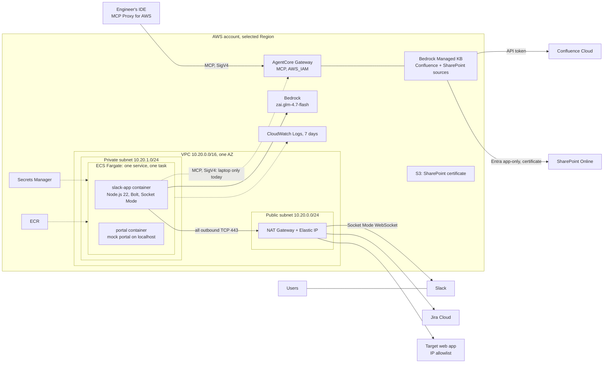

# PoC 1: Slack Automation Platform, Engineering

This document is for the engineer who runs, deploys or changes PoC 1. It holds what the code does not say, or says only across many files: the architecture and the reasons for it, the Slack, AWS and Atlassian settings, the configuration, how to deploy and remove the environment, the behaviour of outside services that the design depends on, measurements, and known gaps. What the system does for its users is in [concept.md](concept.md).

Names in angle brackets, such as `<region>`, are yours to fill in. Nothing in the repository refers to a particular AWS account, Slack workspace, Atlassian site or Microsoft tenant.

## 1. State

| Part | State |
|---|---|
| Web form automation, two paths by email domain | Built, 67 tests pass. Run against the real Slack workspace from a laptop with the mock portal and Bedrock. Not run on AWS: the template does not pass its settings yet (section 10) |
| Daily report | Built. Run from a laptop and on AWS against a real Slack channel and Jira Cloud project |
| Knowledge base chatbot | Built. Knowledge base, connectors and gateway run on AWS with `infra/kb.sh`; the Slack side run from a laptop. Not in the ECS template |
| AWS environment | Nothing deployed. `infra/poc.sh up` and `infra/kb.sh up` rebuild it |
| Real target web app, Jira writes, document permissions | Not built |

## 2. Architecture

### 2.1 Runtime



- **One Node.js process serves all three use cases.** It reaches Slack through Socket Mode, an outbound WebSocket, so nothing listens for inbound traffic. Every other call is outbound HTTPS.
- **At run time the application calls only Bedrock and the gateway.** ECS pulls the image, injects the secrets and ships the logs. The same code runs unchanged on a laptop.
- **No load balancer, API Gateway, Lambda, queue or database.** Socket Mode removes the inbound side, and state is held in memory.

### 2.2 Decisions and the reasons for them

| Decision | Reason |
|---|---|
| Exactly one task (`DesiredCount` 1, `MinimumHealthyPercent` 0, `MaximumPercent` 100) | Slack spreads the events of one app token across every open connection. Two tasks would each see part of a conversation, and a button press could reach the task that does not hold the request. ECS stops the old task before it starts the new one |
| One AZ, one NAT Gateway, one Elastic IP | The task count is one. A second AZ adds a second NAT and a second IP to register with the web app's owner, without real added availability |
| The fixed outbound IP | Only the target web app checks the caller's IP. Slack, Jira and Bedrock do not. Profile `public` drops the NAT for about 43 USD less a month |
| Fargate 1 vCPU, 2 GB, ARM64 | Sized for one Chromium. The image is built for `linux/arm64`. Without the browser, 0.25 vCPU and 0.5 GB would probably do; not measured |
| Mock portal as a second container on `localhost` | The whole flow can be verified on AWS before a real web app is involved |
| Secrets as environment variables at task start | Only the execution role can read the secret, and the code reads plain environment variables. A changed secret needs a new task (`up`) |
| No VPC endpoints | Each one bills hourly and costs more than the NAT traffic it would save at this size |
| Task role: `bedrock:InvokeModel` on one model only | The application calls no other AWS API in the deployed use cases |
| Bedrock with the task role, not an API key | Nothing to store or rotate, and text stays inside the AWS account |
| Managed Knowledge Base rather than a self-run vector store or Dify | Nothing to operate or bill hourly. Native Confluence and SharePoint connectors, a free managed reranker, and an MCP door without code through AgentCore Gateway. Dify needs a public address for Slack, its logo must stay visible to users, it cannot serve several organisations without its maker's agreement, and a self-hosted copy has to be patched and backed up |
| Bedrock Agents Classic not used | It accepts no new customers from 2026-07-30. AgentCore is the successor |
| Text summary instead of a screenshot in the web form flow | The browser is opened only after the decision. No Chromium is held open while a person decides, which can take a day on path 2. The confirmation screen is still read back and compared before submit |
| Email domain read from `users.info` | It is the only identity signal Slack gives an app without SSO integration. It is read for the requester only and never kept |

### 2.3 Where each use case lives

| Use case | Slack entry | Logic | Outside systems |
|---|---|---|---|
| Web form | `src/slack/slack-handlers.js`, `registration-modal.js`, `user-classifier.js` | `src/core/request-flow.js` (states, versions, who may decide), `registration-service.js` (validation, duplicates), `registration-fields.js` (field definitions; the Slack form and the LLM prompt follow from it) | `src/worker/portal-browser-session.js` (Playwright), `src/mock-portal/` |
| Daily report | `src/slack/slack-handlers.js` | `src/report/daily-report-service.js` | `src/report/slack-channel-history.js`, `jira-issues.js` |
| Knowledge base | `src/slack/kb-handlers.js` | `src/kb/answer-question.js` | `src/kb/gateway-mcp-client.js` |
| Shared | `src/slack/start-slack-app.js` builds whatever is configured | `src/config.js` is the only reader of environment variables | `src/llm/configured-chat.js` picks the LLM provider |

Each use case switches on through its configuration. If one is not configured, its command says so and the process still starts.

## 3. Slack app

### 3.1 Settings

The app is created from `slack-app-manifest.yaml`: Socket Mode on, interactivity on, no request URLs, no token rotation.

| Item | Where |
|---|---|
| `SLACK_APP_TOKEN` (`xapp-…`) | Basic Information → App-Level Tokens, scope `connections:write` |
| `SLACK_BOT_TOKEN` (`xoxb-…`) | Issued on Install App |
| Channel IDs for `ALLOWED_CHANNELS`, `REPORT_CHANNELS`, `REPORT_POST_CHANNEL` | Channel details, at the bottom. IDs, not names |
| User IDs for `APPROVER_USER_IDS` | Profile → ⋮ → Copy member ID |

Run one process per app token, and use a separate Slack app for each environment (laptop, AWS). Any change to scopes, commands or events requires the app to be reinstalled, which may need administrator approval again.

### 3.2 Scopes

| Scope | Needed by | Note |
|---|---|---|
| `commands`, `chat:write` | All | |
| `im:write` | Web form | Opens the DM for summaries, approvals and results |
| `users:read.email` | Web form | Classification. Also needs `users:read` |
| `channels:history`, `groups:history`, `channels:read`, `groups:read`, `users:read` | Daily report | Reads only channels the bot was invited to |
| `app_mentions:read`, `im:history` | Knowledge base | Events `app_mention` and `message.im` |
| `files:write` | Nothing | Left over from the screenshot flow. Remove it |
| `chat:write.customize` | Test data only | `npm run seed` posts under invented names. Remove it outside a trial |

The global shortcut `register_visitor` does not open the form. It points the user to `/visitor`, so the command remains the only way in.

### 3.3 Slack behaviour the design relies on

| Behaviour | Consequence |
|---|---|
| A modal must open within 3 seconds of the command (`trigger_id`) | The form opens first. `users.info` (median 0.30 s, slowest 0.72 s over 10 calls) runs before it. The LLM pre-fill runs after it and updates the open view |
| Without `users:read.email`, `users.info` returns `ok: true` with no `email` field | A missing scope is not an error. The classifier treats it as "unknown" and nothing is created |
| `is_email_confirmed: false` is possible after a member changes their email | Treated as unknown |
| Email addresses hidden from members are still returned to apps | Classification works in workspaces that hide emails. Not tested |
| Slack Connect users cannot invoke the app's slash commands | Path 2 cannot reach people of another organisation in a shared channel |
| Whether guests can run slash commands, and whether their email is returned, is undocumented | The classifier reports `guest` (`is_restricted` or `is_ultra_restricted`) but nothing acts on it yet. Test with a real guest |
| A `response_url` works 5 times within 30 minutes | Summaries, approvals and results go by DM (`conversations.open` + `chat.postMessage`). The channel gets only one ephemeral acknowledgement |
| Every interaction payload names the user who pressed the button | Who may press which button is checked on each press |
| Slack has no setting that limits a command to one channel | The app checks `channel_id` against `ALLOWED_CHANNELS` |
| Socket Mode apps cannot be listed in the Slack Marketplace | No effect on an internal app |
| `conversations.join` needs `channels:join`, which the app does not have | The bot must be invited to each channel |

## 4. Web form automation

### 4.1 Classification

| Input from `users.info` | Result |
|---|---|
| Call fails, user deleted, bot or app user | `unknown` |
| No email, or not confirmed | `unknown` |
| Domain in `INTERNAL_EMAIL_DOMAINS` (exact, case-insensitive) | `internal`: path 1 |
| Any other domain | `external`: path 2 |

The match is exact on the whole domain. `sub.corp.example` and `corp.example.evil` do not match `corp.example`, so list every subdomain that counts. If `INTERNAL_EMAIL_DOMAINS` is empty, nobody is classified and everyone takes path 1. In that mode the app does not need `users:read.email`. The class is read again on Send: a requester who has stopped being internal is refused.

### 4.2 Request states

| State | Entered when | Who may act |
|---|---|---|
| `awaiting_confirmation` | Path 1 form sent | The requester: Send, Edit, Cancel. Expires after `APPROVAL_TTL_SECONDS` (600) |
| `awaiting_approval` | Path 2 form sent | An approver: Approve, Reject with a reason. The requester: Edit, Cancel. Expires after `EXTERNAL_APPROVAL_TTL_SECONDS` (86,400) |
| `submitting` | Send or Approve accepted | Nobody. The state is set synchronously, before any `await`, so a second press, by the same person or another approver, is refused |
| `submitted`, `failed`, `cancelled`, `rejected`, `expired` | Final | Nobody |

- Every button carries `requestId:version`. An edit creates a new version and withdraws the earlier approval message. A press on an old version is refused.
- The first approver's decision counts, and the other approvers' messages are updated.
- Duplicates are detected from a key of the requester and the registration's values. The same request is refused while one is waiting, and after submission with the earlier reference number.
- The browser runs only from `submitting`. It calls `fillToConfirmation`, compares every field on the confirmation screen with the agreed values, and calls `submit` only if they match. Measured on the mock portal: 1.5 to 2 seconds from the press to the reference number.
- Each state change writes one log line: request ID, version, requester, deciding user, state, reference and reason. The events are `request_created`, `request_edited`, `request_submitting`, `request_submitted`, `request_failed`, `request_cancelled`, `request_rejected` and `request_expired`, plus `user_unclassified` and `request_not_created`. A test checks that no email appears in the log.

### 4.3 Switching to a real web app

Rewrite three parts and keep the rest:

1. **The fields**, in `src/core/registration-fields.js`: types, allowed values, rules. The Slack form and the LLM prompt follow from them.
2. **The browser worker**, in `src/worker/`. Keep the boundary: one function goes as far as the confirmation screen and returns what it shows; a separate one does the irreversible step. If the site has no confirmation screen, stop before the last button and read back the filled fields.
3. **The command name and wording**, in `src/slack/` and the manifest.

On the AWS side, put the real account in `PORTAL_USERNAME` and `PORTAL_PASSWORD`. In `infra/platform.yaml`, remove the `portal` container and the `DependsOn` of `slack-app`, and set `PORTAL_BASE_URL`. Deploy with the mock portal first, confirm the outbound IP (section 9.2), register it with the owner, and only then switch.

Rules for the browser script:

- Select by what a user sees (label, role, button name), not by CSS classes.
- Wait for page state, not for fixed delays.
- Always read back.
- Run a scheduled test request that stops before submit.

## 5. Daily report

| Aspect | Detail |
|---|---|
| Time window | Local midnight to midnight in `TZ`. For today, it ends at the moment of the request. `TZ` is UTC in a container unless set |
| Chat | `conversations.history` and `conversations.replies` of each `REPORT_CHANNELS` channel. Join and leave notices and the bot's own reports are skipped. Capped at 120,000 characters |
| Jira | `POST /rest/api/3/search/jql`, HTTP Basic with email and API token, paged with `nextPageToken`, up to 100 issues. Default query: the project's open issues plus those updated in the last day. `JIRA_JQL` overrides it |
| Flags computed in code | Overdue (due before the report date and not done). Not mentioned (key absent from the day's chat) |
| LLM | One call. Priority is read from Jira but not passed to the LLM |
| Schedule | A timer in the process (`REPORT_TIME`). A task stopped at that minute posts nothing, and nothing catches up. The AWS-native form would be an EventBridge Scheduler rule that runs a one-off task with `node scripts/run-daily-report.js --post`. Not built |
| Past dates | Jira is read as it is now, not as it was on that day |

Test data: `npm run seed -- <channel ID> --post` posts 25 messages, and `npm run seed:jira -- --post` creates 17 issues labelled `daily-report-seed`, each one a case (catalogue in `test/fixtures/jira-seed-issues.js`). Without `--post` both only print. Due dates are relative to the day of seeding, so the issues go stale after a day. No script removes them; delete them by label. Use a scratch project and a test channel.

The three cases the report missed in the seeded test (103, 108, 113) are outside the four checks the prompt asks for. Extend the prompt to cover them before a pilot.

## 6. Knowledge base chatbot

### 6.1 What `infra/kb.sh` creates

`infra/kb.sh up | sync | status | ask "<question>" | cert | mcp-config | down`. Each resource is named `<app>-kb…`. `up` can be repeated, and it skips a source whose settings are missing, so sources can be added one at a time.

| Resource | Setting that matters |
|---|---|
| Managed Knowledge Base | All defaults: managed embedding, chunking and parsing (section 6.3) |
| Data source `confluence` | Basic auth. The secret `<app>-kb-confluence` holds the email and API token. Spaces from `CONFLUENCE_SPACE_KEYS` |
| Data source `sharepoint` | Entra ID app-only with a certificate. The `.p12` file is in a private, encrypted S3 bucket. The secret `<app>-kb-sharepoint` holds its password and the client ID |
| Both data sources | `aclEnabled: false`. This cannot be changed on an existing data source: carrying over document permissions means connecting the source again |
| KB role | Reads the two secrets and the certificate object, nothing else |
| AgentCore Gateway, target `managed-kb` | Inbound authorisation `AWS_IAM`. Tools `managed-kb___Retrieve` and `managed-kb___AgenticRetrieveStream`. The bot uses Retrieve only |
| Gateway role | Searches this one knowledge base |
| Sync | `KB_SYNC=daily` (the default) at a time AWS chooses, or `manual` |

`down` deletes everything the script created. The Entra app and the local certificate in `infra/kb-cert/` are yours to remove.

### 6.2 SharePoint access

1. `infra/kb.sh cert` creates a self-signed certificate in `infra/kb-cert/` (ignored by git).
2. In Entra ID, register a single-tenant application with no redirect URI.
3. Add **application** permissions and grant admin consent:
   - On a real tenant: `Sites.Selected` on Microsoft Graph and on SharePoint, then grant read access per site.
   - On a throwaway test tenant only: `Sites.Read.All`.
4. Upload `certificate.cer`. The `.p12` file and the private key never leave your machine and your AWS account.
5. Put `SHAREPOINT_TENANT_ID`, `SHAREPOINT_CLIENT_ID` and `SHAREPOINT_SITE_URLS` in `infra/local.env`.

This needs a Microsoft 365 work tenant, not a personal account.

### 6.3 Managed Knowledge Base: limits as tested

Tested in ap-southeast-2 on 2026-10-14. The service was announced in June 2026, and these limits may change.

| Area | What the service does |
|---|---|
| Storage | Managed only. No storage configuration is accepted, S3 Vectors included |
| Embedding | The managed model, or a custom one: Titan V2 at 1,024 dimensions with float32 only, or Cohere Embed Multilingual v3 with no dimensions setting. It cannot be changed after the knowledge base is created. Cohere Embed v4 is offered in Sydney only through a cross-Region profile, which is not allowed in this project |
| Chunking | With the managed model, none may be set: 300 tokens with 20% overlap. With a custom model: fixed size of 200 to 8,192 tokens, or none. Semantic and hierarchical chunking are rejected. It cannot be changed on an existing data source |
| Parsing | Managed only, with no options. A Lambda transformation is accepted and stored, but never runs, with no error |
| Search | Always hybrid. Only the number of results (1 to 100), a metadata filter and a reranker can be set. It always returns the number asked for, even for an unrelated question, so the caller decides when there is no answer |
| Reranker | The managed reranker is free, and puts the best passage first for 23 of 27 questions, against 18 without it. It is rejected on a knowledge base with a custom embedding model. Amazon Rerank 1.0 and Cohere Rerank 3.5 are not offered in Sydney |
| Sync | Incremental. A sync that would delete more than 15% of documents is skipped by default. Status `TEXT_INDEXED` appears during a sync and is undocumented. With Titan V2 a sync was throttled: 28 of 95 files failed after an hour. With the managed model, a few minutes |
| Inspection | The index cannot be opened. `GetDocumentContent` with `EXTRACTED` shows what the parser produced. The sync logs carry no passage counts |
| Permissions | When enabled, the service trusts the email the caller passes. A mismatch with the source returns nothing, without an error |
| Quotas | Retrieve: 600 per minute, bursts of 25 per second. Questions up to 10,000 characters. 10 TB of source data per knowledge base |

### 6.4 Vietnamese text in Word and PDF

Word, PowerPoint and PDF files are read by character recognition on the page image. A correct PDF text layer is ignored, so Vietnamese diacritics are garbled ("du'o'c" for "được").

| Format | Correctly spelt words found |
|---|---|
| Excel, CSV, HTML, Markdown, text, Confluence pages | 100% |
| English Word and PDF | 99 to 100% |
| Vietnamese Word | 41 to 57%, mean 50% |
| Vietnamese PDF | 43 to 61%, mean 52% |
| Vietnamese Word converted to Markdown or HTML with pandoc | 96 to 99% |
| Vietnamese PDF converted with `pdftotext -layout` | 100% |
| Vietnamese Word re-saved as Word with pandoc | 53 to 54% |

Excel is read from the cell data, so hidden rows and white-on-white text become searchable. Conversion picks up hidden content too, so remove it first. The files in SharePoint and Confluence cannot be replaced by converted copies. The copies go in a separate S3 data source, the originals are filtered out by file type, and answers then link to the copies.

### 6.5 The Slack side and the IDE

- The bot needs `KB_MCP_URL` (printed by `up`) and an LLM provider. Its AWS identity needs `bedrock-agentcore:InvokeGateway` on the gateway and `bedrock:InvokeModel` on the model.
- Guards: 600 characters, six questions per person per minute, and a repeated event dropped (`kb_duplicate_event`). One mention was once answered twice, three seconds apart, before that guard existed. The guard has not yet been confirmed live.
- The log records each question and answer in full (`kb_question`, `kb_answered`). By default it is written to `artifacts/logs/slack-bot.jsonl`, which git ignores. Keep it off shared machines.
- IDE: `infra/kb.sh mcp-config` prints an entry for `.mcp.json` (Claude Code) or `.kiro/settings/mcp.json` (Kiro) that runs `mcp-proxy-for-aws-cli` through `uvx`. With the proxy version of 2026-10-21, the printed `--read-only` flag hides both gateway tools, so remove it. Add `--profile <name>` for a named profile. The IDE path has not been run end to end.

## 7. LLM

| `LLM_PROVIDER` | Model setting | Credentials |
|---|---|---|
| `bedrock` (what the template sets) | `BEDROCK_MODEL`, default `zai.glm-4.7-flash`. `BEDROCK_REGION`, default `AWS_REGION` | The AWS default chain: the task role on AWS, `AWS_PROFILE` on a laptop |
| `openrouter` (the code default) | `OPENROUTER_MODEL`, default `deepseek/deepseek-v4.1-flash` | `OPENROUTER_API_KEY`. Text leaves the organisation |

`REPORT_MODEL` and `KB_MODEL` override the model per use case. Every call uses temperature 0 and writes an `llm_call` log line with the input tokens, output tokens and milliseconds.

**Converse API details.** `maxTokens` is always set (2,048 for the pre-fill, 4,096 for the report), because Bedrock otherwise reserves the model's maximum against the tokens-per-minute quota. The answer is all text blocks joined, because a reasoning model returns a reasoning block first.

**Access gates.** Check all three before deploying:

| Result of `aws bedrock-runtime converse --model-id <id> --region <region> …` | Meaning |
|---|---|
| An answer | Usable |
| `AccessDeniedException` | The IAM identity lacks `bedrock:InvokeModel`, or the model's provider needs a one-time agreement in the Bedrock console |
| `ValidationException: Operation not allowed`, or "Access to Bedrock models is not allowed for this account" | An account-level block. IAM cannot fix it; only AWS Support can |
| `ValidationException` about an inference profile | The model is served only cross-Region. Pick a model served in the Region |

**Quality.** `npm test` includes 11 model tests, which run only when a provider is configured: ten pre-fill sentences and one report day. Run them against any candidate model with `LLM_PROVIDER=bedrock BEDROCK_MODEL=<id> npm test`.

| Model | Pre-fill | Report |
|---|---|---|
| `deepseek/deepseek-v4.1-flash` (OpenRouter) | 10 of 10 | Pass |
| `zai.glm-4.7-flash` (Bedrock) | 7 of 10, the same three on every run: a date one day off in a mixed-language sentence, a floor missed beside an ISO date, a building guessed that should be empty | Pass. The Jira check is weaker than the other sections |

The prompts were written for the first model and have not been tuned for the second.

**Measured sizes** with `zai.glm-4.7-flash`:

| Call | Tokens in / out | Time |
|---|---|---|
| Pre-fill | about 510 / 130 | 0.7 to 3.0 s |
| Report, 25 messages and 34 issues | about 2,550 / 670 | 3 to 10 s |
| Report at the 120,000-character cap | up to about 40,000 / 1,500 | not measured |

## 8. Configuration

All settings are environment variables, read only in `src/config.js`. `.env.example` lists every variable with its default. Below are the ones whose meaning or interaction is not obvious.

| Variable | Note |
|---|---|
| `ALLOWED_CHANNELS` | Channels where `/visitor` works. Empty means any channel |
| `INTERNAL_EMAIL_DOMAINS` | Exact domains. Empty turns classification off and sends everyone down path 1 |
| `APPROVER_USER_IDS` | Slack user IDs. Required when `INTERNAL_EMAIL_DOMAINS` is set, or path 2 has nobody to ask |
| `APPROVAL_TTL_SECONDS` | Path 1 wait for Send. Default 600 |
| `EXTERNAL_APPROVAL_TTL_SECONDS` | Path 2 wait for an approver. Default 86,400 |
| `BROWSER_HEADLESS=false` | Shows Chromium while it fills the form |
| `REPORT_TIME` | Local `HH:MM` in `TZ`. Empty means the report is posted only on `/daily-report` |
| `TZ` | Also used for "tomorrow" in a form request. Set it in a container |
| `KB_RESULTS` | Passages per question. Default 8 |
| `KB_REGION` | Falls back to `BEDROCK_REGION`, then `AWS_REGION` |
| `CONFLUENCE_*` | Fall back to the `JIRA_*` values, since it is the same Atlassian site and token |
| `LOG_FILE` | JSON lines, default `artifacts/logs/slack-bot.jsonl`. On AWS, logs go to stdout and CloudWatch |

Where each value goes on AWS:

| File | Holds | Committed |
|---|---|---|
| `.env` | Secrets and per-environment settings for the app | No |
| `infra/local.env` | Region, CLI profile, `TIME_ZONE`, `REPORT_TIME`, `APP`, and the knowledge base settings (`CONFLUENCE_SPACE_KEYS`, `SHAREPOINT_*`, `KB_SYNC`). Overrides the profile | No |
| `infra/profiles/<name>.env` | `NETWORK_PROFILE`, `CPU`, `MEMORY`, `BEDROCK_MODEL`, `TIME_ZONE`, `REPORT_TIME` | Yes |
| Secrets Manager secret | `SLACK_BOT_TOKEN`, `SLACK_APP_TOKEN`, `PORTAL_USERNAME`, `PORTAL_PASSWORD`, and `JIRA_EMAIL` and `JIRA_API_TOKEN` when present. Written by `up` from `.env` through a temporary file readable only by the current user | — |
| Template parameters | `REPORT_CHANNELS`, `REPORT_POST_CHANNEL`, `JIRA_BASE_URL`, `JIRA_PROJECT_KEY`, taken from `.env` | — |

`APP` (default `slack-web-automation-poc`) names the stacks, the resources and the `Project` tag. Set another value to run a second, independent copy.

## 9. Deploy and operate

### 9.1 Deploy

Prerequisites: AWS CLI v2 signed in, Docker with `buildx`, Node.js 22, and a filled `.env`. Do not run `npm run slack` locally with the same app tokens at the same time.

```bash
cp infra/local.env.example infra/local.env   # AWS_REGION, AWS_PROFILE
infra/poc.sh up            # profile private-nat; or: infra/poc.sh up public
```

`up` is safe to repeat. It creates the base stack (ECR and the secret), writes the secret, builds and pushes the image only when none exists, then creates or updates the platform stack. The slow parts of a first run are the image push (about 1 GB compressed) and the NAT Gateway. On an x86 machine the ARM64 build runs under emulation and is slow.

The deployer needs, in one Region: CloudFormation; ECR; Secrets Manager; EC2 for the VPC, subnets, IGW, routes, security group, NAT and EIP; IAM role creation with `PassRole` (and `CreateServiceLinkedRole` the first time ECS is used); ECS; CloudWatch Logs; and `tag:GetResources`. Fargate needs 2 vCPU of quota: one for the service and one while `verify` runs.

### 9.2 Verify

```bash
infra/poc.sh status                     # stacks, task, outbound IP, every tagged resource
infra/poc.sh logs 30
infra/poc.sh verify                     # one-off task: outbound IP, form flow, today's report printed
infra/poc.sh verify <YYYY-MM-DD> --post
```

- `verify` starts a second task without a Slack connection, so it does not disturb the running app.
- The line `OUTBOUND_IP …` must equal the `expected outbound IP`. Check this before giving the address to the web app's owner.
- The `portal` container of the verify task exits with code 137. That is ECS stopping it after the other container finishes, not a failure.
- The app log must show `slack_app_started` with `llmPrefill: true` and `dailyReport: true`.

### 9.3 Operate and remove

| Command | Effect | Still billed |
|---|---|---|
| `infra/poc.sh build` | New image tag, task replaced. Waiting requests are lost, so deploy when none are waiting | |
| `infra/poc.sh pause` / `resume` | Stops or starts the task | NAT and EIP (about 47 USD a month). The IP is kept |
| `infra/poc.sh down` | Removes the platform stack | Image and secret (about 0.5 USD a month). **The IP is released**, and the next `up` gets a new address to register |
| `infra/poc.sh down --all` | Removes both stacks, the image, the secret with no recovery window, and old task definitions | Nothing |
| `infra/kb.sh down` | Removes the knowledge base side | Nothing |

After `down --all`, `status` must show both stacks as `ABSENT` and an empty resource list. The tagging API keeps listing a deleted NAT Gateway and stopped tasks for about an hour, so check the real state with `aws ec2 describe-nat-gateways`. Afterwards, ask the web app's owner to remove the IP, and revoke the trial's Slack, Atlassian, Entra and web app credentials.

In this AWS project, the managed policies block `us-east-1` actions such as `ListStacks`. Nothing of PoC 1 lives there.

### 9.4 Troubleshooting

| Symptom | Cause |
|---|---|
| Platform stack in `ROLLBACK_COMPLETE` | Read the first failed event with `aws cloudformation describe-stack-events`. `up` deletes the empty stack and retries |
| `ResourceInitializationError` right after start | The task cannot reach ECR or Secrets Manager: check the NAT and the private route, or a key missing from the secret |
| `llmPrefill: false`, or model calls fail | Bedrock access (section 7) or a model not served in the Region |
| A command gets no answer, or events arrive only sometimes | No task is running, or a second process is connected with the same app token |
| Everyone takes path 1 | `INTERNAL_EMAIL_DOMAINS` is empty. On AWS it is not passed yet (section 10) |
| Everyone is "unknown" | `users:read.email` is missing, or the app was not reinstalled after it was added |
| The report cannot read or post | Invite the bot to every channel in `REPORT_CHANNELS` and to `REPORT_POST_CHANNEL` |
| Operations that worked now return `AccessDenied` | A spend limit may have paused the AWS project. Check in AWS Settings > Billing |

## 10. Known gaps

| Gap | Effect | Fix |
|---|---|---|
| `infra/platform.yaml` does not pass `ALLOWED_CHANNELS`, `INTERNAL_EMAIL_DOMAINS`, `APPROVER_USER_IDS` or `EXTERNAL_APPROVAL_TTL_SECONDS` | On AWS, `/visitor` works in any channel and everyone takes path 1 | Add them as template parameters and pass them from `.env` in `poc.sh`, as the `REPORT_*` settings are |
| The template has no knowledge base settings | The task role allows only one Bedrock model and cannot call the gateway, and the task has no `KB_*` variables | Add `bedrock-agentcore:InvokeGateway` on the gateway ARN, the answer model, and `KB_MCP_URL` |
| `registration-service` still writes the confirmation screenshot to `artifacts/` | Personal data on the task's disk, unused | Stop writing it |
| `files:write` and `chat:write.customize` in the manifest | Broader scopes than needed | Remove both for a pilot |
| Requests held in memory | A restart or `build` loses waiting requests. Their buttons answer "not known" and nothing is submitted | A store such as DynamoDB, keyed by request ID and version |
| A press on a stale or unknown button is not logged | No trace of a refused late approval | Log it, without the email |
| Request record in a 7-day log | No durable audit trail | Write the request record to a store with its own retention |
| The handlers of the web form and the daily report share `slack-handlers.js` | The file grows with each use case | Split it per use case |
| Report schedule inside the process | A stopped task misses the day | EventBridge Scheduler and a one-off task |
| Two different people as requester and approver, a guest, path 2 on AWS | Untested | Run with a second account and a guest |

## 11. Measurements

| Check | Result |
|---|---|
| Task start to Slack connected | about 40 s |
| `users.info` | median 0.30 s, slowest 0.72 s |
| LLM pre-fill, after the form is open | 1.4 to 3.0 s |
| Send or Approve to reference number, mock portal | 1.5 to 2 s |
| Peak use over five requests in a row | about 10% of 2 GB, 7% of 1 vCPU |
| Daily report | 3 to 10 s |
| Knowledge base Retrieve, from a laptop | about 1.5 s |
| Question to answer in Slack | 2.6 to 4.3 s |
| First sync: 137 Confluence documents, 97 SharePoint files | a few minutes each, 0 failed |
| Recall: expected fact among the 8 passages | 28 of 28 test questions |
| "Tomorrow" sent at 23:29 local time | Next local day, with `TZ` set |
| Secrets or emails in the logs | None found |

## 12. Cost model

List prices in ap-southeast-2, October 2026, USD. One month is 730 hours.

| Item | Unit price | `private-nat` | `public` |
|---|---|---|---|
| Fargate, 1 vCPU and 2 GB | 0.03885 per vCPU-hour, 0.00426 per GB-hour | 34.6 | 34.6 |
| NAT Gateway | 0.059 per hour, 0.059 per GB | 43.1 + traffic under 0.5 | 0 |
| Public IPv4 | 0.005 per hour | 3.7 | 3.7 |
| Secrets Manager | 0.40 per secret | 0.4 | 0.4 |
| CloudWatch Logs, ECR | | under 0.6 | under 0.6 |
| Bedrock, 500 pre-fills and 22 reports | 0.07 / 0.41 per million tokens in / out | about 0.05 | about 0.05 |
| **Total** | | **about 82** | **about 39** |
| Knowledge base storage | 5.00 per GB of source data per month | | |
| Knowledge base Retrieve | 1.00 per 1,000 calls. Agentic retrieval costs 4.00 per 1,000 calls plus the searches it runs | | |
| Knowledge base parsing, embedding, reranking | 0 | | |

For current prices, use the AWS Pricing Calculator, the Bedrock pricing page, or `aws pricing get-products --region us-east-1 --service-code AmazonECS --filters Type=TERM_MATCH,Field=regionCode,Value=<region>`. The Price List API is served only from a few Regions, but the call reads prices and creates nothing there. After a month, compare with Cost Explorer filtered by the `Project` tag, once it has been activated as a cost allocation tag. Set an AWS Budget on that tag.
