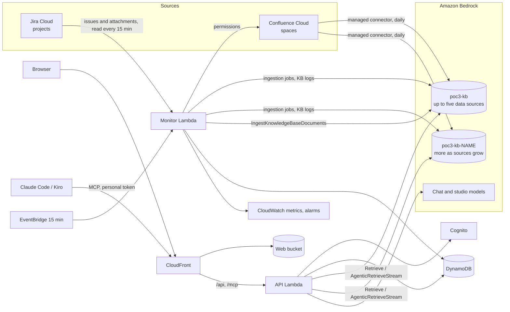

# Project Notebook (PoC 3)

A project knowledge assistant in the spirit of NotebookLM, for a project team (business analysts, bridge system engineers, solution architects) who must learn a project's business from a large set of documents. The documents stay in Confluence Cloud and Jira Cloud; Amazon Bedrock Managed Knowledge Bases index them, with the files attached to Confluence pages and Jira issues. On top of the knowledge bases sit a web app, an MCP server for local agents (Claude Code, Kiro), a sync monitor, and per-user access by Confluence space and Jira project.

Documents: [docs/01-executive-overview.md](docs/01-executive-overview.md) for leadership (problem, solution, how it is built, cost), [CONCEPT.md](CONCEPT.md) for the concept (what it does, how it works, what was verified, limits, comparison with Atlassian Rovo), and [docs/02-engineering-guide.md](docs/02-engineering-guide.md) for engineers (detailed architecture, AWS resources, permissions). [docs/04-cost-estimate.md](docs/04-cost-estimate.md) holds the cost estimate. This file is the engineers' quick reference and holds the test results.

**To build it in your own environment**, with your own Atlassian site and AWS project, follow the [engineering guide](docs/02-engineering-guide.md), section 7. Nothing in the code names a site, an AWS project or a Region. The PoC's results below were measured on invented test content.

## Layout

| Path | What it is |
|---|---|
| `infra/sources.json` | The data sources: one per Confluence space and per set of Jira projects. A source is the unit a user is granted |
| `infra/kb.mjs` | Creates the knowledge bases, their data sources (the Confluence connector with a daily sync, the custom Jira source), the service role, the bucket, the secrets and the log delivery; removes data sources that `infra/sources.json` no longer names |
| `infra/stack.yaml` | The app: DynamoDB table, Cognito user pool, API and monitor Lambda functions, CloudFront in front of the web bucket and the API, alarms, dashboard |
| `infra/deploy.mjs` | Builds, uploads and deploys the stack, publishes the web UI, creates the test accounts |
| `infra/redeploy.mjs` | Recreates everything after a teardown in one command (`npm run redeploy`), with the knowledge bases and the app made side by side |
| `src/api/handler.mjs` | The API (`/api/*`) and the MCP endpoint (`/mcp`), one Lambda function behind a function URL with response streaming |
| `src/monitor/handler.mjs` | Every 15 minutes: the Jira sync, sync jobs into DynamoDB, CloudWatch metrics per source, document lists; once a day the permission import |
| `src/lib/` | `kb` (search, agentic search, documents, syncs), `jira` (the Jira sync: issues, comments and attachments into a custom data source), `prepare` and `extract` (the step before the knowledge base: the text of a pptx, docx, xlsx, doc, pdf, scan or picture as Markdown, with the pictures inside the file read by a model), `custom` (documents the app sends itself), `confluence-text` (the text documents of a Confluence source's attachments), `answer` (chat: fast, deep and agent mode), `tools` (the reading tools shared by the MCP server and agent mode), `claude` (the Claude API client), `studio`, `mcp`, `auth`, `permissions`, `connectors`, `graph`, `store`, `usage`, `llm`, `config` |
| `web/` | The single-page web UI, no build step |
| `scripts/e2e.mjs` | End-to-end test of the deployed app as the five test accounts |
| `scripts/eval.mjs` | A file of questions with reference answers (`POC3_QUESTIONS`) through the chat API |
| `scripts/attach-fixtures.mjs` | Puts the attachment test's data on an Atlassian test site (`up`, `status`, `down`): three Jira issues, two Confluence pages and a blog post, with the 23 files of `eval/attachments/` (built by `eval/attachments/make.py`) |
| `scripts/attach-test.mjs` | The attachment test: every file is indexed and has its text document, 38 questions each answered from one part of one file, access scope, and a file attached or removed later |
| `scripts/compare.mjs` | The same questions through the web UI's chat API and through Claude Code on the tester's machine with the MCP server, same model (`cli`, `web`, `score`, `show`) |
| `scripts/preprocess-lab.mjs` | The lab behind the step before the knowledge base: each way of preparing a file, measured in a data source of its own (`build`, `up`, `measure`, `recount`, `readers`, `down`) |
| `scripts/restrict-test.mjs` | The test of page and issue restrictions, with an index written by hand |
| `docs/` | Executive overview and engineering guide |

## How it fits together



- **Sources and grants.** A knowledge base holds at most five data sources (a fixed quota), so each source names its knowledge base in `infra/sources.json`: `poc3-kb`, or `poc3-kb-<name>` when the first is full. A user's grants are a list of data source ids. A search runs on every knowledge base that holds a granted source, filtered on `_data_source_id`, and the passages are merged by score. Admins read every source.
- **Jira.** Managed knowledge bases have no Jira connector, so a Jira source is a data source of type `CUSTOM` that the monitor fills ([src/lib/jira.mjs](src/lib/jira.mjs)). Each issue becomes one text document (fields, description, comments, the names of its attachments) sent inline, and each attachment becomes one document: the file is copied to `jira/` in the data bucket and sent by its S3 location, so the managed parser reads it like any other file. The document ids are the Jira links, so citations open the issue or the file. A run reads the issues changed since the last one (all of them once a day), skips what has not changed, and removes the documents of deleted issues and attachments. "Sync now" on a Jira source starts the monitor for that source.
- **The step before the knowledge base.** A managed knowledge base has no parser setting, and its parser keeps about half the words of a Vietnamese pptx, docx, doc or pdf and none of a slide's speaker notes (see the lab below). So for every attachment of those formats, and for scans and pictures, the monitor makes a second document next to the file: the file's text as Markdown ([src/lib/prepare.mjs](src/lib/prepare.mjs)), read from the file itself (slides with tables and notes, Word paragraphs and tables, each Excel sheet row by row, a PDF's text layer) or, for a picture or a scanned page, by a model with image input (`POC3_READ_MODEL`, Qwen3 VL 235B by default, in the Region). Pictures placed inside a pptx, docx, xlsx or pdf (screen designs, flow charts, tables pasted as pictures, common in Japanese projects) are read by the same model, and their text is put where the picture stands: on its slide, after its paragraph, at its row of the sheet, on its page of the PDF. Icons and pictures smaller than about 200 × 200, a picture repeated in the same file and a full-page background are skipped; at most 40 pictures per file are read; a picture in a format the model does not take (emf, wmf, tiff, svg) or over 3.5 MB is counted as not read in the document's header. The file stays in the knowledge base as it is. The text document's id is the file's link plus `#text` and its passages are shown under the file's own link, so a citation opens the file. Jira: the text document goes into the Jira data source with the file ([src/lib/jira.mjs](src/lib/jira.mjs)). Confluence: the connector takes no document from anyone else, so a Confluence source with `"text": true` in `infra/sources.json` gets a second data source `<name>-text` of type `CUSTOM` that the monitor fills ([src/lib/confluence-text.mjs](src/lib/confluence-text.mjs)); the app shows the two as one source and searches both. Nothing is written to Confluence. A file that cannot be prepared after three tries stays as the knowledge base reads it, with a warning in the monitor's log.
- **Chat.** Fast mode: the question is made to stand alone from the history, one `Retrieve` call per knowledge base, then the chat model streams an answer with `[n]` citations and three follow-up questions. Deep mode: `AgenticRetrieveStream` plans sub-queries (shown as steps), then the studio model writes. Agent mode: the model itself works in a loop with the six reading tools of the MCP server (`search`, `list_sources`, `list_documents`, `get_document`, `query_jira`, `query_table`, in [src/lib/tools.mjs](src/lib/tools.mjs)), as a local agent does through MCP: it searches several times in other words, reads a whole document when passages are not enough, then answers with `[n]` citations of the passages it used. The loop runs in the API function ([src/lib/answer.mjs](src/lib/answer.mjs)), limited to the notebook's sources, to 8 rounds, 24 tool calls and 3 minutes; each tool call is shown as a step. It needs a Claude model through the Claude API. Research mode: an outline from a first search, every section researched by its own tool loop at the same time, then a summary and the points the documents leave open; the report has `[n]` citations, comes with its list price (0.21 to 0.26 USD and 29 to 43 seconds on three measured reports) and can be saved as Markdown ([src/lib/research.mjs](src/lib/research.mjs)). All four stream as server-sent events (`sources`, `step`, `delta`, `reset`, `done`).
- **Exact counts.** Search returns the closest passages, never "all of them", so two tools compute instead: `query_jira` runs a JQL query in Jira at that moment, inside the projects of the person's sources (the exact total, counts per status, assignee and so on), and `query_table` filters, counts and sums the rows of a table in one document. `list_documents` lists a source completely and can show the files attached to one page or issue. Agent mode, research mode and MCP share them.
- **Page and issue restrictions.** Below the grant of a source, a Confluence page with a read restriction (and the pages and files under it) and a Jira issue on a security level are shown only to the people named, matched by email. The monitor reads the restrictions every run ([src/lib/restrictions.mjs](src/lib/restrictions.mjs)); every reading path checks them ([src/lib/acl.mjs](src/lib/acl.mjs)). `scripts/restrict-test.mjs` tests it live; the limits are in the [engineering guide](docs/02-engineering-guide.md), section 9.
- **Notebooks.** A notebook is a named set of sources with its chat history and notes. Studio outputs (briefing, FAQ, glossary, mind map in Mermaid, timeline, onboarding guide) and the per-document source guide are written from passages and saved as notes.
- **What the web UI adds.** A local agent gets text back from MCP; the web UI is where a person checks an answer and where the team sees what its documents lack. A search palette (Ctrl or Cmd+K) shows passages as the person types, without a model. A click on a citation opens the passage beside the answer with how fresh its source is, and the reader shows the whole extracted document with the cited passage marked. The next questions can be limited to one document. The steps of an agent or deep answer are shown while it runs and kept with the answer. An answer can be voted up or down with a reason, exported, or shared to a team library, where an admin marks entries verified and a person sees only the entries whose sources they may read. Admins get a knowledge base quality page from the question log: what was asked, what the documents could not answer, which documents are cited most, which questions repeat. A notebook lists the documents that changed last. Light and dark themes. The routes are in the [engineering guide](docs/02-engineering-guide.md), section 2.5.
- **MCP.** Streamable HTTP without sessions at `/mcp`, with a personal access token created in the web app (only its hash is stored). Tools: `search`, `ask`, `list_sources`, `list_documents`, `get_document`, `query_jira`, `query_table`, `list_notebooks`. Every tool sees only the caller's sources, and inside them only the documents the caller may read.
- **Sync monitor.** The monitor stores each source's latest jobs and their statistics, reads why a document failed from the knowledge base's application logs, and publishes `SyncAgeHours` and `DocumentsIndexed` per source and `SyncAgeHoursMax`, `JobFailedTotal`, `DocumentsFailedTotal` (namespace `Poc3Kb`). Each custom metric costs about 0.30 USD a month, so per-source failures stay on the app's sync page. Alarms: a source not synced for 30 hours, a failed job, a monitor error; they mail `POC3_ALERT_EMAIL` when it is set.
- **Registration and permissions.** People sign up with email in Cognito and wait for an admin, who sets their grants; a pending user can request sources. The permission import reads who may read each Confluence space (space permissions, groups expanded) and turns them into grants by email; grants on a Jira source are given by an admin. A person who has not signed up yet gets the grants when they do.
- **Usage and cost.** Each search, agentic call and model call is counted per day; the cost page shows the month at list prices (`src/lib/config.mjs`).

## Run it

The full procedure for a new environment is in the [engineering guide](docs/02-engineering-guide.md), section 7: what you need, the settings, `infra/sources.json`, the order, the first admin, removal. In short:

- **Needs.** Node.js 22 and the AWS CLI v2, signed in to the AWS project. A Confluence Cloud and Jira Cloud account that reads the chosen spaces and projects, with its API token. A Claude API key.
- **Settings.** Environment variables of the shell: `AWS_REGION`, `CONFLUENCE_BASE_URL`, `CONFLUENCE_EMAIL`, `CONFLUENCE_API_TOKEN`, `JIRA_BASE_URL`, `JIRA_EMAIL`, `JIRA_API_TOKEN`, `POC3_ADMIN_EMAILS`. Keep them in a file outside the repository.
- **Sources.** Your own spaces and projects in `infra/sources.json`.

```bash
npm install
node infra/kb.mjs up               # knowledge bases and data sources
node infra/kb.mjs sync             # first sync of the Confluence sources (later: daily, by the connector)
node infra/kb.mjs wait             # waits until no sync is running, then prints each source's last job
node infra/deploy.mjs claude-key   # asks for the Claude API key (not echoed), checks it, saves it in the secret poc3-kb/anthropic
node infra/deploy.mjs up           # the app; the site address goes to infra/deploy.local.json
node infra/deploy.mjs monitor      # one monitor run: the Jira sources and the text documents
```

Optional settings at deploy time: `POC3_CHAT_MODEL`, `POC3_STUDIO_MODEL`, `POC3_AGENT_MODEL` (a `claude-*` id goes to the Claude API, any other id is a Bedrock model in the Region), `POC3_READ_MODEL` (a Bedrock model id in the Region; it reads pictures, the pictures inside Office and PDF files, and scanned pages for the step before the knowledge base), `POC3_ALERT_EMAIL`. A person who signed up can be made admin with `node infra/deploy.mjs make-admin <email>`.

The PoC's own tests need its sources and invented content; what to change to run them elsewhere is in the engineering guide, section 7.6:

```bash
node infra/deploy.mjs users           # five test accounts; passwords in infra/deploy.local.json
node scripts/e2e.mjs                  # end-to-end test; its grants group gives the test accounts their sources
python eval/attachments/make.py       # builds the attachment test's files (needs openpyxl, xlwt, python-docx, python-pptx, reportlab, Pillow)
node scripts/attach-fixtures.mjs up   # the attachment test's issues, pages and files, written to the Atlassian site
node scripts/attach-test.mjs          # the attachment test (sync, docs, cases, scope, lifecycle)
node scripts/restrict-test.mjs        # the test of page and issue restrictions
```

Remove everything with `node infra/deploy.mjs down` then `node infra/kb.mjs down`. Bring it all back with `npm run redeploy` ([infra/redeploy.mjs](infra/redeploy.mjs)): it makes the knowledge bases and the app side by side, runs the first sync while CloudFront is created, then creates the test accounts, runs the monitor and the end-to-end test (`npm run redeploy -- --no-e2e` skips the test). A teardown loses the accounts, grants and notebooks in the table, and the Claude API key in its secret; `infra/deploy.local.json` is kept.

## Attachment test

Does the assistant answer from the files attached to Jira issues and Confluence pages? The test data is three Jira issues, two Confluence pages and one blog post on an Atlassian test site, with 23 invented files in Vietnamese, and 38 questions, each answered from one part of one file (a sheet, a slide, a table, a code block). A question passes when the answer holds the expected facts and a passage of the expected file was retrieved. Run of 2026-11-14, fast mode, with the step before the knowledge base in place:

- **Indexing.** All 23 files and the 3 issue texts were indexed, through both paths: the Confluence connector for the files on pages and blog posts, the Jira sync for the files on issues. The 13 files of a prepared format (6 on Jira, 7 on Confluence) each have their text document, indexed.
- **Questions.** 38 of 38 passed: 19 of 19 on Jira, 19 of 19 on Confluence. Before the step, on the files alone, it was 34 of 38.

| Format | What was asked | Jira issue | Confluence page or blog post | Files alone, before |
|---|---|---|---|---|
| Issue description, issue comment | The text of the issue itself | 2/2 | - | 2/2 |
| Excel `.xlsx` | First sheet, second sheet | 2/2 | 2/2 | 4/4 |
| Excel `.xls` | Rows | 1/1 | 1/1 | 2/2 |
| Word `.docx` | Paragraphs, table | 2/2 | 2/2 | 4/4 |
| Word `.doc` | Paragraphs | 1/1 | 1/1 | 2/2 |
| PowerPoint `.pptx` | Slide bullets, slide table, speaker notes | 3/3 | 4/4 | 4/7 |
| PDF with text | Text, table | 1/1 | 2/2 | 3/3 |
| PDF scan, no text layer | The scanned page | 1/1 | 1/1 | 2/2 |
| Markdown `.md` | Paragraph, bullet list, table, code block, task list | 3/3 | 4/4 | 7/7 |
| Text `.txt` | Log lines | 1/1 | - | 1/1 |
| CSV | Rows | 1/1 | 1/1 | 2/2 |
| Picture `.png` | Text in the picture | 1/1 | 1/1 | 1/2 |

- **What the four earlier failures were.** Two limits of the managed parser, not of the app: *PowerPoint speaker notes are not indexed* (3 questions), and *a picture attached to a Confluence page gave no passage* (1 question). Both are answered now from the file's text document.
- **A file attached or removed later.** A text file attached after the first sync was answered from after the next sync, and was gone from the answers after it was removed and the source synced again. Jira: about 20 seconds each way with "sync now", and the file left the document list. Confluence: one connector sync each way (new 1, then deleted 1). A Word file attached to an issue and to a page got its text document on the next monitor run, and lost it (document and Markdown file in the bucket) on the run after it was removed.
- **Access scope.** 4 of 5 checks passed. A member with only the Confluence grant gets no passage of a Jira attachment, although both sources are in one knowledge base, and the Jira document list is refused (403). A member with only the grant of another Confluence source gets nothing from Jira. The failed check: that member *does* get the first source's Confluence attachments. The cause is the test configuration, not the search filter: the test's `sources.json` named one space in two sources, so the space is indexed in both and a grant on either reads it, text documents included. Name a space in one source only.
- **Found by the end-to-end test on the way.** The document reader behind the source guide and the MCP `get_document` tool returned nothing for a text file (Markdown, text) and dropped every table of an Office file. It now reads both, and reads a prepared file from its text document ([src/lib/kb.mjs](src/lib/kb.mjs), `documentText`). The end-to-end test passes (88 of 88 checks on the current build).

## The step before the knowledge base: what was tried

`scripts/preprocess-lab.mjs` sent each file in several forms to a data source of its own in `poc3-kb` and measured three things: how much of the file's true text the knowledge base keeps (all words, and the words with Vietnamese accents), whether the facts are in the top five passages, and whether the chat model answers. The true text is what `eval/attachments/make.py` wrote into the file. Results in `eval/out/preprocess-lab.json`.

**The files as they are.** `.xlsx`, `.xls`, `.md`, `.txt`, `.csv`: 100% of the words. `.png`: 97%, 95% of the accented words. `.pdf` with text: 54 to 72%, accented 34 to 38%. Scanned `.pdf`: 50 to 53%, accented 27 to 30%. `.doc`: 55 to 62%. `.docx`: 58 to 61%. `.pptx`: 45 to 49%, accented 23 to 31%, and no speaker notes. The text of a picture placed inside a docx or a pptx is read.

| File | Form sent to the knowledge base | Words kept | Accented words kept | Facts in the top passages | Right answers |
|---|---|---|---|---|---|
| pptx | the file | 47% | 27% | 3/7 | 3/7 |
| pptx | the file + its speaker notes as text | 68% | 52% | 6/7 | 7/7 |
| pptx | Markdown made from the file | 100% | 100% | 7/7 | 7/7 |
| pptx | **the file + Markdown** | 100% | 100% | 7/7 | 7/7 |
| pptx | HTML made from the file | 100% | 100% | 7/7 | 7/7 |
| pptx | the file with its notes copied onto the slides | 57% | 34% | 5/7 | 5/7 |
| pptx | PDF made from the file | 57% | 34% | 6/7 | 6/7 |
| docx | the file | 59% | 36% | 3/4 | 4/4 |
| docx | Markdown, HTML, or **the file + Markdown** | 96% | 100% | 4/4 | 4/4 |
| docx | Markdown by pandoc | 83% | 88% | 4/4 | 4/4 |
| docx | PDF made from the file | 59% | 36% | 3/4 | 4/4 |
| pdf with text | the file | 62% | 35% | 3/3 | 3/3 |
| pdf with text | its text layer (pdfjs), alone or **with the file** | 100% | 100% | 3/3 | 3/3 |
| doc | the file | 59% | 40% | 1/2 | 2/2 |
| doc | its text (word-extractor), alone or **with the file** | 100% | 100% | 2/2 | 2/2 |
| scanned pdf | the file | 51% | 28% | 1/2 | 2/2 |
| scanned pdf | text read by Qwen3 VL, alone or **with the file** | 100% | 100% | 2/2 | 2/2 |
| scanned pdf | text read by Nova Lite | 82% | 73% | 2/2 | 2/2 |
| scanned pdf | each page as a png | 97% | 95% | 2/2 | 2/2 |
| png | the file | 97% | 95% | 2/2 | 2/2 |
| png | text read by Qwen3 VL | 100% | 100% | 2/2 | 2/2 |
| png | text read by Nova Lite | 83% | 72% | 2/2 | 2/2 |
| png | PDF made from the picture | 58% | 31% | 2/2 | 2/2 |

The 4% a docx loses as Markdown are the words "h", "p" and "table" of a code line, not Vietnamese text. The chat model often answers right from a garbled passage, because it restores the accents; a name or an exact term is not restored reliably, and a fact that is in no passage (speaker notes) is not answered at all.

**Readers of pictures and scanned pages** (two pictures and two scanned pages; models served in the Region, no cross-Region profile):

| Reader | Words | Accented words | Seconds per page |
|---|---|---|---|
| Qwen3 VL 235B | 100% | 100% | 3.3 |
| Mistral Large 3 | 100% | 100% | 2.9 |
| Kimi K2.5 | 100% | 100% | 3.8 |
| Gemma 3 27B | 100% | 100% | 5.2 |
| Gemma 3 12B / 4B | 99% | 99 to 100% | 9.3 (12B) |
| Magistral Small, Ministral 3 | 96% | 94% | |
| Nova Pro | 83% | 77% | |
| Nemotron Nano 12B v2 | 82% | 75% | |
| Nova Lite | 69% | 58% | |
| Amazon Textract (DetectDocumentText) | 49% | 29% | |

Textract does not read Vietnamese. Bedrock Data Automation was not tried: in the PoC's Region it needs a cross-Region inference profile, which the PoC does not use. Which readers are served differs by Region; measure the ones of yours with `node scripts/preprocess-lab.mjs readers`.

**What was chosen.** The file as it is, plus its text as a second document: it is never worse than the file alone, it keeps what only the file has (a picture the model does not read), and a citation still opens the file. For Confluence a second way works too and was tested: attaching the Markdown file to the page itself, which the connector then indexes (the five questions on the pptx and png files of two pages passed). It writes to the wiki, so the app does not do it.

### Pictures inside Office and PDF files

Japanese projects, and many others, put screen designs, flow charts and tables into Excel, PowerPoint, Word and PDF files as pictures. The managed parser gives no text for a picture, and the first text documents left pictures out too. The text document now carries the text of each picture inside the file, read by the reader model and placed where the picture stands. Excel files, which the parser reads well, now get a text document too, for their pictures and text boxes.

It was tested on the preparation step with four files made for the test, in Japanese: a screen design workbook (xlsx: a screen capture and a table pasted as a picture on one sheet, a flow chart on a second sheet, an icon and a text box), a basic design deck (pptx), an incident report (docx) and an operations manual (pdf: a figure on a text page and a full-page background). The files also held a tiff picture and repeated pictures.

| What was checked | Result |
|---|---|
| Text in the pictures: Japanese, error codes, extension numbers, times | Transcribed word for word in all four files |
| Where it goes | At the picture's row of the sheet, on its slide, after its paragraph, on its page |
| A table in a picture | Written as a Markdown table |
| Icon, repeated picture, full-page background | Skipped, with no model call |
| tiff picture | Not read, and counted as not read |
| Time | 3 to 15 seconds per file with 1 to 3 pictures; up to four pictures are read at a time |
| The 23 files of the attachment test, old code against new | The same text for pptx, docx, doc, pdf and png; the two xlsx files now get a text document |

Not tested yet: questions on these pictures through a deployed knowledge base (the PoC had been removed), and real project files with dozens of pictures.

## Web UI and Claude Code compared

Does the web UI's agent mode answer as well as a coding agent that reaches the same documents through MCP? `scripts/compare.mjs` asks both the same 79 questions with the same model, Claude Sonnet 5.5 at effort medium.

- **Web arm.** The chat API in agent mode, as the web UI calls it.
- **CLI arm.** Claude Code on the tester's machine (`claude -p`) from an empty directory, with no built-in tools and no user settings, only the app's MCP server. The `ask` tool is withheld, because it hands the question to the app's own answer chain.
- **What is the same.** The model, the effort, the account (so the sources), and the code of the tools: the MCP server and the agent loop both run [src/lib/tools.mjs](src/lib/tools.mjs). What differs is the loop around the model and its system prompt.
- **Questions.** 24 questions on the pages of the Confluence sources, half in Vietnamese and half in English (4 of them with no answer in the documents), the 38 attachment questions, and 17 questions that need several documents ([eval/compare/multi.json](eval/compare/multi.json)).
- **Scoring.** A matcher looks for the expected facts in the answer. Every answer it failed was then read by hand, and the verdicts are in [eval/compare/review.json](eval/compare/review.json), each with its reason. Most were right answers in other words than the matcher wants.

Runs of 2026-11-14, one answer per question:

| Arm | Passed | Pages | Attachments | Several documents | Matcher alone | Median seconds | Tool calls per question | Tokens in / out per question |
|---|---|---|---|---|---|---|---|---|
| Claude Code CLI | 78/79 | 24/24 | 38/38 | 16/17 | 71/79 | 6.7 | 2.2 | 10 006 / 507 |
| Web UI, first run | 76/79 | 22/24 | 38/38 | 16/17 | 68/79 | 5.9 | 2.4 | 12 109 / 528 |
| Web UI, after one more line in its prompt | 78/79 | 24/24 | 38/38 | 16/17 | 70/79 | 5.8 | 2.4 | 12 189 / 530 |

- **Where the web UI lost in the first run.** Two questions whose fact is written away from the feature's own page, in a test document. The agent read the feature's page, did not find the fact, and said the documents do not state it. Claude Code searched again in other words and found it.
- **The line added.** The agent's prompt now says that a fact about a feature is often written elsewhere, and to search for the fact itself before saying it is missing ([src/lib/answer.mjs](src/lib/answer.mjs), `AGENT_SYSTEM`). The line was written after reading those two failures, so the third row is not an independent test: the first run is the unbiased number.
- **Repeat runs of the two questions**, three each. Web UI before the line: 1 of 3 and 0 of 3. After it: 3 of 3 and 1 of 3. Claude Code: 3 of 3 and 2 of 3, with 4 to 7 tool calls against the web UI's 2 to 5. A question whose answer is not in the documents was still answered as missing in 3 of 3 after the line. So the gap is small and mostly closed, and one of the two questions stays unsure in both arms.
- **The one failure both share.** Asked for the files attached to one page, both list five and miss the sixth.
- **Other numbers.** No errors in any run. The web UI answered every question in the question's language; Claude Code answered four in the other language. Cost per question: 0.030 USD for the web UI (its tokens at list price) and 0.036 USD as Claude Code reports it for itself (it ran on a Claude subscription sign-in, not on the API key); the two are not measured the same way.
- **Limits of the test.** One answer per question, and an answer changes from run to run, as the repeat runs show: a difference of one or two questions in 79 is within that noise. The questions are in Vietnamese and English on one small set of documents. The matcher and the reviewer are the same for both arms, but the hand review was done by the coding assistant that built the app, knowing which arm wrote each answer; it is not a blind review.

```bash
node scripts/compare.mjs cli      # Claude Code with the MCP server; makes a one-day access token and revokes it at the end
node scripts/compare.mjs web      # the chat API in agent mode
node scripts/compare.mjs score    # the arms side by side and the questions they differ on
```

## Models

The default is Claude Sonnet 5.5 (`claude-sonnet-5-5`) through the Claude API for chat, deep mode, agent mode, research mode and studio ([src/lib/claude.mjs](src/lib/claude.mjs), the official SDK). The API key is in the secret `poc3-kb/anthropic`, which only the API function reads; `node infra/deploy.mjs claude-key` puts it there without showing it. With these models the question and the passages sent to the model leave the project's Region for the Claude API; the knowledge bases, the search and the reader of pictures stay in the Region. A request that Claude Sonnet 5.5 declines for a safety reason is answered by Claude Sonnet 5 inside the same call (the API's server-side fallback).

To keep every call in the Region, set `POC3_CHAT_MODEL` and `POC3_STUDIO_MODEL` to the id of a Bedrock model served in your Region (an earlier build of the PoC ran `zai.glm-5`) and run `node infra/deploy.mjs up`; agent mode then answers that it needs a Claude model. Claude models on Bedrock need the one-time Anthropic use case form (Bedrock console, model access) and the inference profile prefix of your geography in `infra/stack.yaml` (engineering guide, section 3.3). Cross-Region (`global.`) inference profiles are not used.

## Things learned the hard way

- `AgenticRetrieveStream` is not authorized against a knowledge base ARN; its IAM statement needs `Resource: "*"`.
- `aws cloudformation deploy` keeps the previous value of a parameter that is not passed, so the deploy passes the models every time.
- A Lambda streamed response sends its status with the first write; a reply without a body (the MCP notification's 202) must still write once.
- `ListKnowledgeBaseDocuments` serves only S3 and custom data sources, so the document list of a Confluence source comes from Confluence directly, with each document's state from the monitor. `Retrieve` does not return a document's own id, which `GetDocumentContent` needs; one agentic call filtered to the document's link finds it, and the id is cached.
- Confluence hides the email of people who chose to hide it; the permission import counts and skips those people.
- A PowerPoint file the managed parser cannot read fails with the reason in the knowledge base's application log, which the monitor shows on the sync page.
- `IngestKnowledgeBaseDocuments` on a custom data source is refused without `bedrock:StartIngestionJob`, on top of its own action.
- A document sent to a custom data source of a managed knowledge base ends in the state `TEXT_INDEXED`, not `INDEXED`; the app shows both as indexed.
- `Retrieve` on a managed knowledge base needs `managedSearchConfiguration`; the filter key for a source is `_data_source_id`.
- The managed parser does not index PowerPoint speaker notes, and the Confluence connector gives no passage for a picture attached to a page. Neither is reported as a failure, so only a question finds it. The file's text document covers both.
- A connector data source (Confluence) refuses `IngestKnowledgeBaseDocuments`; only a `CUSTOM` data source takes documents from the app. A custom document's `_source_uri` is its own id, and the attributes sent with it come back in the passage's metadata.
- The Confluence connector's link of an attachment is the site address plus `/wiki` plus the attachment's `_links.webui` from the REST API, so a text document can carry the same link as its file.
- pdfjs runs in Lambda without the canvas package when only the text layer is read; a scanned page's picture and a figure on a page are taken from the PDF's own image objects, not rendered. A page counts as scanned when it has almost no text and one image covers more than half of it; otherwise its images that cover 1 to 80% of the page are read as figures.
- An xlsx made by openpyxl writes its XML without the `xdr:` prefix and its numbers with `t="n"`; Japanese cells carry furigana (`rPh`) that must be left out. The parser handles all three.
- The Confluence connector has no per-document state. A file is known to be indexed only by asking for it, or by its absence from the last job's failed list.
- Tags on a CloudWatch Logs delivery source or destination can only be given at creation; `infra/kb.mjs` looks the resource up first, so `up` can be run again.
- `GetDocumentContent` (extracted) gives a text file as one string in `plainTextDocumentContent`, and a parsed file as a list of elements in `nonPlainTextDocumentContent`, where a table's cells are in `tableRows` and its `text` is empty.
- `node infra/deploy.mjs users` creates the test accounts without grants. The grants come from the end-to-end test's `grants` group, and until then an account is pending and reads nothing.
