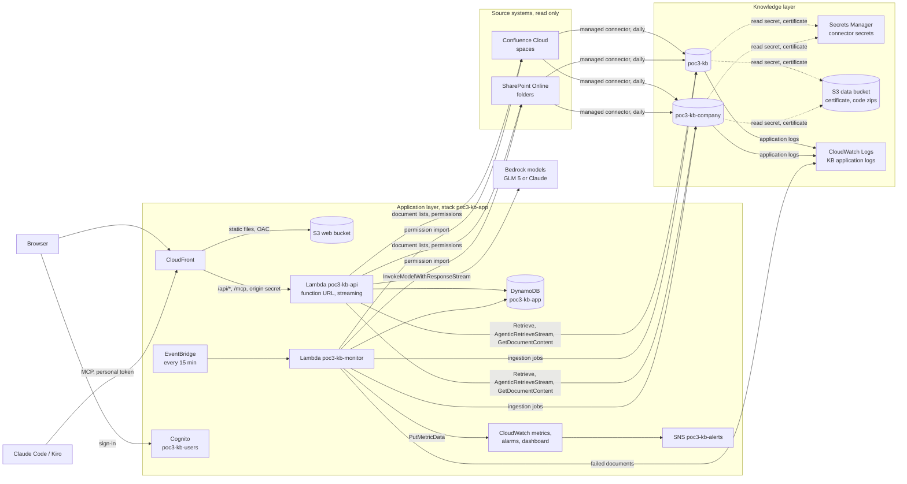
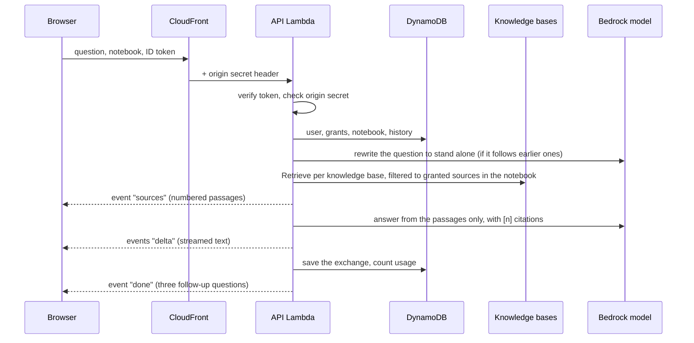

# Project Notebook: Engineering Guide

For engineers who deploy, operate or extend the Project Notebook. It covers the detailed architecture, how to deploy it, every AWS resource it creates, and the permissions it needs, both on AWS and in Confluence and SharePoint. It contains no code. Each section links to the files that implement it. The decision-maker summary is in [01-executive-overview.md](01-executive-overview.md), and the test results are in [CONCEPT.md](../CONCEPT.md), section 6.

## 1. Overview

The system has two layers, each deployed by its own script:

| Layer | What it holds | Deployed by | How |
|---|---|---|---|
| Knowledge layer | Amazon Bedrock Managed Knowledge Bases, one data source per Confluence space and per SharePoint folder, the connector secrets and certificate, the service role, log delivery | [infra/kb.mjs](../infra/kb.mjs) | AWS CLI calls, idempotent |
| Application layer | Web UI, API and MCP server, sign-in, app data, sync monitor, alarms, dashboard | [infra/deploy.mjs](../infra/deploy.mjs) and [infra/stack.yaml](../infra/stack.yaml) | One CloudFormation stack, `poc3-kb-app` |

Everything is in one AWS account and one Region (the POC used `ap-southeast-2`). Every resource is named `poc3-kb…` and tagged `Project=poc3-kb`, so it can be found, costed and removed as a unit.

## 2. Architecture

### 2.1 Components

| Component | Role | Code |
|---|---|---|
| Data sources | One per Confluence space and per SharePoint folder. A source is the unit of access: a user's grants are a list of data source ids | [infra/sources.json](../infra/sources.json) |
| Knowledge bases | Managed knowledge bases (`type MANAGED`, managed embeddings), with managed connectors on a daily schedule. A knowledge base holds at most five data sources (a fixed quota), so each source names its knowledge base | [infra/kb.mjs](../infra/kb.mjs) |
| Web UI | One static page, with no build step. It signs in against Cognito from the browser and calls `/api/*` with the ID token | [web/](../web/index.html), [web/app.js](../web/app.js) |
| API | One Lambda function on a function URL with response streaming. It serves about thirty routes under `/api/*` and the MCP endpoint at `/mcp` | [src/api/handler.mjs](../src/api/handler.mjs) |
| Search | Fast search with `Retrieve` (8 passages by default), one call per knowledge base that holds a granted source, filtered on the data source id and merged by score. Deep search with `AgenticRetrieveStream`. Documents with `GetDocumentContent` | [src/lib/kb.mjs](../src/lib/kb.mjs) |
| Chat and studio | Question rewriting, the answer with citations and follow-ups, and the six studio outputs and the source guide | [src/lib/answer.mjs](../src/lib/answer.mjs), [src/lib/studio.mjs](../src/lib/studio.mjs), [src/lib/llm.mjs](../src/lib/llm.mjs) |
| MCP server | Streamable HTTP without sessions, with six tools: `search`, `ask`, `list_sources`, `list_documents`, `get_document`, `list_notebooks` | [src/lib/mcp.mjs](../src/lib/mcp.mjs) |
| Auth | Cognito ID token (web) or personal access token (MCP), and the user's granted source ids | [src/lib/auth.mjs](../src/lib/auth.mjs) |
| Source connectors | Confluence REST and Microsoft Graph, used for the document lists and the permission import | [src/lib/connectors.mjs](../src/lib/connectors.mjs), [src/lib/graph.mjs](../src/lib/graph.mjs) |
| Permission import | Space and folder readers turned into grants by email | [src/lib/permissions.mjs](../src/lib/permissions.mjs) |
| Sync monitor | Every 15 minutes: job history, failed documents with reasons, document lists and metrics. Once a day: the permission import | [src/monitor/handler.mjs](../src/monitor/handler.mjs) |
| Store | One DynamoDB table (section 2.4) | [src/lib/store.mjs](../src/lib/store.mjs) |
| Usage and prices | Daily usage counters and the list prices used by the cost page | [src/lib/usage.mjs](../src/lib/usage.mjs), [src/lib/config.mjs](../src/lib/config.mjs) |

### 2.2 Request flows

**Fast chat** (`POST /api/chat`, streamed as server-sent events):

**Deep chat** replaces the `Retrieve` calls with one `AgenticRetrieveStream` call. Its planning steps are streamed as `step` events, and the studio model writes the answer.

**Studio** runs four searches over the notebook's sources, then writes one of six outputs with the studio model and saves it as a note. The **source guide** reads one document with `GetDocumentContent` and caches the guide per document.

**MCP** clients post JSON-RPC to `/mcp` with `Authorization: Bearer` and a personal access token. The API looks up the token by its SHA-256 hash, finds the owner, and runs the tool within the owner's grants.

**Sync monitor** (EventBridge, every 15 minutes):

1. Lists the `poc3-kb*` knowledge bases and their data sources, and each source's latest ingestion jobs.
2. Writes new jobs and their statistics to DynamoDB, for the sync page.
3. When a source's latest job has changed, it refreshes the source's document list from Confluence or SharePoint. It also reads the job's failed documents and their reasons from the knowledge base application logs.
4. Publishes `SyncAgeHours` and `DocumentsIndexed` per source, and `SyncAgeHoursMax`, `JobFailedTotal` and `DocumentsFailedTotal` overall, in namespace `Poc3Kb`.
5. Once a day, it runs the permission import.

**Permission import** reads who may read each Confluence space (space permissions, with groups expanded) and each SharePoint folder (direct permissions, Microsoft 365 groups, and SharePoint site groups). It turns them into grants by email. A registered user gets them at once. An unregistered address keeps them until that person signs up. Grants an admin gave by hand are kept. Anything it cannot resolve is counted in the report and not guessed: a hidden Confluence email, a nested group, or an everyone-style claim.

### 2.3 Access model

| Layer | Rule |
|---|---|
| Edge | CloudFront adds a random `x-origin-verify` header, generated at first deploy and kept in `infra/deploy.local.json`. The API refuses every request without it, so the public function URL cannot be used directly |
| Identity | Web: a Cognito ID token, verified in the function (JWKS, no IAM call). MCP: a personal access token. Only its hash is stored. It expires after 90 days by default (365 at most) and can be revoked |
| Status | A new sign-up is `pending` and reads nothing until an admin approves it. A person named by the permission import is activated automatically (`AUTO_APPROVE_IMPORTED`, default on). Emails in `ADMIN_EMAILS` become admins at first sign-in |
| Data | Every search, document read and sync view is filtered to the caller's granted data source ids, intersected with the notebook's selected sources. Admins read every source. Members cannot start a sync or use the admin routes |
| Granularity | A whole space or folder. The knowledge bases run with `aclEnabled: false`, so page-level and file-level restrictions inside a source are not enforced |

### 2.4 Data model

One DynamoDB table, `poc3-kb-app`. It is on-demand, encrypted, with TTL on the `ttl` attribute, and a global secondary index `gsi1` that lists users. The keys are documented at the top of [src/lib/store.mjs](../src/lib/store.mjs):

| Partition | Items |
|---|---|
| `USER#<email>` | Profile, one item per grant, the user's notebooks, the user's token list |
| `NB#<id>` | Chat messages and notes of one notebook |
| `PAT#<hash>` | Token-to-user lookup |
| `SOURCE#<id>` | Sync job history, written by the monitor |
| `DOC#<hash>` | Cached source guide of one document |
| `USAGE#<yyyy-mm>` | Daily usage counters for the cost page |
| `IMPORT#<email>` | Imported grants waiting for a person who has not signed up |

## 3. AWS resources

### 3.1 Created by `infra/kb.mjs` (knowledge layer)

| Resource | Name | Purpose |
|---|---|---|
| Bedrock knowledge base | `poc3-kb`, `poc3-kb-company` (more as sources grow) | The managed index. Up to five data sources each |
| Bedrock data source | One per entry of `sources.json` (`confluence-*`, `sp-*`) | A managed Confluence or SharePoint connector with a daily sync schedule |
| IAM role | `poc3-kb-role` | The knowledge bases' service role (section 4.1) |
| S3 bucket | `poc3-kb-data-<account>-<region>` | The SharePoint certificate (`cert/`) and the Lambda code zips (`code/`). Public access is blocked, and the bucket is encrypted |
| Secrets Manager secret | `poc3-kb/confluence` | The Confluence site, account and API token, for the Confluence connector |
| Secrets Manager secret | `poc3-kb/sharepoint` | The Entra client id and certificate password, for the SharePoint connector |
| Secrets Manager secret | `poc3-kb/graph` | The app's own copy: Entra tenant, client, site, PEM certificate and key, and the Confluence credentials. It is used for document lists and the permission import |
| CloudWatch log group | `/aws/vendedlogs/bedrock/poc3-kb` | The knowledge bases' application logs, kept for 30 days |
| CloudWatch Logs delivery | Destination `poc3-kb-logs`, one source per knowledge base (`<kb>-logs`), one delivery each | Sends each knowledge base's `APPLICATION_LOGS` to the log group above |

### 3.2 Created by `infra/stack.yaml` (application layer, stack `poc3-kb-app`)

| Resource | Name | Settings |
|---|---|---|
| DynamoDB table | `poc3-kb-app` | On demand, SSE, TTL, `gsi1` |
| Cognito user pool | `poc3-kb-users` | Email as username, auto-verified, password of 10 or more characters with mixed case and digits, self sign-up allowed |
| Cognito app client | `poc3-kb-web` | No secret. Password and SRP auth. ID and access tokens last 60 minutes, refresh tokens 30 days |
| Lambda function | `poc3-kb-api` | Node.js 22, arm64, 1,024 MB, 300 s timeout |
| Lambda function URL | on `poc3-kb-api` | Auth `NONE`, `RESPONSE_STREAM`. It is protected by the origin secret |
| Lambda function | `poc3-kb-monitor` | Node.js 22, arm64, 512 MB, 600 s timeout |
| IAM roles | `poc3-kb-api`, `poc3-kb-monitor` | Section 4.2 |
| CloudWatch log groups | `/aws/lambda/poc3-kb-api`, `/aws/lambda/poc3-kb-monitor` | 30 days |
| EventBridge rule | `poc3-kb-monitor` | `rate(15 minutes)`, targets the monitor |
| S3 bucket | `poc3-kb-web-<account>-<region>` | The web UI and its `config.json`. Public access is blocked, ownership is enforced, SSE-S3. Readable only by the distribution |
| CloudFront origin access control | `poc3-kb-web` | SigV4 signing to the web bucket |
| CloudFront distribution | (generated domain) | HTTP/2 and HTTP/3, `PriceClass_200`. Default behaviour: web bucket, cached, security headers. `/api/*` and `/mcp`: the function URL, not cached, all methods, HTTPS only |
| SNS topic | `poc3-kb-alerts` | The alarm target. Email subscription when `POC3_ALERT_EMAIL` is set |
| CloudWatch alarms | `poc3-kb-sync-stale`, `poc3-kb-sync-failed`, `poc3-kb-monitor-errors` | Fire when a source has not synced for more than 30 hours (missing data counts as breaching), when the latest job fails, or when the monitor errors |
| CloudWatch dashboard | `poc3-kb` | Sync age, documents indexed, failures, alarms, API calls, errors and p90 duration |

Outside the stack, the deploy also uses Amazon Bedrock foundation models in the Region (`zai.glm-5` by default) and CloudFront's managed cache, origin request and response headers policies.

### 3.3 Region constraints

- Every Regional resource is in the project's Region. CloudFront is global by nature and needs nothing in `us-east-1`.
- Models are called in the Region. Cross-Region `global.` inference profiles are not used. If Claude is enabled, it runs through the `au.` profiles, which stay inside Australia.
- Lambda@Edge, StackSets and cross-Region replication are not used.

## 4. IAM: runtime permissions

These are the permissions the running system holds. They are defined in [infra/kb.mjs](../infra/kb.mjs) (`putRole`) and [infra/stack.yaml](../infra/stack.yaml) (`ApiRole`, `MonitorRole`, `WebBucketPolicy`, the Lambda permissions).

### 4.1 Knowledge base service role `poc3-kb-role`

| Trust | `bedrock.amazonaws.com`, limited to this account and to knowledge bases in this Region (`aws:SourceAccount`, `aws:SourceArn`) |
|---|---|

| Action | Resource | Why |
|---|---|---|
| `secretsmanager:GetSecretValue` | Secrets `poc3-kb/*` | The connectors read their credentials |
| `s3:ListBucket` | The data bucket | The SharePoint connector finds the certificate |
| `s3:GetObject` | Objects in the data bucket | The SharePoint connector reads the certificate |

### 4.2 Lambda roles

| Action | Resource | `poc3-kb-api` | `poc3-kb-monitor` | Why |
|---|---|---|---|---|
| `logs:CreateLogStream`, `logs:PutLogEvents` | The function's own log group | ✓ | ✓ | Function logs |
| `logs:FilterLogEvents` | `/aws/vendedlogs/bedrock/poc3-kb` | | ✓ | The reasons documents failed |
| `bedrock:ListKnowledgeBases` | `*` (a list action cannot be scoped) | ✓ | ✓ | Find the `poc3-kb*` knowledge bases |
| `bedrock:ListDataSources`, `GetDataSource`, `ListIngestionJobs`, `GetIngestionJob`, `ListKnowledgeBaseDocuments` | `knowledge-base/*` in this account and Region | ✓ | ✓ | Sources and sync state |
| `bedrock:Retrieve`, `GetDocumentContent` | `knowledge-base/*` | ✓ | | Search and document reads |
| `bedrock:StartIngestionJob` | `knowledge-base/*` | ✓ | | The admin's "sync now" |
| `bedrock:AgenticRetrieveStream` | `*` | ✓ | | Deep mode. It is not authorised against a knowledge base ARN |
| `bedrock:InvokeModel`, `InvokeModelWithResponseStream` | Foundation models in the Region, `au.anthropic.*` inference profiles, and `anthropic.*` foundation models behind them | ✓ | | Chat, deep mode, studio |
| `secretsmanager:GetSecretValue` | `poc3-kb/graph*` only | ✓ | ✓ | Confluence and Graph calls. The connector secrets are not readable by the app |
| `dynamodb:GetItem`, `PutItem`, `UpdateItem`, `DeleteItem`, `Query` | The table and its indexes | ✓ | ✓ | App data |
| `dynamodb:BatchWriteItem` | The table and its indexes | ✓ | | Deleting many items at once, such as a notebook's messages |
| `cloudwatch:PutMetricData` | `*`, with the condition namespace `Poc3Kb` | | ✓ | Sync metrics |

### 4.3 Resource policies

| Resource | Policy |
|---|---|
| Web bucket | `s3:GetObject` for `cloudfront.amazonaws.com`, only when `AWS:SourceArn` is this distribution |
| API function URL | `lambda:InvokeFunctionUrl` (auth type `NONE`) and `lambda:InvokeFunction` (only via the function URL) for any principal. The origin secret is the gate |
| Monitor function | `lambda:InvokeFunction` for `events.amazonaws.com`, only from the `poc3-kb-monitor` rule |

## 5. IAM: deployer permissions

The person or pipeline that runs the two scripts needs the following, scoped to `poc3-kb*` names where the service allows it. In an AWS project with managed IAM, check that the team member's managed permissions include them before the first deploy.

| Service | Actions used | By |
|---|---|---|
| STS | `GetCallerIdentity` | both scripts |
| IAM | `GetRole`, `CreateRole`, `UpdateAssumeRolePolicy`, `PutRolePolicy`, `DeleteRolePolicy`, `DeleteRole`, `TagRole`, `PassRole` (to Bedrock for `poc3-kb-role`, to Lambda for the two function roles) | kb.mjs, CloudFormation (`CAPABILITY_NAMED_IAM`) |
| S3 | `CreateBucket`, `PutBucketPublicAccessBlock`, `PutBucketTagging`, `PutBucketPolicy`, `PutEncryptionConfiguration`, `PutBucketOwnershipControls`, `ListBucket`, `GetObject`, `PutObject`, `DeleteObject`, `DeleteBucket` | both |
| Secrets Manager | `CreateSecret`, `PutSecretValue`, `DescribeSecret`, `TagResource`, `DeleteSecret` | kb.mjs |
| Bedrock | `CreateKnowledgeBase`, `GetKnowledgeBase`, `ListKnowledgeBases`, `DeleteKnowledgeBase`, `CreateDataSource`, `UpdateDataSource`, `GetDataSource`, `ListDataSources`, `DeleteDataSource`, `StartIngestionJob`, `ListIngestionJobs`, `TagResource` | kb.mjs |
| CloudWatch Logs | `CreateLogGroup`, `DescribeLogGroups`, `PutRetentionPolicy`, `DeleteLogGroup`, `PutDeliveryDestination`, `PutDeliverySource`, `CreateDelivery`, `DescribeDeliveries`, `DeleteDelivery`, `DeleteDeliverySource`, `DeleteDeliveryDestination`, `TagResource`, and Bedrock's `AllowVendedLogDeliveryForResource` on the knowledge bases | kb.mjs, CloudFormation |
| CloudFormation | `CreateChangeSet`, `ExecuteChangeSet`, `DescribeChangeSet`, `DescribeStacks`, `DescribeStackEvents`, `DeleteStack` | deploy.mjs |
| Lambda | Create, update, delete functions, function URLs and permissions; `InvokeFunction` on the monitor (the `monitor` command) | CloudFormation, deploy.mjs |
| DynamoDB | Create and delete the table, `GetItem`, `UpdateItem` (the `make-admin` command) | CloudFormation, deploy.mjs |
| Cognito | Create and delete the pool and client, `AdminGetUser`, `AdminCreateUser`, `AdminSetUserPassword` (the `users` command) | CloudFormation, deploy.mjs |
| CloudFront | `ListCachePolicies`, `ListOriginRequestPolicies`, `ListResponseHeadersPolicies`, create, update and delete distribution and origin access control, `CreateInvalidation` | deploy.mjs, CloudFormation |
| EventBridge, SNS, CloudWatch | Create and delete the rule, topic, subscription, alarms and dashboard | CloudFormation |
| Bedrock models | Model access in the Region. GLM 5 needs nothing more. Claude needs the account's one-time Anthropic use case form | Once, in the console |

## 6. Permissions in the source systems

| System | What is needed | Used by | Notes |
|---|---|---|---|
| Confluence Cloud | A dedicated account that can read the chosen spaces, and its API token | The managed connector (basic auth), and the app for document lists and the permission import | To import permissions it must be able to read space permissions. It may count as a paid user. Users who hide their email cannot be mapped and are skipped |
| Microsoft Entra ID | An app registration with application permission `Sites.Read.All` and administrator consent, signing in with a certificate | The managed connector (app-only, certificate in S3), and the app through Microsoft Graph and SharePoint REST | `GroupMember.Read.All` is optional. Without it, nested Microsoft 365 groups are not expanded by the import |

The certificate and its password are created once, outside the scripts, and kept locally (section 7.1). Only the scripts move them into Secrets Manager and S3.

## 7. Deployment

### 7.1 Prerequisites

- Node.js 22 and the AWS CLI v2, signed in to the project's AWS account with a profile for its Region.
- The settings file and secrets, none of which are in git:
  - `../poc1-slack-platform/infra/local.env`: Region, CLI profile, SharePoint tenant, client and site URL, and Confluence space keys.
  - `../poc1-slack-platform/.env`: Confluence site, account and API token.
  - `../poc1-slack-platform/infra/kb-cert/`: the SharePoint certificate (`.p12` with its password file, and the PEM certificate and private key).

  PoC 3 reuses PoC 1's test settings. For a new environment, put the same keys in those files, or change the paths at the top of [infra/kb.mjs](../infra/kb.mjs).
- The data sources listed in [infra/sources.json](../infra/sources.json), each naming its knowledge base, with no more than five per knowledge base.
- Optional deploy settings, read from the environment or the files above:
  - `POC3_CHAT_MODEL` and `POC3_STUDIO_MODEL` (Bedrock model ids in the Region; default GLM 5);
  - `POC3_ADMIN_EMAILS` (comma-separated);
  - `POC3_ALERT_EMAIL`.

### 7.2 Order

All commands run from the `poc3-project-notebook/` folder, in this order:

| Step | Command | What happens | Time |
|---|---|---|---|
| 1 | `npm install` | Dependencies for the build | 1 min |
| 2 | `node infra/kb.mjs up` | Data bucket, service role, three secrets, certificate upload, knowledge bases, data sources (waits until each is `AVAILABLE`), log delivery. It is safe to re-run: existing resources are updated, and a source moved to another knowledge base is removed from the old one | A few minutes |
| 3 | `node infra/kb.mjs sync` | Starts the first ingestion of every source. Later syncs run daily on the connector's schedule | Depends on the volume; follow it with step 4 |
| 4 | `node infra/kb.mjs status` | Each source's last job, with documents scanned, indexed, failed and deleted. `node infra/kb.mjs wait` waits until no sync is running, then prints the same | seconds |
| 5 | `node infra/deploy.mjs up` | Bundles the two functions ([scripts/build.mjs](../scripts/build.mjs)), uploads the zips by content hash, creates the origin secret once, deploys the stack, publishes the web UI with its `config.json`, and invalidates CloudFront. The site address is written to `infra/deploy.local.json` | 5 to 15 min the first time (CloudFront) |
| 6 | `node infra/deploy.mjs users` | Optional: five test accounts under `.invalid` emails (no email is sent). Their passwords go to `infra/deploy.local.json` | seconds |
| 7 | `node infra/deploy.mjs monitor` | Runs the monitor once, so the sync page and the metrics fill at once | 1 min |
| 8 | `node scripts/e2e.mjs` | The 46-check end-to-end test as the test accounts ([scripts/e2e.mjs](../scripts/e2e.mjs)) | A few minutes |
| 9 | `node scripts/eval.mjs fast` | Optional: the 48-question benchmark ([scripts/eval.mjs](../scripts/eval.mjs)) | A few minutes |

**In one command.** `npm run redeploy` ([infra/redeploy.mjs](../infra/redeploy.mjs)) runs steps 2 to 8 after `npm install`. The data bucket is made first, because it holds the function code. Then two lanes run side by side. One makes the knowledge bases, starts the first sync and waits for it. The other deploys the app stack and creates the test accounts. Steps 7 and 8 follow. This works because the app needs the knowledge bases only at run time, when it finds them by name. So the first sync runs while CloudFront is being created, and the whole run takes about as long as the slower of the two. Nearly all of that time is AWS creating resources and indexing documents: the build takes seconds, and a container image would not shorten it. `npm run redeploy -- --no-e2e` skips the test.

A real person signs up on the site. An admin then approves them, or `node infra/deploy.mjs make-admin <email>` promotes someone who has signed in once.

### 7.3 Changes

| Change | What to run |
|---|---|
| Code of the functions | `node infra/deploy.mjs up` (the zip key carries the content hash, so changed code always reaches Lambda) |
| Web UI only | `node infra/deploy.mjs web` |
| Model | Set `POC3_CHAT_MODEL` and `POC3_STUDIO_MODEL`, then `deploy.mjs up`. The deploy passes the models every time, because CloudFormation would otherwise keep the previous values |
| A new space or folder | Add it to `sources.json` and give it a knowledge base with fewer than five sources (or a new `poc3-kb-<name>`). Then run `kb.mjs up <name>`, `kb.mjs sync <name>`, and grant it to people. The app finds new `poc3-kb*` knowledge bases by name, with no redeploy |
| Connector credentials | Update the local files, then `kb.mjs up` (it rewrites the secrets) |

### 7.4 Removal

Run `node infra/deploy.mjs down` first. It empties the web bucket, deletes the stack and waits for CloudFront, then removes the code zips. Then run `node infra/kb.mjs down`. It removes log delivery, data sources (with their indexed data), knowledge bases, the three secrets (without the recovery window), the data bucket and the service role. Afterwards, check that nothing tagged `Project=poc3-kb` remains, using the Resource Groups tag editor in the Region.

What a teardown loses, and what it keeps:

- **Lost:** the table and the user pool. These hold every account, grant, notebook, note, chat history and personal access token. In a pilot with real people, export the table first, for example with DynamoDB's export to S3 into a bucket outside the stack.
- **Kept:** everything needed to rebuild, on the deployer's machine. That is the code and `sources.json` in git, the PoC 1 settings and certificate, and `infra/deploy.local.json`. That file holds the origin secret and the test passwords, which a redeploy reuses. The CloudFront address changes on every redeploy and is written to `infra/deploy.local.json` again.

## 8. Operations

| Need | Where |
|---|---|
| Is every source in sync? | The app's **Sync** page: last job, documents indexed and failed, the reason for each failure, history, and "sync now" for admins. In AWS: the `poc3-kb` dashboard and the three alarms |
| Why did a document fail? | The sync page. It reads the knowledge base application logs in `/aws/vendedlogs/bedrock/poc3-kb`. Typical case: a PowerPoint file the managed parser cannot read |
| API errors or slowness | The dashboard (invocations, errors, throttles, p90 duration) and `/aws/lambda/poc3-kb-api`. A Bedrock throttling error is returned to the user as "busy, retry". Errors are logged with their name and message only, never with a token |
| Cost | The app's **Cost** page (admins): searches, agentic searches and tokens per model at the list prices in [src/lib/config.mjs](../src/lib/config.mjs). In AWS: Cost Explorer filtered on the tag `Project=poc3-kb`, once the tag is activated as a cost allocation tag |
| Who can read what | The **Users** page: grants per person, pending requests, and the permission import with its report of unresolved entries |
| A leaked MCP token | The owner revokes it on the **MCP** page, or an admin removes the person's grants. A token never reads beyond its owner's grants |

Unit costs and monthly estimates are in [01-executive-overview.md](01-executive-overview.md), section 5.

## 9. Known limits and lessons

| Topic | Detail |
|---|---|
| Five sources per knowledge base | A fixed quota. The design spreads sources across knowledge bases and merges results by score |
| Document lists | `ListKnowledgeBaseDocuments` serves only S3 and custom sources. For connector sources the lists come from Confluence and SharePoint directly, with each document's state from the monitor |
| Document ids | `Retrieve` does not return the id that `GetDocumentContent` needs. One agentic call filtered to the document's link finds it, and the id is cached |
| Agentic retrieval IAM | `AgenticRetrieveStream` needs `Resource: "*"` |
| Streaming | A streamed Lambda response sends its status with the first write. A reply without a body (MCP's 202) must still write once |
| Group expansion | With only `Sites.Read.All`, SharePoint group members come from SharePoint REST, which lists direct members only |
| Per-document access | Not enforced inside a source (`aclEnabled: false`). Keep restricted content in its own space or folder |
| Rate limiting | None per person yet. A daily quota per user is needed before a wide rollout |
| Backups | The table has no point-in-time recovery. Notebooks and notes would be lost with the stack. The documents themselves stay in Confluence and SharePoint, and can be re-indexed |

More notes from the build are in the [README](../README.md), "Things learned the hard way".
