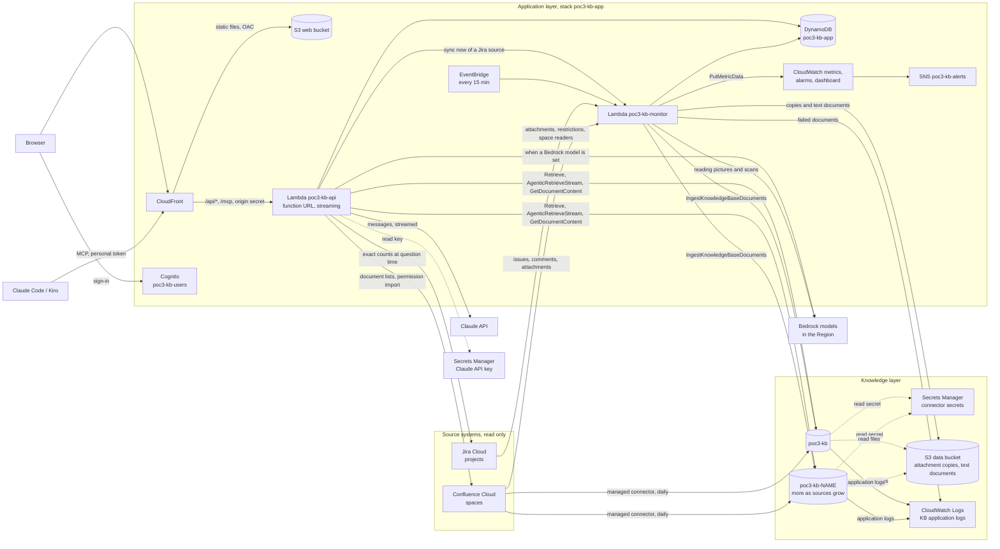
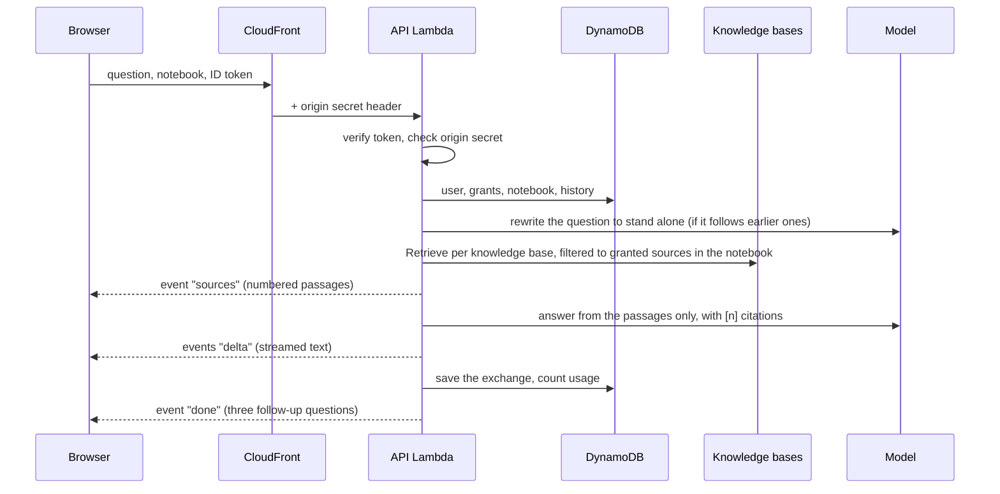
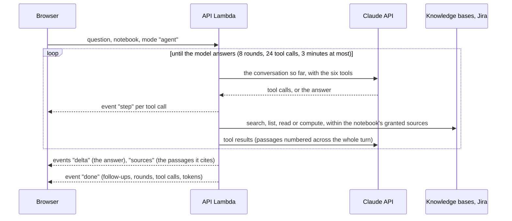

# Project Notebook: Engineering Guide

For engineers who deploy, operate or extend the Project Notebook, with their own Atlassian site and AWS project. It explains how the system works, lists every AWS resource it creates and every permission it needs, and gives the procedure to build it in a new environment (section 7). It contains no code; each part links to the files that implement it.

The other documents: [01-executive-overview.md](01-executive-overview.md) for decision makers, [CONCEPT.md](../CONCEPT.md) for the concept and what was verified, and the [README](../README.md) for the test results in detail.

The figures quoted here were measured on a proof of concept (PoC) filled with invented test content.

How to read it:

| If you want to | Read |
|---|---|
| Understand the system | Sections 1 and 2 |
| Review what it creates and what it may do in AWS, Confluence and Jira | Sections 3 to 6 |
| Build it in your own environment | Section 7, with sections 5 and 6 for the access to ask for |
| Run it | Section 8 |
| Know where it stops | Section 9 |

## 1. The system in brief

The Project Notebook answers questions from a team's Confluence pages, Jira issues and the files attached to them. People use it in a web UI; coding agents such as Claude Code and Kiro use it through an MCP server. It only reads Confluence and Jira.

Three ideas carry the design:

- **A source is the unit of everything.** A source is one Confluence space, or one group of Jira projects, held as one data source of a knowledge base. Syncing, monitoring and access are all per source: a person's grants are a list of data source ids.
- **Amazon Bedrock Managed Knowledge Bases hold the searchable copy.** AWS parses, embeds and indexes the documents. The app adds what the managed service does not do: a sync for Jira, a full-text copy of attached files it reads poorly, and the access rules.
- **One set of reading tools serves every client.** The web UI's agent and research modes and the MCP server run the same code, under the same access checks.

The system is deployed in two layers, each by its own script:

| Layer | What it holds | Deployed by | How |
|---|---|---|---|
| Knowledge layer | The knowledge bases, one data source per source, the secrets, the service role, the data bucket, log delivery | [infra/kb.mjs](../infra/kb.mjs) | AWS CLI calls, safe to re-run |
| Application layer | Web UI, API and MCP server, sign-in, app data, sync monitor, alarms, dashboard | [infra/deploy.mjs](../infra/deploy.mjs) and [infra/stack.yaml](../infra/stack.yaml) | One CloudFormation stack, `poc3-kb-app` |

Everything is in one AWS project (one AWS account) and one Region. Every resource is named `poc3-kb…` and tagged `Project=poc3-kb`, so it can be found, costed and removed as a unit. The one service outside the project is the Claude API, which writes the answers by default (section 2.3).

## 2. Architecture

### 2.1 Components



| Component | Role | Code |
|---|---|---|
| Sources | The list of sources: each names its spaces or projects and the knowledge base that holds it | [infra/sources.json](../infra/sources.json) |
| Knowledge bases | Managed knowledge bases (`type MANAGED`, managed embeddings). A knowledge base holds at most five data sources, a fixed quota, so the sources are spread over `poc3-kb` and `poc3-kb-<name>` | [infra/kb.mjs](../infra/kb.mjs) |
| Web UI | One static page with no build step. It signs in against Cognito from the browser and calls `/api/*` with the ID token | [web/](../web/index.html), [web/app.js](../web/app.js) |
| API | One Lambda function on a function URL with response streaming. It serves about thirty routes under `/api/*` and the MCP endpoint at `/mcp` | [src/api/handler.mjs](../src/api/handler.mjs) |
| Sync monitor | One Lambda function, run every 15 minutes. It fills what the managed connector does not, and records the state of every source (section 2.2) | [src/monitor/handler.mjs](../src/monitor/handler.mjs) |
| Search | `Retrieve`, `AgenticRetrieveStream` and `GetDocumentContent` on the knowledge bases | [src/lib/kb.mjs](../src/lib/kb.mjs) |
| Chat and studio | The four chat modes, the six studio outputs and the source guide | [src/lib/answer.mjs](../src/lib/answer.mjs), [src/lib/agent.mjs](../src/lib/agent.mjs), [src/lib/research.mjs](../src/lib/research.mjs), [src/lib/studio.mjs](../src/lib/studio.mjs) |
| Models | A model named `claude-*` is called through the Claude API with the Anthropic SDK; any other name is an Amazon Bedrock model in the Region | [src/lib/claude.mjs](../src/lib/claude.mjs), [src/lib/llm.mjs](../src/lib/llm.mjs) |
| Reading tools | The six tools that agent mode, research mode and the MCP server share | [src/lib/tools.mjs](../src/lib/tools.mjs), [src/lib/jira.mjs](../src/lib/jira.mjs), [src/lib/tables.mjs](../src/lib/tables.mjs) |
| MCP server | Streamable HTTP without sessions | [src/lib/mcp.mjs](../src/lib/mcp.mjs) |
| Auth and access | Tokens, grants, and the page and issue restrictions (section 2.4) | [src/lib/auth.mjs](../src/lib/auth.mjs), [src/lib/acl.mjs](../src/lib/acl.mjs), [src/lib/restrictions.mjs](../src/lib/restrictions.mjs), [src/lib/permissions.mjs](../src/lib/permissions.mjs) |
| Confluence and Jira clients | REST calls for document lists, the Jira sync, restrictions and the permission import | [src/lib/connectors.mjs](../src/lib/connectors.mjs), [src/lib/jira.mjs](../src/lib/jira.mjs) |
| Text documents | The full-text copies of attached files (section 2.2) | [src/lib/prepare.mjs](../src/lib/prepare.mjs), [src/lib/extract.mjs](../src/lib/extract.mjs), [src/lib/custom.mjs](../src/lib/custom.mjs), [src/lib/confluence-text.mjs](../src/lib/confluence-text.mjs) |
| Store | One DynamoDB table (section 2.6) | [src/lib/store.mjs](../src/lib/store.mjs) |
| Usage and prices | Daily usage counters and the list prices used by the cost page | [src/lib/usage.mjs](../src/lib/usage.mjs), [src/lib/config.mjs](../src/lib/config.mjs) |

### 2.2 How content gets in

Content reaches the knowledge bases on three paths.

| Path | What it carries | Who runs it | How often |
|---|---|---|---|
| Managed Confluence connector | Pages, blog posts and their attachments of a Confluence source | Bedrock, in a data source `confluence-*` | Daily, on the connector's schedule; an admin can start a sync at once |
| Jira sync | Issues and their attachments of a Jira source | The monitor, into a data source `jira-*` of type `CUSTOM` | Every 15 minutes |
| Text documents | A full-text copy of attached files the managed parser reads poorly | The monitor, into `CUSTOM` data sources | Every 15 minutes |

**Jira sync.** The PoC found no managed Jira connector to use, so a Jira source is a data source of type `CUSTOM` that the monitor fills ([jira.mjs](../src/lib/jira.mjs)):

- One text document per issue, sent inline: fields, description, comments and attachment names.
- One document per attachment. The file is copied to `jira/` in the data bucket and sent by its S3 location, so the managed parser reads it like any other file.
- Document ids are the Jira links, so a citation opens the issue or the file.
- A run reads the issues changed since the last run, and all of them once a day. It sends new and changed issues and attachments with `IngestKnowledgeBaseDocuments`, skips what has not changed, and removes the documents of deleted issues and attachments with `DeleteKnowledgeBaseDocuments`.

**Text documents (the step before the knowledge base).** A managed knowledge base has no parser setting. Its parser kept about half the words of a Vietnamese pptx, docx, doc or pdf, and no speaker notes. So for each attachment of those formats, and for scans and pictures, the monitor makes a second document ([prepare.mjs](../src/lib/prepare.mjs)):

- It is the file's text as Markdown, read from the file itself or, for a picture or a scanned page, by a Bedrock model with image input (the reader model, `ReadModel`).
- It is stored in the data bucket and sent to a `CUSTOM` data source with the id `<file link>#text`. The file itself stays indexed as it is.
- For Jira it goes into the Jira data source. For Confluence it goes into a second data source, `<source>-text`, because the connector's own data source takes no document from the app.
- The app treats the pair as one source: it searches both and shows a text document's passages under the file's link.
- A file gets up to three tries. A failure is a warning in the monitor's log and never stops a sync.

**The monitor's run.** EventBridge starts the monitor every 15 minutes. In one run it:

1. Lists the `poc3-kb*` knowledge bases, their data sources and each source's latest ingestion jobs.
2. Runs the Jira sync for each Jira source and writes the run to DynamoDB like a sync job. An admin's "sync now" on a Jira source starts this step at once.
3. Writes the new jobs of each Confluence source and their statistics to DynamoDB, for the sync page.
4. When a Confluence source's latest job has changed, refreshes the source's document list from Confluence, and reads the job's failed documents and their reasons from the knowledge base application logs.
5. Makes the text documents of new and changed Confluence attachments.
6. Publishes `SyncAgeHours` and `DocumentsIndexed` per source, and `SyncAgeHoursMax`, `JobFailedTotal` and `DocumentsFailedTotal` overall, in the namespace `Poc3Kb`.
7. Rebuilds the index of restricted pages and issues of every source (section 2.4).
8. Once a day, runs the permission import (section 2.4).

### 2.3 How a question is answered

Every chat request is `POST /api/chat`, streamed as server-sent events. The mode decides who drives the search:

| Mode | Who decides what to read | Search | Use |
|---|---|---|---|
| Fast | The app: one search, one answer | `Retrieve`, 8 passages by default | Direct questions |
| Deep | The knowledge base's own planner | `AgenticRetrieveStream` | Questions that need several searches |
| Agent | The model, with the six reading tools | Any tool, in a loop | Questions that need lists, whole documents or exact counts |
| Research | The model, per section of a report | Any tool, one loop per section | A report on a topic |

Chat, studio and agent mode each have a model setting; all three default to Claude Sonnet 5.5 through the Claude API. Fast and deep mode also run on a Bedrock model in the Region. Agent and research mode need tool use through the Claude API; with a Bedrock model set as `AgentModel` they answer with an error that says so.

**Fast mode.**



The search is one `Retrieve` call per knowledge base that holds a granted source, filtered on the data source ids and merged by score.

**Deep mode** replaces the `Retrieve` calls with one `AgenticRetrieveStream` call. Its planning steps are streamed as `step` events, and the studio model writes the answer.

**Agent mode** gives the model the reading tools and lets it decide what to look up, the way a coding agent does over MCP.



- The loop runs in the API function ([answer.mjs](../src/lib/answer.mjs), `agentAnswer`). The model's turns are streamed; text written before a tool call is withdrawn with a `reset` event.
- Each tool input is checked against its schema before it runs. A failed tool call goes back to the model as an error result, so it can try something else.
- Past a limit, the next turn runs with `tool_choice: none`: the model must answer from what it has read.
- A `: ping` comment goes out every 10 seconds, because CloudFront closes an origin that is silent for 60 seconds.

**The reading tools.** Each is limited to the person's granted sources and to the documents the person may read inside them.

| Tool | What it returns |
|---|---|
| `search` | Passages for a query |
| `list_sources` | The sources the person may read |
| `list_documents` | The complete list of a source, with filters on kind, title and the page or issue a file is attached to |
| `get_document` | The text of one document |
| `query_jira` | A JQL query run in Jira at that moment, kept inside the projects of the person's Jira sources: the exact total, counts per status, assignee, priority, type, version or label, and the rows |
| `query_table` | Filter, count, sum, average, minimum, maximum and group on a table of one document: a spreadsheet, a CSV file, a table of a page or of a Word or PDF file |

The last two compute instead of retrieve. Their results are numbered and cited like documents; the web UI shows them as computed results, and a Jira query opens in Jira with the same JQL.

**Research mode** writes a report instead of an answer, in three stages inside one request ([research.mjs](../src/lib/research.mjs)):

1. **Plan.** One broad search (12 passages), then one model turn writes the outline as JSON: a title and three to five sections, each with the questions it must answer.
2. **Sections.** Every section runs its own tool loop at the same time, on one session, so a document has the same number in every section. A section has 5 model rounds and 10 tool calls at most. The draft is sent again each time a section is ready.
3. **Synthesis.** One turn reads the sections and writes the summary, the points the documents leave open and three follow-up questions.

The `done` event carries the report in Markdown and its statistics: sections, model turns, tool calls, searches, tokens, seconds, and the list price in USD (model tokens plus searches). The web UI shows the price in the trace and offers the report as a Markdown file. Three measured reports of four or five sections took 29 to 43 seconds, 10 or 11 tool calls, 86,000 to 92,000 input and about 7,000 output tokens, and 0.21 to 0.26 USD each.

**Studio and source guide.** Studio runs four searches over the notebook's sources, writes one of six outputs with the studio model and saves it as a note. The source guide reads one document with `GetDocumentContent` and is cached per document.

**MCP.** Clients post JSON-RPC to `/mcp` with `Authorization: Bearer` and a personal access token. The API looks up the token by its SHA-256 hash, finds the owner, and runs the tool within the owner's grants. The server offers eight tools: the six reading tools, `ask` (an answer with citations) and `list_notebooks`.

### 2.4 Access model

A request passes four gates, then two levels of data access.

| Gate | Rule |
|---|---|
| Edge | CloudFront adds a random `x-origin-verify` header, generated at the first deploy and kept in `infra/deploy.local.json`. The API refuses every request without it, so the public function URL cannot be used directly |
| Identity | Web: a Cognito ID token, verified in the function (JWKS, no IAM call). MCP: a personal access token, of which only the hash is stored. It expires after 90 days by default (365 at most) and can be revoked |
| Status | A new sign-up is `pending` and reads nothing until an admin approves it. A person named by the permission import is activated automatically (`AUTO_APPROVE_IMPORTED`, default on). Emails in `ADMIN_EMAILS` become admins at their first sign-in |
| Role | Members cannot start a sync or use the admin routes |

**Level 1, the source.** Every search, document read and sync view is filtered to the caller's granted data source ids, intersected with the notebook's selected sources. Admins read every source.

Grants come from an admin, or from the **permission import** ([permissions.mjs](../src/lib/permissions.mjs)). The import reads who may read each Confluence space (space permissions, with groups expanded) and turns them into grants by email:

- A registered user gets the grants at once. An unregistered address keeps them until that person signs up.
- Grants an admin gave by hand are kept.
- Grants on a Jira source are not imported: an admin gives them.
- Anything it cannot resolve is counted in the report and not guessed: a hidden Confluence email, a nested group, or an everyone-style claim.

**Level 2, the page or issue.** Inside a granted source, some documents are shown only to the people their restriction names, matched by email:

- a Confluence page with a read restriction, the pages below it and their attachments;
- a Jira issue on a security level, and its attachments.

The monitor reads these restrictions on each run and keeps, per source, an index of the restricted documents with the emails that may read each ([restrictions.mjs](../src/lib/restrictions.mjs)). The knowledge bases run with `aclEnabled: false`; the app filters after retrieval, in [acl.mjs](../src/lib/acl.mjs).

| Property | Detail |
|---|---|
| Where it is checked | Search and deep search (passages), agent and research mode (every tool), the document lists, the reader, the source guide, one-document questions, the recent changes, the team library (an entry citing a hidden document is hidden), the MCP tools, and `query_jira` (hidden issues are left out of the rows and the counts) |
| What a hidden document looks like | It answers as if it did not exist |
| Admins | An admin of the app reads every source, but is checked against the restrictions like anyone else |
| Failing closed | A source without an index shows nothing until the monitor has written one. When Confluence or Jira cannot be read, the previous index stays, with a note on the admin page (`GET /api/admin/restrictions`) |
| Delay | A new restriction applies at the monitor's next run, 15 minutes at most |

### 2.5 What the web UI adds to the chat

A local agent reaches the documents through MCP and gets text back. The web UI is where a person checks an answer, and where the team sees what its documents lack. These parts have no counterpart in MCP:

| Part | What it does | Route |
|---|---|---|
| Search palette (Ctrl or Cmd+K) | Passages as the person types, grouped by document, without a model. From a result: read the document, summarise it, or ask in it | `POST /api/search` |
| Evidence pane | A click on a citation shows the passage beside the answer, with when the document changed and when its source last synced | saved with the answer |
| Reader | The whole text the knowledge base extracted from a document, with the cited passage marked in its place | `POST /api/documents/text` |
| One-document questions | The next questions read one document alone | `focus` in `POST /api/chat` |
| Trace | Each search and each document an agent or deep answer read, shown while it runs and kept with the answer | `step` and `stepdone` events |
| Votes | Up or down on an answer; a down vote takes a reason (wrong, missing, outdated, not in the documents) | `POST /api/notebooks/:id/feedback` |
| Library | Answers shared with the team. A person sees an entry only when they may read every source it cites. An admin marks an entry verified | `/api/library` |
| Knowledge base quality (admins) | Questions per day, answered and not answered, the questions the documents could not answer or that were voted down, the documents cited most, and repeated questions | `GET /api/admin/insights` |
| Recently changed | The documents of the notebook's sources that changed last, and a summary of the changes | `GET /api/recent` |

Every route checks the person's access on the server, as the chat does.

### 2.6 Data model

One DynamoDB table, `poc3-kb-app`, holds all app data. It is on-demand and encrypted, with TTL on the `ttl` attribute and a global secondary index `gsi1` that lists users. The keys are documented at the top of [src/lib/store.mjs](../src/lib/store.mjs).

| Partition | Items |
|---|---|
| `USER#<email>` | Profile, one item per grant, the user's notebooks, the user's token list |
| `IMPORT#<email>` | Imported grants waiting for a person who has not signed up |
| `PAT#<hash>` | Token-to-user lookup |
| `NB#<id>` | Chat messages and notes of one notebook |
| `LIB` | Answers shared with the team, each with the passages it cites |
| `DOC#<hash>` | Cached source guide of one document |
| `SOURCE#<id>` | Sync job history, written by the monitor |
| `JIRA#<source id>` | What the Jira sync sent: one item per issue with its attachments and their text documents, and the time of the last run |
| `CFTEXT#<text data source id>` | One item per Confluence attachment that has a text document: its version, the document and how it was made |
| `USAGE#<yyyy-mm>` | Daily usage counters for the cost page |
| `QLOG#<yyyy-mm>` | The question log: one item per question asked in the web UI, without the asker. It expires after 180 days |

## 3. AWS resources

### 3.1 Created by `infra/kb.mjs` (knowledge layer)

| Resource | Name | Purpose |
|---|---|---|
| Bedrock knowledge base | `poc3-kb`, `poc3-kb-<name>` (as `sources.json` names them) | The managed index. Up to five data sources each |
| Bedrock data source | `confluence-*`, one per Confluence entry of `sources.json` | The managed Confluence connector with a daily sync schedule. It crawls pages, blog posts and their attachments |
| Bedrock data source | `jira-*`, one per Jira entry | Type `CUSTOM`, no schedule. Filled by the monitor |
| Bedrock data source | `<name>-text`, for a Confluence entry with `"text": true` | Type `CUSTOM`. Holds the text documents of the source's attachments. It counts toward the five data sources of its knowledge base |
| IAM role | `poc3-kb-role` | The knowledge bases' service role (section 4.1) |
| S3 bucket | `poc3-kb-data-<account>-<region>` | The copies of Jira attachments and their text documents (`jira/`), the text documents of Confluence attachments (`text/`) and the Lambda code zips (`code/`). Public access is blocked, and the bucket is encrypted |
| Secrets Manager secret | `poc3-kb/confluence` | The Confluence site, account and API token, for the managed connector |
| Secrets Manager secret | `poc3-kb/graph` | The app's own copy of the Confluence and Jira sites, accounts and API tokens, and each Jira source's projects. The two functions use it for document lists, the Jira sync, restrictions and the permission import |
| Secrets Manager secret | `poc3-kb/anthropic` (created by `node infra/deploy.mjs claude-key`) | The Claude API key, as `{ "apiKey": "..." }`. Only the API function reads it. The command asks for the key without showing it, checks it against the API and stores it; the key is in no file and no log |
| CloudWatch log group | `/aws/vendedlogs/bedrock/poc3-kb` | The knowledge bases' application logs, kept for 30 days |
| CloudWatch Logs delivery | Destination `poc3-kb-logs`, one source per knowledge base (`<kb>-logs`), one delivery each | Sends each knowledge base's `APPLICATION_LOGS` to the log group above |

### 3.2 Created by `infra/stack.yaml` (application layer, stack `poc3-kb-app`)

| Resource | Name | Settings |
|---|---|---|
| DynamoDB table | `poc3-kb-app` | On demand, SSE, TTL, `gsi1` |
| Cognito user pool | `poc3-kb-users` | Email as username, auto-verified, password of 10 or more characters with mixed case and digits, self sign-up allowed |
| Cognito app client | `poc3-kb-web` | No secret. Password and SRP auth. ID and access tokens last 60 minutes, refresh tokens 30 days |
| Lambda function | `poc3-kb-api` | Node.js 22, arm64, 1,024 MB, 300 s timeout |
| Lambda function URL | on `poc3-kb-api` | Auth `NONE`, `RESPONSE_STREAM`. It is protected by the origin secret |
| Lambda function | `poc3-kb-monitor` | Node.js 22, arm64, 1,024 MB (it reads Office and PDF files), 600 s timeout |
| IAM roles | `poc3-kb-api`, `poc3-kb-monitor` | Section 4.2 |
| CloudWatch log groups | `/aws/lambda/poc3-kb-api`, `/aws/lambda/poc3-kb-monitor` | 30 days |
| EventBridge rule | `poc3-kb-monitor` | `rate(15 minutes)`, targets the monitor |
| S3 bucket | `poc3-kb-web-<account>-<region>` | The web UI and its `config.json`. Public access is blocked, ownership is enforced, SSE-S3. Readable only by the distribution |
| CloudFront origin access control | `poc3-kb-web` | SigV4 signing to the web bucket |
| CloudFront distribution | (generated domain) | HTTP/2 and HTTP/3, `PriceClass_200`. Default behaviour: web bucket, cached, security headers. `/api/*` and `/mcp`: the function URL, not cached, all methods, HTTPS only |
| SNS topic | `poc3-kb-alerts` | The alarm target. Email subscription when `POC3_ALERT_EMAIL` is set |
| CloudWatch alarms | `poc3-kb-sync-stale`, `poc3-kb-sync-failed`, `poc3-kb-monitor-errors` | Fire when a source has not synced for more than 30 hours (missing data counts as breaching), when the latest job fails, or when the monitor errors |
| CloudWatch dashboard | `poc3-kb` | Sync age, documents indexed, failures, alarms, API calls, errors and p90 duration |

The system also uses three things it does not create: the Claude API, Amazon Bedrock foundation models in the Region (the reader model, and any Bedrock model set as a chat or studio model), and CloudFront's managed cache, origin request and response headers policies.

### 3.3 Region constraints

- Every Regional resource is in the project's Region. CloudFront is global by nature and needs nothing in `us-east-1`.
- Bedrock models are called in the Region. Cross-Region `global.` inference profiles are not used.
- The reader model (`POC3_READ_MODEL`) must be served in your Region and take image input. The default is `qwen.qwen3-vl-235b-a22b`; the [README](../README.md) lists the other readers that were measured.
- A Claude model on Bedrock, if you set one, runs through a geography-bound inference profile. The API role in [infra/stack.yaml](../infra/stack.yaml) allows the `au.anthropic.*` profiles; change that prefix to the one of your Region's geography.
- Lambda@Edge, StackSets and cross-Region replication are not used.

## 4. IAM: runtime permissions

These are the permissions the running system holds. They are defined in [infra/kb.mjs](../infra/kb.mjs) (`putRole`) and [infra/stack.yaml](../infra/stack.yaml) (`ApiRole`, `MonitorRole`, `WebBucketPolicy`, the Lambda permissions).

### 4.1 Knowledge base service role `poc3-kb-role`

The role trusts `bedrock.amazonaws.com`, limited to this account and to knowledge bases in this Region (`aws:SourceAccount`, `aws:SourceArn`).

| Action | Resource | Why |
|---|---|---|
| `secretsmanager:GetSecretValue` | Secrets `poc3-kb/*` | The connectors read their credentials |
| `s3:ListBucket` | The data bucket | Ingestion of the files sent by S3 location |
| `s3:GetObject` | Objects in the data bucket | The knowledge base reads the Jira attachments and the text documents |

### 4.2 Lambda roles

| Action | Resource | `poc3-kb-api` | `poc3-kb-monitor` | Why |
|---|---|---|---|---|
| `logs:CreateLogStream`, `logs:PutLogEvents` | The function's own log group | ✓ | ✓ | Function logs |
| `logs:FilterLogEvents` | `/aws/vendedlogs/bedrock/poc3-kb` | | ✓ | The reasons documents failed |
| `bedrock:ListKnowledgeBases` | `*` (a list action cannot be scoped) | ✓ | ✓ | Find the `poc3-kb*` knowledge bases |
| `bedrock:ListDataSources`, `GetDataSource`, `ListIngestionJobs`, `GetIngestionJob`, `ListKnowledgeBaseDocuments` | `knowledge-base/*` in this account and Region | ✓ | ✓ | Sources and sync state |
| `bedrock:Retrieve`, `GetDocumentContent` | `knowledge-base/*` | ✓ | | Search and document reads |
| `bedrock:AgenticRetrieveStream` | `*` | ✓ | | Deep mode. It is not authorised against a knowledge base ARN |
| `bedrock:StartIngestionJob` | `knowledge-base/*` | ✓ | ✓ | The admin's "sync now" (API). `IngestKnowledgeBaseDocuments` is refused without it (monitor) |
| `bedrock:IngestKnowledgeBaseDocuments`, `DeleteKnowledgeBaseDocuments`, `GetKnowledgeBaseDocuments` | `knowledge-base/*` | | ✓ | The Jira sync and the text documents |
| `s3:PutObject`, `s3:DeleteObject` | `jira/*` and `text/*` in the data bucket | | ✓ | The copies of Jira attachments and the text documents |
| `bedrock:InvokeModel` | The one foundation model named by `ReadModel`, in the Region | | ✓ | Reading pictures and scanned pages for the text documents |
| `bedrock:InvokeModel`, `InvokeModelWithResponseStream` | Foundation models in the Region, the `au.anthropic.*` inference profiles (section 3.3), and `anthropic.*` foundation models behind them | ✓ | | Chat, deep mode and studio, when a Bedrock model is set |
| `lambda:InvokeFunction` | The monitor function | ✓ | | "Sync now" on a Jira source |
| `secretsmanager:GetSecretValue` | `poc3-kb/graph*` | ✓ | ✓ | Confluence and Jira calls. The connector secret is not readable by the app |
| `secretsmanager:GetSecretValue` | `poc3-kb/anthropic*` | ✓ | | The Claude API key |
| `dynamodb:GetItem`, `PutItem`, `UpdateItem`, `DeleteItem`, `Query` | The table and its indexes | ✓ | ✓ | App data |
| `dynamodb:BatchWriteItem` | The table and its indexes | ✓ | | Deleting many items at once, such as a notebook's messages |
| `cloudwatch:PutMetricData` | `*`, with the condition namespace `Poc3Kb` | | ✓ | Sync metrics |

### 4.3 Resource policies

| Resource | Policy |
|---|---|
| Web bucket | `s3:GetObject` for `cloudfront.amazonaws.com`, only when `AWS:SourceArn` is this distribution |
| API function URL | `lambda:InvokeFunctionUrl` (auth type `NONE`) and `lambda:InvokeFunction` (only via the function URL) for any principal. The origin secret is the gate |
| Monitor function | `lambda:InvokeFunction` for `events.amazonaws.com`, only from the `poc3-kb-monitor` rule |

## 5. IAM: deployer permissions

The person or pipeline that runs the two scripts needs the following, scoped to `poc3-kb*` names where the service allows it. In an AWS project with managed IAM, check that the team member's managed permissions include them before the first deploy.

| Service | Actions used | By |
|---|---|---|
| STS | `GetCallerIdentity` | both scripts |
| IAM | `GetRole`, `CreateRole`, `UpdateAssumeRolePolicy`, `PutRolePolicy`, `DeleteRolePolicy`, `DeleteRole`, `TagRole`, `PassRole` (to Bedrock for `poc3-kb-role`, to Lambda for the two function roles) | kb.mjs, CloudFormation (`CAPABILITY_NAMED_IAM`) |
| S3 | `CreateBucket`, `PutBucketPublicAccessBlock`, `PutBucketTagging`, `PutBucketPolicy`, `PutEncryptionConfiguration`, `PutBucketOwnershipControls`, `ListBucket`, `GetObject`, `PutObject`, `DeleteObject`, `DeleteBucket` | both |
| Secrets Manager | `CreateSecret`, `PutSecretValue`, `DescribeSecret`, `TagResource`, `DeleteSecret` | both |
| Bedrock | `CreateKnowledgeBase`, `GetKnowledgeBase`, `ListKnowledgeBases`, `DeleteKnowledgeBase`, `CreateDataSource`, `UpdateDataSource`, `GetDataSource`, `ListDataSources`, `DeleteDataSource`, `StartIngestionJob`, `ListIngestionJobs`, `TagResource` | kb.mjs |
| CloudWatch Logs | `CreateLogGroup`, `DescribeLogGroups`, `PutRetentionPolicy`, `DeleteLogGroup`, `PutDeliveryDestination`, `PutDeliverySource`, `CreateDelivery`, `DescribeDeliveries`, `DeleteDelivery`, `DeleteDeliverySource`, `DeleteDeliveryDestination`, `TagResource`, and Bedrock's `AllowVendedLogDeliveryForResource` on the knowledge bases | kb.mjs, CloudFormation |
| CloudFormation | `CreateChangeSet`, `ExecuteChangeSet`, `DescribeChangeSet`, `DescribeStacks`, `DescribeStackEvents`, `DeleteStack` | deploy.mjs |
| Lambda | Create, update, delete functions, function URLs and permissions; `InvokeFunction` on the monitor (the `monitor` command) | CloudFormation, deploy.mjs |
| DynamoDB | Create and delete the table, `GetItem`, `UpdateItem` (the `make-admin` command) | CloudFormation, deploy.mjs |
| Cognito | Create and delete the pool and client, `AdminGetUser`, `AdminCreateUser`, `AdminSetUserPassword` (the `users` command) | CloudFormation, deploy.mjs |
| CloudFront | `ListCachePolicies`, `ListOriginRequestPolicies`, `ListResponseHeadersPolicies`, create, update and delete distribution and origin access control, `CreateInvalidation` | deploy.mjs, CloudFormation |
| EventBridge, SNS, CloudWatch | Create and delete the rule, topic, subscription, alarms and dashboard | CloudFormation |

Two things are set up outside the scripts:

- **Bedrock model access** in the Region, once, in the console. The reader model needs nothing more. Claude on Bedrock needs the one-time Anthropic use case form; the app does not use it by default.
- **A Claude API key** of a Claude Console workspace, given to `deploy.mjs claude-key`.

## 6. Permissions in the source systems

The system reads Confluence and Jira with one account's API token (basic auth). It sees what that account sees, and nothing else.

| System | What is needed | Used by |
|---|---|---|
| Confluence Cloud | A dedicated account that can read the chosen spaces, and its API token | The managed connector, and the app for document lists, restrictions and the permission import |
| Jira Cloud | An account that can browse the chosen projects and read their attachments, and its API token. It can be the Confluence account | The monitor (REST API v3), and `query_jira` at question time |

What the account needs beyond plain reading depends on the features you use:

| Feature | Extra access | Why |
|---|---|---|
| Permission import | Read the space permissions | They are what the import turns into grants |
| Page restrictions | Read the restricted pages themselves, and the members of the groups a restriction names | A page the account cannot read is neither indexed nor listed |
| Issue security | See the issues on every level, and read the security schemes (Administer Jira) | The sync indexes only the issues the account sees, and the schemes say who is on each level |

- A Confluence user who hides their email cannot be mapped to an app account and is skipped.
- A security level member that is a project role, an application role or a custom field cannot be turned into people and gives nobody access.
- The account may count as a paid Atlassian user.

The API tokens are given to the scripts as environment variables (section 7.2). Only the scripts move them into Secrets Manager.

## 7. Deploying in your own environment

Nothing in the code names a site, an AWS project or a Region. Everything specific to an environment comes from environment variables (section 7.2) and from [infra/sources.json](../infra/sources.json) (section 7.3). The resource names (`poc3-kb…`) are the code's own and are the same in every deployment, so one AWS project and Region holds one deployment.

### 7.1 What you need

| Need | Detail |
|---|---|
| An AWS project and Region | A Region where Amazon Bedrock Managed Knowledge Bases and their Confluence connector are offered, and where a model with image input is served for the reader (section 3.3). Check the Bedrock documentation for your Region before you start. The deployer's permissions are in section 5 |
| A Confluence Cloud and Jira Cloud site | An account that reads the chosen spaces and projects, and its API token (section 6) |
| A Claude API key | From a Claude Console workspace, for chat, studio, agent and research mode. Without one, set the model settings to Bedrock model ids of your Region; agent and research mode are then not available |
| Tools on the deployer's machine | Node.js 22 and the AWS CLI v2, signed in to the project. Python 3 only for the attachment test's files |

### 7.2 Settings

The two scripts read their settings from the environment of the shell that runs them.

| Variable | Required | Meaning |
|---|---|---|
| `AWS_REGION` | Yes | The Region every resource is created in |
| `AWS_PROFILE` | No | The AWS CLI profile to use |
| `CONFLUENCE_BASE_URL` | Yes | The Confluence site address (with or without `/wiki`) |
| `CONFLUENCE_EMAIL`, `CONFLUENCE_API_TOKEN` | Yes | The connector account and its API token. When they are not set, the `JIRA_*` values are used |
| `JIRA_BASE_URL`, `JIRA_EMAIL`, `JIRA_API_TOKEN` | When `sources.json` has a Jira source | The Jira site, account and API token |
| Any `$NAME` used in `sources.json` | When used | A comma-separated list of space keys or project keys (section 7.3) |
| `POC3_ADMIN_EMAILS` | Recommended | Comma-separated emails that become admins at their first sign-in |
| `POC3_ALERT_EMAIL` | No | The address the alarms mail |
| `POC3_CHAT_MODEL`, `POC3_STUDIO_MODEL`, `POC3_AGENT_MODEL` | No | Default `claude-sonnet-5-5`. A name that starts with `claude-` is called through the Claude API; any other name is a Bedrock model id in the Region |
| `POC3_READ_MODEL` | No | The Bedrock model that reads pictures and scanned pages, served in the Region. Default `qwen.qwen3-vl-235b-a22b` |
| `JIRA_PROJECT_KEY` | For the attachment test only | The project `scripts/attach-fixtures.mjs` creates its test issues in |

```bash
export AWS_REGION=<your-region>
export AWS_PROFILE=<your-cli-profile>            # optional
export CONFLUENCE_BASE_URL=https://<your-site>.atlassian.net/wiki
export CONFLUENCE_EMAIL=<connector-account-email>
export CONFLUENCE_API_TOKEN=<api-token>
export JIRA_BASE_URL=https://<your-site>.atlassian.net
export JIRA_EMAIL=<connector-account-email>
export JIRA_API_TOKEN=<api-token>
export POC3_ADMIN_EMAILS=<first-admin-email>
```

- Keep these lines in a file outside the repository and `source` it, so the API tokens are neither committed nor left in the shell history.
- The scripts also read `KEY=value` lines from `../poc1-slack-platform/.env` and `../poc1-slack-platform/infra/local.env` when those files exist. This is where the PoC kept its own settings; git ignores both, and a variable of the shell wins. A new environment does not need them.
- The scripts move the tokens into Secrets Manager; the running system reads them only from there.

### 7.3 The sources

Replace the entries of [infra/sources.json](../infra/sources.json) with your own. The file in the repository holds the PoC's test sources.

```json
{
  "confluence": [
    { "name": "confluence-<name>", "kb": "poc3-kb", "title": "<shown to users>", "text": true, "spaces": ["<SPACE_KEY>"] }
  ],
  "jira": [
    { "name": "jira-<name>", "kb": "poc3-kb", "title": "<shown to users>", "projects": ["<PROJECT_KEY>"] }
  ]
}
```

| Field | Rule |
|---|---|
| `name` | The data source's name, unique. It is the unit a person is granted. A name must not end in `-text`: that suffix is the text data source the scripts add |
| `kb` | The knowledge base that holds the source: `poc3-kb` or `poc3-kb-<name>`. The app finds knowledge bases by this prefix |
| `title` | The name people see in the web UI |
| `text` (Confluence) | `true` adds the data source `<name>-text` for the text documents of the source's attachments (section 2.2) |
| `spaces`, `projects` | Space keys or project keys. An entry `$NAME` is replaced by the comma-separated values of the environment variable `NAME` |

- A knowledge base holds at most five data sources. A Confluence source with `"text": true` uses two of them.
- Name a space in one source only. A space named in two sources is indexed in both, and a grant on either source reads it.

### 7.4 Order

All commands run from the `poc3-project-notebook/` folder, in this order:

| Step | Command | What happens | Time |
|---|---|---|---|
| 1 | `npm install` | Dependencies for the build | 1 min |
| 2 | `node infra/kb.mjs up` | Data bucket, service role, two secrets, knowledge bases, data sources (waits until each is `AVAILABLE`), log delivery. It is safe to re-run: existing resources are updated, and a data source that `sources.json` no longer names, or that moved to another knowledge base, is removed with its indexed data | A few minutes |
| 3 | `node infra/kb.mjs sync` | Starts the first ingestion of every Confluence source. Later syncs run daily on the connector's schedule. A Jira source is synced by the monitor (step 7, then every 15 minutes) | Depends on the volume; follow it with step 4 |
| 4 | `node infra/kb.mjs status` | Each source's last job, with documents scanned, indexed, failed and deleted. `node infra/kb.mjs wait` waits until no sync is running, then prints the same | seconds |
| 5 | `node infra/deploy.mjs claude-key` | Asks for the Claude API key without showing it, checks it against the API and saves it in the secret `poc3-kb/anthropic`. Needed once, and again to replace the key. Skip it when every model setting names a Bedrock model | seconds |
| 6 | `node infra/deploy.mjs up` | Bundles the two functions ([scripts/build.mjs](../scripts/build.mjs)), uploads the zips by content hash, creates the origin secret once, deploys the stack, publishes the web UI with its `config.json`, and invalidates CloudFront. The site address is written to `infra/deploy.local.json` | 5 to 15 min the first time (CloudFront) |
| 7 | `node infra/deploy.mjs monitor` | Runs the monitor once, so the Jira sources, the text documents, the restriction index, the sync page and the metrics are filled at once | 1 min or more, by volume |

`infra/deploy.local.json` holds the origin secret and the site address. Git ignores it; do not share it.

### 7.5 The first people

1. Open the site address and sign up with an email of `POC3_ADMIN_EMAILS`. That account is an admin from its first sign-in. Someone who signed up without being on the list can be promoted with `node infra/deploy.mjs make-admin <email>`.
2. Everyone else signs up and waits. On the **Users** page the admin approves each person and ticks the sources they may read.
3. Or the admin runs the permission import on the same page (it also runs once a day): people who may read a Confluence space get its source, by email. Grants on a Jira source are always given by hand.
4. For page and issue restrictions to apply, a person's email in the app must be the email of their Atlassian account (section 2.4).

### 7.6 The PoC's test scripts

The scripts under `scripts/` were written against the PoC's own sources and invented content. In another environment they need the changes below; the system itself does not depend on them.

| Script | What ties it to the PoC | To use it elsewhere |
|---|---|---|
| `node infra/deploy.mjs users` | Creates five test accounts under `.invalid` addresses (no email is sent), passwords in `infra/deploy.local.json` | Works anywhere. The accounts read nothing until they are given grants |
| [scripts/e2e.mjs](../scripts/e2e.mjs) | Grants the test accounts the PoC's three source names and asks about the PoC's content | Change the source names and the questions to your own. The checks of sign-in, roles, tokens and MCP need no content |
| `npm run redeploy` ([infra/redeploy.mjs](../infra/redeploy.mjs)) | Runs steps 2 to 7 in two parallel lanes, then the test accounts and the end-to-end test | `npm run redeploy -- --no-e2e`. It does not ask for the Claude API key (step 5) |
| [scripts/attach-fixtures.mjs](../scripts/attach-fixtures.mjs), [scripts/attach-test.mjs](../scripts/attach-test.mjs) | The fixtures are portable: `eval/attachments/make.py` builds 23 invented files, and `attach-fixtures.mjs up` writes three issues, two pages and a blog post to your site (`down` removes them). Both scripts look up the PoC's source names | Set the source names at the top of the two scripts and `JIRA_PROJECT_KEY`. Use a test space and a test project: this is the only script that writes to Confluence and Jira |
| [scripts/restrict-test.mjs](../scripts/restrict-test.mjs) | Names one PoC source and one of its pages | Point it at a page of your own. On a site with page restrictions and issue security it can also cover the part the PoC could not test (section 9) |
| [scripts/eval.mjs](../scripts/eval.mjs), [scripts/compare.mjs](../scripts/compare.mjs) | Read a question file that is not in this repository | Set `POC3_QUESTIONS` to your own `questions.json`, written for your documents (the fields each script reads are at its top), and the source names inside the scripts |
| [scripts/preprocess-lab.mjs](../scripts/preprocess-lab.mjs) | Uses the files of `eval/attachments/` in a data source of its own in `poc3-kb` | Works anywhere; `down` removes its data source |

### 7.7 Changes

| Change | What to run |
|---|---|
| Code of the functions | `node infra/deploy.mjs up` (the zip key carries the content hash, so changed code always reaches Lambda) |
| Web UI only | `node infra/deploy.mjs web` |
| Model | Set `POC3_CHAT_MODEL`, `POC3_STUDIO_MODEL` and `POC3_AGENT_MODEL`, then `deploy.mjs up`. The deploy passes the models every time, because CloudFormation would otherwise keep the previous values |
| A new space or Jira project | Add it to `sources.json` and give it a knowledge base with fewer than five sources (or a new `poc3-kb-<name>`). Then run `kb.mjs up <name>`, `kb.mjs sync <name>`, and grant it to people. The app finds new `poc3-kb*` knowledge bases by name, with no redeploy |
| Connector credentials | Set the new values in the environment, then `kb.mjs up` (it rewrites the secrets) |

### 7.8 Removal

1. Run `node infra/deploy.mjs down`. It empties the web bucket, deletes the stack and waits for CloudFront, then removes the code zips.
2. Run `node infra/kb.mjs down`. It removes log delivery, data sources (with their indexed data), knowledge bases, the secrets (without the recovery window), the data bucket and the service role.
3. Check that nothing tagged `Project=poc3-kb` remains, using the Resource Groups tag editor in the Region.

What a teardown loses, and what it keeps:

- **Lost:** the table and the user pool, which hold every account, grant, notebook, note, chat history and personal access token. In a pilot with real people, export the table first, for example with DynamoDB's export to S3 into a bucket outside the stack. The Claude API key in its secret is lost too: run `node infra/deploy.mjs claude-key` again when you rebuild.
- **Kept:** everything needed to rebuild, on the deployer's machine. That is the code and `sources.json` in git, your settings file, and `infra/deploy.local.json`, whose origin secret a redeploy reuses. The CloudFront address changes on every redeploy and is written to `infra/deploy.local.json` again.
- **Untouched:** Confluence and Jira. The system only reads them (the attachment test's fixtures are the exception, section 7.6).

## 8. Operations

| Need | Where |
|---|---|
| Is every source in sync? | The app's **Sync** page: last job, documents indexed and failed, the reason for each failure, history, and "sync now" for admins. In AWS: the `poc3-kb` dashboard and the three alarms |
| Why did a document fail? | The sync page. It reads the knowledge base application logs in `/aws/vendedlogs/bedrock/poc3-kb`. Typical case: a PowerPoint file the managed parser cannot read |
| Why does a file have no text document? | The monitor's log, `/aws/lambda/poc3-kb-monitor`: a failed text document is a warning there |
| API errors or slowness | The dashboard (invocations, errors, throttles, p90 duration) and `/aws/lambda/poc3-kb-api`. A Bedrock throttling error is returned to the user as "busy, retry". Errors are logged with their name and message only, never with a token |
| Cost | The app's **Cost** page (admins): searches, agentic searches and tokens per model at the list prices in [src/lib/config.mjs](../src/lib/config.mjs). In AWS: Cost Explorer filtered on the tag `Project=poc3-kb`, once the tag is activated as a cost allocation tag |
| Who can read what | The **Users** page: grants per person, pending requests, and the permission import with its report of unresolved entries. The state of the restriction index: `GET /api/admin/restrictions` |
| A new restriction must apply now | `node infra/deploy.mjs monitor` runs the monitor at once |
| A leaked MCP token | The owner revokes it on the **MCP** page, or an admin removes the person's grants. A token never reads beyond its owner's grants |

Measured costs per request are in [CONCEPT.md](../CONCEPT.md), section 8. The list prices behind the cost page are those of the PoC's Region; set the ones of your Region in `PRICES` in [src/lib/config.mjs](../src/lib/config.mjs).

## 9. Known limits and lessons

**The managed knowledge base service**

| Topic | Detail |
|---|---|
| Five sources per knowledge base | A fixed quota. The design spreads sources across knowledge bases and merges results by score |
| Document lists | `ListKnowledgeBaseDocuments` serves only S3 and custom sources. For a Confluence source the list comes from Confluence directly, and a document's state is only "in the last job's failed list or not". A Jira source has each document's real state |
| Document ids | `Retrieve` does not return the id that `GetDocumentContent` needs. One agentic call filtered to the document's link finds it, and the id is cached |
| Agentic retrieval IAM | `AgenticRetrieveStream` needs `Resource: "*"` |
| Streaming | A streamed Lambda response sends its status with the first write. A reply without a body (MCP's 202) must still write once |

**Access**

| Topic | Detail |
|---|---|
| What was tested | The blocking was tested on the running system with an index written by hand (`scripts/restrict-test.mjs`, 12 checks: lists, search, reader, guide, MCP, agent). Reading a real restriction from Confluence or a real security level from Jira was not, because the PoC's test site had neither feature. Run the test again on a site that has them before real use |
| Matching by email | The Atlassian account and the app account must have the same email. An account that hides its email gets no access to restricted documents |
| Delay | The index is rebuilt every 15 minutes, so a new restriction takes up to 15 minutes to apply |
| What a restriction does not reach | An answer saved before a restriction keeps its text and excerpts in its owner's notebook. The quality page shows admins the titles of cited documents |
| Index size | The index of one source holds about 380 KB |
| Source guide | `POST /api/documents/guide` takes the document id the browser sends for a source the person may read. That is safe while every source of a knowledge base has the same readers; with different readers in one knowledge base, the id has to be looked up on the server, as the reader does |

**Chat modes and tools**

| Topic | Detail |
|---|---|
| Agent mode | 8 model rounds, 24 tool calls and 3 minutes per answer, inside the function's 300 seconds. A whole document is cut at the length `get_document` returns. A policy decline of Claude Sonnet 5.5 is retried by the API on Claude Sonnet 5 (server-side fallback); the model that answered is in the `done` event |
| Research mode | One report runs inside one request of 300 seconds: sections must write after 150 seconds, and a section still writing after 215 seconds is replaced by a line saying so. The report is as complete as the documents found; its last part lists what they leave open |
| Exact counts | `query_jira` reads at most 2,000 issues per query and says so when there are more. `query_table` works on tables the extraction kept as tables; a table that a PDF or a scan gave as running text is not one. `list_documents` shows 300 documents and gives the exact total |
| Live search cost | The search palette runs one `Retrieve` per knowledge base for each query, after a short pause in typing. Each is billed as a search and counted on the cost page |

**Attached files**

| Topic | Detail |
|---|---|
| What is covered | Word, Excel, PowerPoint, PDF (text and scanned), Markdown, text, CSV and picture files attached to Jira issues and Confluence pages are indexed and answered from (38 of 38 questions) |
| The managed parser alone | It keeps about half the words of a Vietnamese pptx, docx, doc or pdf, indexes no speaker notes, and gave no passage for a picture attached to a Confluence page. None of it is reported as a failure. The text documents (section 2.2) cover these. Results and the options that were measured are in the [README](../README.md), "Attachment test" and "The step before the knowledge base: what was tried" |
| Text documents | A file over 20 MB gets none. Only the first scanned pages of a PDF are read by the model (`MAX_READ_PAGES` in `prepare.mjs`). Each picture or scanned page is one model call per new file version. Raising `PREP` in `custom.mjs` makes every sync prepare its files again |

**Where the data goes**

| Topic | Detail |
|---|---|
| Claude API | With a `claude-*` model, the question, the notebook's recent messages and the passages and documents the answer reads go to the Claude API, outside the project's Region and outside AWS. Indexing, search and the store stay in the Region. Setting the three model settings to a Bedrock model id keeps the answers in the Region too, without agent and research mode |
| Text documents | For this step a file's content leaves the knowledge base's own path: it is read in the monitor function and, for a picture or scan, by the reader model in the Region |
| Question log | Admins can read every question asked in the web UI on the quality page. The log stores no name or email, but a question's own words can point to a person, and the saved answer in the asker's notebook keeps the reference to its log item (that is how a vote reaches it). Questions through MCP are not logged. Items expire after 180 days |

**Not built yet**

| Topic | Detail |
|---|---|
| Rate limiting | None per person. A daily quota per user is needed before a wide rollout |
| Backups | The table has no point-in-time recovery. Notebooks and notes would be lost with the stack. The documents themselves stay in Confluence and Jira, and can be re-indexed |
| Unused SharePoint code | [src/lib/graph.mjs](../src/lib/graph.mjs) and the SharePoint parts of `connectors`, `permissions`, `kb` and `infra/kb.mjs` read SharePoint Online. They are not reached without a `sharepoint` list in `sources.json`, are not described here and were not tested with the current build |

More notes from the build are in the [README](../README.md), "Things learned the hard way".
