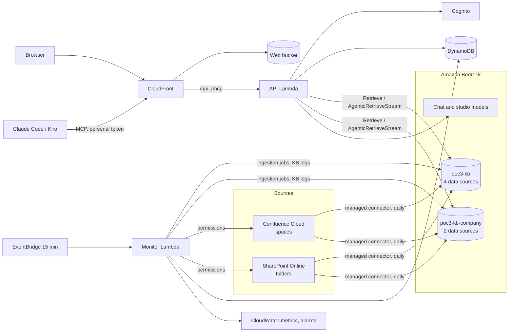

# Project Notebook (PoC 3)

A project knowledge assistant in the spirit of NotebookLM, for a project team (business analysts, bridge system engineers, solution architects) who must learn a project's business from a large set of documents. The documents stay in Confluence Cloud and SharePoint Online; Amazon Bedrock Managed Knowledge Bases index them. On top of the knowledge bases sit a web app, an MCP server for local agents (Claude Code, Kiro), a sync monitor, and per-user access by Confluence space and SharePoint folder.

The decision-maker view (what was proven, the cost, the comparison with Rovo) is [docs/poc/04-project-knowledge-notebook.md](../docs/poc/04-project-knowledge-notebook.md). This file is for engineers.

## Layout

| Path | What it is |
|---|---|
| `infra/sources.json` | The data sources: one per Confluence space and per SharePoint folder. A source is the unit a user is granted |
| `infra/kb.mjs` | Creates the knowledge bases, their managed connectors (daily sync), the service role, the bucket, the secrets and the log delivery |
| `infra/stack.yaml` | The app: DynamoDB table, Cognito user pool, API and monitor Lambda functions, CloudFront in front of the web bucket and the API, alarms, dashboard |
| `infra/deploy.mjs` | Builds, uploads and deploys the stack, publishes the web UI, creates the test accounts |
| `src/api/handler.mjs` | The API (`/api/*`) and the MCP endpoint (`/mcp`), one Lambda function behind a function URL with response streaming |
| `src/monitor/handler.mjs` | Every 15 minutes: sync jobs into DynamoDB, CloudWatch metrics per source, document lists; once a day the permission import |
| `src/lib/` | `kb` (search, agentic search, documents, syncs), `answer` (chat), `studio`, `mcp`, `auth`, `permissions`, `connectors`, `graph`, `store`, `usage`, `llm`, `config` |
| `web/` | The single-page web UI, no build step |
| `scripts/e2e.mjs` | End-to-end test of the deployed app as the five test accounts |
| `scripts/eval.mjs` | The AIPF knowledge-base benchmark's 48 questions through the chat API |

## How it fits together



- **Sources and grants.** A knowledge base holds at most five data sources (a fixed quota), so the sources are spread over `poc3-kb` and `poc3-kb-company`. A user's grants are a list of data source ids. A search runs on every knowledge base that holds a granted source, filtered on `x-amz-bedrock-kb-data-source-id`, and the passages are merged by score. Admins read every source.
- **Chat.** Fast mode: the question is made to stand alone from the history, one `Retrieve` call per knowledge base, then the chat model streams an answer with `[n]` citations and three follow-up questions. Deep mode: `AgenticRetrieveStream` plans sub-queries (shown as steps), then the studio model writes. Both stream as server-sent events (`sources`, `step`, `delta`, `done`).
- **Notebooks.** A notebook is a named set of sources with its chat history and notes. Studio outputs (briefing, FAQ, glossary, mind map in Mermaid, timeline, onboarding guide) and the per-document source guide are written from passages and saved as notes.
- **MCP.** Streamable HTTP without sessions at `/mcp`, with a personal access token created in the web app (only its hash is stored). Tools: `search`, `ask`, `list_sources`, `list_documents`, `get_document`, `list_notebooks`. Every tool sees only the caller's sources.
- **Sync monitor.** The monitor stores each source's latest jobs and their statistics, reads why a document failed from the knowledge base's application logs, and publishes `SyncAgeHours` and `DocumentsIndexed` per source and `SyncAgeHoursMax`, `JobFailedTotal`, `DocumentsFailedTotal` (namespace `Poc3Kb`). Each custom metric costs about 0.30 USD a month, so per-source failures stay on the app's sync page. Alarms: a source not synced for 30 hours, a failed job, a monitor error; they mail `POC3_ALERT_EMAIL` when it is set.
- **Registration and permissions.** People sign up with email in Cognito and wait for an admin, who sets their grants; a pending user can request sources. The permission import reads who may read each Confluence space (space permissions, groups expanded) and each SharePoint folder (folder permissions, SharePoint site groups and Microsoft 365 groups expanded) and turns them into grants by email. A person who has not signed up yet gets the grants when they do.
- **Usage and cost.** Each search, agentic call and model call is counted per day; the cost page shows the month at list prices (`src/lib/config.mjs`).

## Run it

Needs Node 22, the AWS CLI with a profile for the project's Region, `../infra/local.env` and `../.env` (Region, SharePoint tenant, client and site, Confluence site, account, token and space keys) and the SharePoint certificate in `../infra/kb-cert/`. None of these are in git.

```bash
npm install
node infra/kb.mjs up          # knowledge bases and data sources
node infra/kb.mjs sync        # first sync (later: daily, by the connector)
node infra/deploy.mjs up      # the app; the site address goes to infra/deploy.local.json
node infra/deploy.mjs users   # test accounts; passwords in infra/deploy.local.json
node scripts/e2e.mjs          # end-to-end test
node scripts/eval.mjs fast    # benchmark (deep for deep mode, score to summarise)
```

Settings passed at deploy time: `POC3_CHAT_MODEL`, `POC3_STUDIO_MODEL` (Bedrock model ids in the Region), `POC3_ADMIN_EMAILS` (comma-separated), `POC3_ALERT_EMAIL`. A person who signed up can be made admin with `node infra/deploy.mjs make-admin <email>`.

Remove everything with `node infra/deploy.mjs down` then `node infra/kb.mjs down`.

## Models

The default is GLM 5 for chat, deep mode and studio, served in the Region on demand. Claude models on Bedrock need the account's one-time Anthropic use case form (Bedrock console, model access); once it is submitted, set `POC3_CHAT_MODEL=au.anthropic.claude-haiku-4-5-20251001-v1:0` and `POC3_STUDIO_MODEL=au.anthropic.claude-sonnet-4-6` and run `node infra/deploy.mjs up`. Cross-Region (`global.`) inference profiles are not used.

## Things learned the hard way

- `AgenticRetrieveStream` is not authorized against a knowledge base ARN; its IAM statement needs `Resource: "*"`.
- `aws cloudformation deploy` keeps the previous value of a parameter that is not passed, so the deploy passes the models every time.
- A Lambda streamed response sends its status with the first write; a reply without a body (the MCP notification's 202) must still write once.
- `ListKnowledgeBaseDocuments` serves only S3 and custom data sources, so the document lists of connector sources come from Confluence and SharePoint directly, with each document's state from the monitor. `Retrieve` does not return a document's own id, which `GetDocumentContent` needs; one agentic call filtered to the document's link finds it, and the id is cached.
- The SharePoint app has only `Sites.Read.All`. Microsoft Graph's group endpoints need `GroupMember.Read.All`, so group members are read through SharePoint's own REST API (`SP.Directory.DirectorySession`), which lists direct members only. Confluence hides the email of people who chose to hide it; those people are counted and skipped.
- A PowerPoint file the managed parser cannot read fails with the reason in the knowledge base's application log, which the monitor shows on the sync page.
